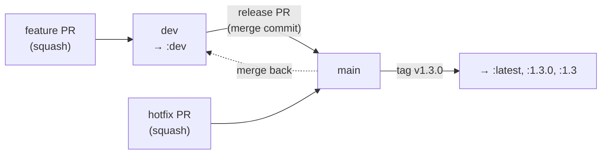

<div align="center">

<a href="README.md"></a>

# Kizuna · Contributing

**Bug reports, mapping fixes, code and docs are all welcome.**

[🐛 Issues](#-reporting-a-problem) &nbsp;·&nbsp; [🛠️ Setup](#%EF%B8%8F-development-setup) &nbsp;·&nbsp; [✅ Checks](#-checks) &nbsp;·&nbsp; [📐 Rules](#-ground-rules) &nbsp;·&nbsp; [🔀 Pull requests](#-pull-requests) &nbsp;·&nbsp; [🌿 Branches & releases](#-branches-and-releases) &nbsp;·&nbsp; [🗺️ Code map](#%EF%B8%8F-code-map)

</div>

---

## 🐛 Reporting a problem

Open an [issue](https://github.com/KurtzPT/kizuna/issues/new/choose) and pick the template that fits:

| Template | For |
|---|---|
| 📺 **Wrong match or metadata** | wrong show, no match, wrong titles, episodes, seasons, artwork |
| 🛠️ **Migration script** | `kizuna-migrate.sh` wrote wrong hints or failed |
| 🐳 **Running Kizuna** | Docker, Plex registration, access, health check, logs |
| 🐞 **Something else** | crashes, restarts, errors, memory or disk use, anything the others don't cover |
| ✨ **Feature request** | something Kizuna should do |

**Check the [troubleshooting table](SETUP.md#-troubleshooting) first**, and attach the log lines for the show
(see [Logs](SETUP.md#-logs)). Keys and Plex tokens are already `***` in the logs, but remove any paths you don't want
public.

> [!IMPORTANT]
> **Security problems never go in a public issue.** Follow [SECURITY.md](SECURITY.md).

> [!TIP]
> **A show maps to the wrong TVDB season or episode?** The mapping usually comes from
> [Anime-Lists](https://github.com/Anime-Lists/anime-lists). You can fix it for yourself right away with
> [`anime-list-custom.xml`](SETUP.md#-fixing-a-wrong-mapping), and fixing it upstream fixes it for everyone.

## 🛠️ Development setup

**You need:** Go (the version in [`go.mod`](go.mod) or newer). Docker and
[ShellCheck](https://www.shellcheck.net) are optional.

```bash
git clone -b dev https://github.com/KurtzPT/kizuna.git
cd kizuna
go test ./...
go build -o kizuna ./cmd/kizuna
```

Run it locally against a scratch data folder (all settings are environment variables, see
[Settings](SETUP.md#%EF%B8%8F-settings)):

```bash
DATA_DIR=./data ANIDB_CLIENT=<your client> TVDB_API_KEY=... TMDB_API_KEY=... ./kizuna
curl http://localhost:32600/health
```

Or build the image the way CI does (the build runs the tests first):

```bash
docker build -t kizuna .
```

> [!WARNING]
> **Mind AniDB while developing.** Use your own registered client name, and don't loop refreshes or bulk-scan a big
> library against AniDB: the [fair-use limits](README.md#-anidb-fair-use) are per IP, and a ban hits your Plex too.
> The tests never call a real service, so `go test` is always safe.

## ✅ Checks

CI ([`ci.yml`](.github/workflows/ci.yml)) runs these on every push and pull request. Run them before you push:

```bash
gofmt -l .                       # must print nothing (fix with gofmt -w .)
go vet ./...
go test -race -count=1 ./...
bash -n scripts/kizuna-migrate.sh
shellcheck --severity=warning scripts/*.sh
```

The [`docker`](.github/workflows/docker.yml) workflow also builds the `amd64` and `arm64` images for a pull request,
without publishing anything.

## 📐 Ground rules

| | Rule | Why |
|---|---|---|
| 🪶 | **Standard library only.** No new modules in `go.mod` | one static binary, a ~10 MB image, nothing to audit |
| 🤝 | **Don't touch the AniDB fair-use limits** in `internal/sources/anidb.go` | they're fixed on purpose: breaking them gets users' IPs banned |
| 🌐 | **Every outside request goes through `internal/fetch`** | one place for caching, throttling, redaction and disk cleanup |
| 🔒 | **Never log or return a secret.** New keys or tokens must be redacted by `fetch.Redact` | logs get pasted into public issues |
| 🛡️ | **Keep the access checks** (`ALLOW_FROM`, `ALLOWED_HOSTS`) on every route | Kizuna has no login, see [SECURITY.md](SECURITY.md) |
| 🧪 | **Tests stay offline**: fixtures and `httptest`, never a real API | CI and contributors have no keys |
| 📖 | **Docs and code change together.** A new setting goes in [SETUP.md → Settings](SETUP.md#%EF%B8%8F-settings) | the docs are the only manual |

The `anime-list-custom.xml` examples in [SETUP.md](SETUP.md#-fixing-a-wrong-mapping) are checked by
`internal/mapping/docs_examples_test.go`. If you change one, change the other.

**Upgrading Go** is automated: every Monday the [`go-update`](.github/workflows/go-update.yml) workflow checks go.dev and,
when there's a new minor release, opens a pull request against `dev` that bumps both the `go` line in [`go.mod`](go.mod) and
`ARG GO_VERSION` in the [`Dockerfile`](Dockerfile). To do it by hand, change both lines: CI reads the version from
`go.mod`, the image build is passed it, and the `go` job fails if the Dockerfile default doesn't match.

**Style:** `gofmt`, small packages under `internal/`, comments that say *why*. Docs follow the existing files: short
sentences, tables over long paragraphs, examples with real anime.

## 🔀 Pull requests

1. **Something big?** Open an issue first, so the idea can be agreed on before you write it.
2. Branch from **`dev`** and open the pull request **against `dev`**, not `main` (see
   [branches](#-branches-and-releases)). Keep it to **one change**, and add or update tests for it.
3. Run the [checks](#-checks).
4. Write the pull request **title as a short summary** and the **body as the why**. Pull requests are squash-merged,
   so the title and body become the commit on `dev`.
5. Link the issue it fixes (`Fixes #123`).

Release notes are generated from the labels on merged pull requests (`bug`, `enhancement`, `metadata`, `migration`,
`running`, `documentation`, `dependencies`); a maintainer sets them.

By contributing, you agree that your work is released under the [GPL-3.0](LICENSE), like the rest of Kizuna.

## 🌿 Branches and releases

| Branch | Holds | Image |
|---|---|---|
| **`main`** (default) | the latest **stable** release, and the docs that match it | `:latest`, `:1.2.3`, `:1.2` from release tags |
| **`dev`** | the next version: every merged pull request lands here first | `:dev` (beta), rebuilt on every push |



**Releasing a stable version** (maintainer):

1. Open a pull request from `dev` to `main`, titled `Release v1.3.0`, labelled `release`.
2. Merge it with **Create a merge commit**, never squash. A squash gives `main` a commit `dev` doesn't have, and every
   release after it conflicts.
3. Tag and publish the release on `main`; the tag builds the stable image:

   ```bash
   gh release create v1.3.0 --target main --generate-notes
   ```

**A beta testers can pin** (optional): tag `dev` with a pre-release version. It publishes `:1.3.0-beta.1`, never
`:latest`:

```bash
gh release create v1.3.0-beta.1 --target dev --prerelease --generate-notes
```

**A hotfix** for the stable version, when `dev` already holds unreleased work:

1. Branch from `main`, fix it, open a pull request against `main` (squash), then release `v1.3.1` as above.
2. Merge `main` back into `dev` (`git switch dev && git merge main`) so the fix isn't lost.

Dependabot **security** updates always open against `main` (GitHub doesn't let them target another branch), so they
follow the hotfix path. Version updates and Go upgrades open against `dev`.

The image workflow refuses to publish a stable tag (`v1.2.3` with no `-beta`) that isn't on `main`, so `:latest`
is always something that was released.

## 🗺️ Code map

```text
cmd/kizuna/main.go         start-up, list refresh, `kizuna health` (Docker healthcheck)
internal/config            environment variables
internal/fetch             HTTP + disk cache + throttling + free-space cleanup (every source uses it)
internal/logfile           daily log file, old days deleted
internal/anidb             offline AniDB title list: search and title-language picking
internal/mapping           AniDB ⇄ TVDB/TMDB/IMDb/MAL/AniList/Kitsu/ANN ids (Anime-Lists + Fribb)
internal/sources           AniDB HTTP API (fair-use rules), TheTVDB v4 (+ legacy v3), TheMovieDb, MyAnimeList, ANN
internal/provider          modes, matching, show model, Plex JSON, HTTP routes
scripts/kizuna-migrate.sh  .plexmatch hints for existing libraries (not part of the image)
```

| To add… | Start in |
|---|---|
| a setting | `internal/config`, then [SETUP.md](SETUP.md#%EF%B8%8F-settings) |
| a metadata source | `internal/sources`, then the per-field source order in `internal/provider/fields.go` |
| an id prefix like `[anidb-…]` | `internal/provider/match.go` |
| a migration rule | `scripts/kizuna-migrate.sh`, then [MIGRATION.md](MIGRATION.md) |
