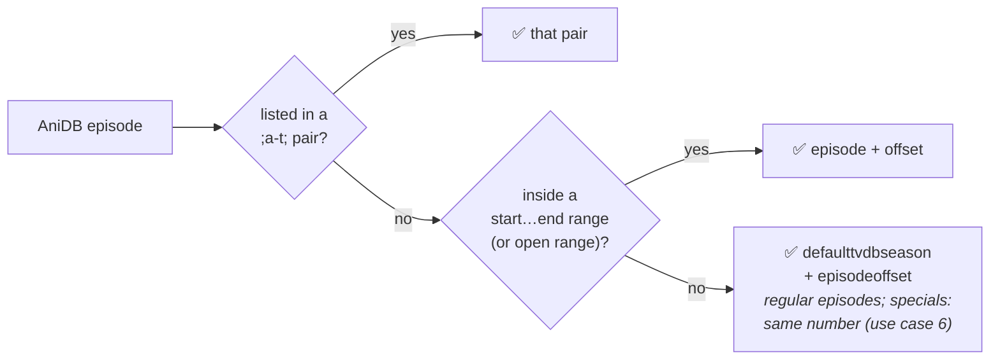
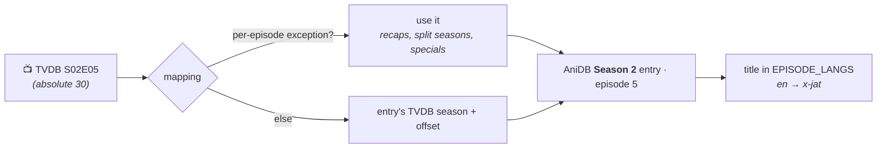

<div align="center">

<a href="README.md"></a>

# Kizuna · Fixing a wrong mapping

**Correct which AniDB entry is which TVDB series, season and episode, for your own library.**

[Home](README.md) &nbsp;·&nbsp; [Setup](SETUP.md) &nbsp;·&nbsp; [Guide](GUIDE.md) &nbsp;·&nbsp; [Settings](SETTINGS.md) &nbsp;·&nbsp; **Mapping** &nbsp;·&nbsp; [Migration](MIGRATION.md)

<sub>On this page: [The file](#-the-file) · [Exceptions](#-reading-mapping-list) · [Pairing](#-how-episodes-are-paired) · [Use cases](#-use-cases) · [Checking it](#-checking-a-correction)</sub>

</div>

---

Kizuna learns which AniDB entry is which TVDB series, season and episode from the
[Anime-Lists](https://github.com/Anime-Lists/anime-lists) and [Fribb](https://github.com/Fribb/anime-lists) lists
([id mapping](README.md#-id-mapping)). When they're wrong or incomplete, write your own correction in
**`anime-list-custom.xml`** in the data folder (next to `cache/` and `logs/`). Your entries win over both lists, and
are used even while neither list could be downloaded.

| A correction changes | How |
|---|---|
| 🎯 Matching | which AniDB entry a `[tvdb-…]`, `[tmdb-…]` or `[imdb-…]` tag points to |
| 📺 `/tvdb` shows | which AniDB entries make up a TVDB series, and which one supplies the show details |
| 🖼️ `/anidb` episodes | which TVDB episode gives each AniDB episode its thumbnail, summary and date |
| 🏷️ Episode titles | which episodes are [paired](#-how-episodes-are-paired) across AniDB, TheTVDB and TheMovieDb, in both modes |

## 📄 The file

```xml
<anime-list>
  <anime anidbid="1234" tvdbid="56789" defaulttvdbseason="2" episodeoffset="0">
    <name>My Show Season 2</name>   <!-- optional, just a note for you -->
    <mapping-list>                  <!-- optional: per-episode exceptions -->
      <mapping anidbseason="1" tvdbseason="0">;9-1;</mapping>
    </mapping-list>
  </anime>
</anime-list>
```

| Attribute | Meaning |
|---|---|
| `anidbid` | the AniDB entry, from its page: `anidb.net/anime/1234` |
| `tvdbid` | the TVDB series id (on its page at thetvdb.com). Anything else (`movie`, `OVA`, `unknown`…) or left out = no TVDB series |
| `defaulttvdbseason` | the TVDB season the entry's episodes are in; `a` = TheTVDB's absolute order; `0` = TheTVDB's specials. **Always set it when `tvdbid` is a number**: left out, it counts as `0` |
| `episodeoffset` | AniDB episode 1 is TVDB episode `1 + offset` in that season (default `0`) |
| `tmdbtv` · `tmdbid` · `imdbid` | TheMovieDb TV show · TheMovieDb movie · IMDb id (`tt…`) |
| `tmdbseason` · `tmdboffset` | the same as `defaulttvdbseason` · `episodeoffset`, for the `tmdbtv` show, whose seasons often differ from TheTVDB's. Used for TheMovieDb's episode titles, directors and writers, in both modes. Left out, TheMovieDb is paired at the TVDB season and number in `/anidb`, and by absolute episode number in `/tvdb` |

> [!WARNING]
> An entry **replaces** that AniDB id's whole entry from both lists, including the MyAnimeList, AniList, Kitsu and
> ANN ids that only the Fribb list has. Those can't be written in this format, so for a corrected show a
> `[mal-…]`-style folder tag no longer matches. Use an `[anidb-…]` or `[tvdb-…]` tag for it.

## 📖 Reading `<mapping-list>`

Without exceptions, AniDB episode *N* is TVDB episode *N + `episodeoffset`* in `defaulttvdbseason`. A `<mapping>`
says otherwise for specific episodes:

```xml
<mapping anidbseason="1" tvdbseason="0">;9-1;18-2;</mapping>
<!--     AniDB side      TVDB side      pairs: "AniDB episode - TVDB episode" -->
```

| Attribute | Values |
|---|---|
| `anidbseason` | `1` = regular episodes (1, 2, 3…) · `0` = specials (`S1` is 1, `S2` is 2…; credits `C1` is 101, `C2` 102…, trailers `T1` 201…, other `O1` 401…, as Anime-Lists numbers them. Plex shows endings from 151, but here they keep their C number) |
| `tvdbseason` | the TVDB season the episodes land in · `0` = TheTVDB's specials · `a` = absolute order |
| `tmdbseason` | the same for TheMovieDb (`tmdbtv`). A `<mapping>` has `tvdbseason`, `tmdbseason` or both, and only moves the episodes of the site(s) it names; the pairs, `start`, `end` and `offset` work the same for both |

| Written | Means |
|---|---|
| `;9-1;` | AniDB episode **9** is TVDB episode **1** |
| `;9-1;18-2;` | AniDB 9 → TVDB 1, and AniDB 18 → TVDB 2 |
| `;5-5+6;` | AniDB 5 is TVDB 5 *and* 6 (a double episode). Kizuna uses the first, TVDB 5 |
| `;2-0;` | AniDB 2 has **no** TVDB episode: nothing is paired with it |
| `start="10" end="17" offset="-1"` | AniDB 10 … 17 are TVDB 9 … 16: every episode in the range, shifted by `offset` |
| `start="1156" offset="-1155"` | no `end`: AniDB 1156 and every later episode are TVDB 1, 2, 3… |
| `offset="7"` (no `start`, `end`) | every episode of the `anidbseason` is shifted (for specials: `S1`…`S99` only, not credits or trailers). Pairs in the same mapping still win |

When several rules cover the same episode, the most specific one wins:



**The same AniDB episode in two `<mapping>` lines of one entry.** A real episode beats "none", in either order:
`;1-0;` under `tvdbseason="0"` plus `;1-26;` under `tvdbseason="1"` says "special 1 isn't a TVDB special, it is
S01E26". Two *different* episodes for one AniDB episode is a mistake in the entry: Kizuna uses the first and logs
a warning (`an AniDB episode is paired with two different episodes`) that names the file and the entry. Fix your
own entry, or correct the list's entry in your `anime-list-custom.xml`.

## 🔗 How episodes are paired

To give an episode a title, thumbnail or crew from another source, Kizuna first finds that episode on the other
source: it **pairs** them through the mapping.



**AniDB and TheTVDB**, first rule that applies:

1. The per-episode exceptions ([above](#-reading-mapping-list)).
2. The AniDB entry's TVDB season and episode offset.
3. For an AniDB special the mapping doesn't list: TheTVDB's special with the same number (`S1` = `S00E01`), but
   only on the entry that starts the series and isn't in TVDB season 0. Openings, endings and trailers only pair
   through an exception.

**The other sites** are paired per mode:

- **`/anidb`**: TheMovieDb the same way, by its own season, offset and exceptions (`tmdbseason`…), else at TheTVDB's
  season and number.
- **`/tvdb`**: through AniDB. An episode's place on the list gives its AniDB episode, and the mapping gives that
  episode's place on the other site. An episode without an AniDB counterpart (or whose AniDB entry isn't cached yet)
  is paired by absolute number, a special by its number in season 0. An episode whose AniDB entry the mapping puts on
  another TheMovieDb show gets no TheMovieDb title or crew.

**Picking the title:** [`EPISODE_TITLES`](SETTINGS.md#-sources-per-field) sets the source order (default AniDB → TheTVDB → TheMovieDb), in both modes.
The first **real** title wins: *Episode 12* or *TBA* don't count. AniDB titles follow [`EPISODE_LANGS`](SETTINGS.md#-matching--titles) (default
English, then romaji); with none of those, the other sources' real titles come first, then AniDB's title in any
language.

In `/tvdb` a show spans several AniDB entries. Uncached ones are fetched in the background
([within AniDB's limits](GUIDE.md#-anidb-fair-use)), so their titles appear on a later refresh.

## 🧩 Use cases

| # | Problem | Fix |
|---|---|---|
| [1](#uc1) | no TVDB series, or the wrong one | `tvdbid` + `defaulttvdbseason` |
| [2](#uc2) | a sequel is a later TVDB season | `defaulttvdbseason="3"` |
| [3](#uc3) | a second cour continues the same TVDB season | `episodeoffset="12"` |
| [4](#uc4) | a long series in TheTVDB's absolute order | `defaulttvdbseason="a"` |
| [5](#uc5) | recaps that TheTVDB files as specials | pairs + ranges |
| [6](#uc6) | AniDB specials that are TVDB specials | `anidbseason="0"` pairs |
| [7](#uc7) | an OVA among TheTVDB's specials | `defaulttvdbseason="0"` |
| [8](#uc8) | a season TheTVDB splits in two | a range into season 2 |
| [9](#uc9) | a movie, kept out of the TV series | `tvdbid="movie"` |

<details open>
<summary><b><a id="uc1"></a>1 · The show has no TVDB series, or the wrong one</b></summary>

AniDB 1234 should be TVDB series 56789, starting at season 1:

```xml
<anime anidbid="1234" tvdbid="56789" defaulttvdbseason="1" episodeoffset="0" />
```

</details>

<details>
<summary><b><a id="uc2"></a>2 · A sequel is a later TVDB season</b></summary>

AniDB has one entry per season; TheTVDB has one series. The AniDB entry for season 3 is TVDB season 3, from its
episode 1:

```xml
<anime anidbid="1236" tvdbid="56789" defaulttvdbseason="3" episodeoffset="0" />
```

| AniDB 1236 | TheTVDB |
|---|---|
| episode 1 | S03E01 |
| episode 12 | S03E12 |

</details>

<details>
<summary><b><a id="uc3"></a>3 · A second cour continues the same TVDB season</b></summary>

AniDB gives episodes 13–24 their own entry, but TheTVDB keeps them in season 1. With `episodeoffset="12"`, episode 1
of the second cour is TVDB S01E13:

```xml
<anime anidbid="1235" tvdbid="56789" defaulttvdbseason="1" episodeoffset="12" />
```

| AniDB 1235 | TheTVDB |
|---|---|
| episode 1 | S01E13 |
| episode 12 | S01E24 |

</details>

<details>
<summary><b><a id="uc4"></a>4 · A long series in TheTVDB's absolute order</b></summary>

For series that TheTVDB numbers 1…n across seasons, use `a` and the number of episodes before this entry. This entry
starts after the first 61 episodes:

```xml
<anime anidbid="1240" tvdbid="56789" defaulttvdbseason="a" episodeoffset="61" />
```

| AniDB 1240 | TheTVDB |
|---|---|
| episode 1 | absolute 62, in whichever season TheTVDB has it |

</details>

<details>
<summary><b><a id="uc5"></a>5 · Recaps that TheTVDB files as specials</b></summary>

AniDB counts recap episodes 9 and 18 as regular episodes; TheTVDB moved them to specials S00E01 and S00E02. So every
episode after a recap is one (then two) behind on TheTVDB:

```xml
<anime anidbid="1234" tvdbid="56789" defaulttvdbseason="1" episodeoffset="0">
  <mapping-list>
    <mapping anidbseason="1" tvdbseason="0">;9-1;18-2;</mapping>
    <mapping anidbseason="1" tvdbseason="1" start="10" end="17" offset="-1"/>
    <mapping anidbseason="1" tvdbseason="1" start="19" end="26" offset="-2"/>
  </mapping-list>
</anime>
```

| AniDB | TheTVDB | Rule |
|---|---|---|
| 1 … 8 | S01E01 … S01E08 | default |
| **9** | **S00E01** | `;9-1;` |
| 10 … 17 | S01E09 … S01E16 | range, `offset="-1"` |
| **18** | **S00E02** | `;18-2;` |
| 19 … 26 | S01E17 … S01E24 | range, `offset="-2"` |

</details>

<details>
<summary><b><a id="uc6"></a>6 · AniDB specials that are TVDB specials</b></summary>

Without a mapping, the series' first entry pairs AniDB special `S1` with TheTVDB's S00E01, `S2` with S00E02 and so
on. Later entries, and entries in `defaulttvdbseason="0"`, pair their specials only through a mapping. Here AniDB's
specials `S1` and `S3` are TheTVDB's S00E04 and S00E05, and `S2` has no TVDB counterpart:

```xml
<anime anidbid="1234" tvdbid="56789" defaulttvdbseason="1" episodeoffset="0">
  <mapping-list>
    <mapping anidbseason="0" tvdbseason="0">;1-4;2-0;3-5;</mapping>
  </mapping-list>
</anime>
```

</details>

<details>
<summary><b><a id="uc7"></a>7 · An OVA that TheTVDB lists among the specials</b></summary>

The AniDB entry is a two-episode OVA that TheTVDB has as S00E07 and S00E08. Put the whole entry in season `0`:

```xml
<anime anidbid="1250" tvdbid="56789" defaulttvdbseason="0" episodeoffset="6" />
```

In `/tvdb` the OVA's titles then land on those two specials, and the OVA's own folder is its own show in every mode
([movies and specials](GUIDE.md#-movies-and-specials)).

</details>

<details>
<summary><b><a id="uc8"></a>8 · A season that TheTVDB splits in two</b></summary>

AniDB has 24 episodes in one entry; TheTVDB splits them into S01 (1–12) and S02 (1–12):

```xml
<anime anidbid="1234" tvdbid="56789" defaulttvdbseason="1" episodeoffset="0">
  <mapping-list>
    <mapping anidbseason="1" tvdbseason="2" start="13" end="24" offset="-12"/>
  </mapping-list>
</anime>
```

| AniDB | TheTVDB |
|---|---|
| 1 … 12 | S01E01 … S01E12 (default) |
| 13 … 24 | S02E01 … S02E12 (range) |

</details>

<details>
<summary><b><a id="uc9"></a>9 · A movie, kept out of the TV series</b></summary>

`tvdbid="movie"` says there's no TVDB series on purpose, so no list can add one. `tmdbid` is the TheMovieDb movie,
used for artwork and details:

```xml
<anime anidbid="1260" tvdbid="movie" tmdbid="98765" imdbid="tt1234567" />
```

</details>

## ✅ Checking a correction

1. **Restart Kizuna** (`docker restart kizuna`), or wait for the daily mapping refresh. A file that doesn't parse
   (an XML error) is logged as `anime-list-custom.xml ignored`; the daily refresh then keeps the entries of the
   file's last good version, a restart starts without them.
2. In Plex, run **Refresh Metadata** on the show.
3. With [`LOG_LEVEL=debug`](SETTINGS.md#-logging), find the show's lines:

| Log line | Tells you |
|---|---|
| `episode pairing … exceptions=18 … paired_tvdb=26` | `/anidb` only: how many AniDB episodes your pairs and `start…end` ranges cover (use case 5 covers 18; open ranges aren't counted) and how many were paired with TheTVDB |
| `episode titles: source used … anidb=24 tvdb=0` | both modes: where each episode title came from |

> [!TIP]
> If your fix would help everyone, send it upstream to [Anime-Lists](https://github.com/Anime-Lists/anime-lists).
> Once it's in their list, delete it from yours.
