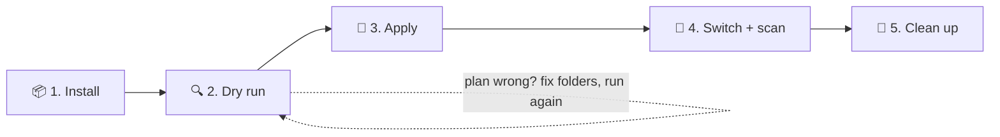
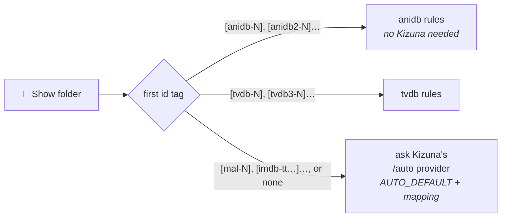

<div align="center">

<a href="README.md"></a>

# Kizuna · Migrating from HAMA

**Move a HAMA + Absolute Series Scanner library to Kizuna without renaming a single file.**

[Home](README.md) &nbsp;·&nbsp; [Setup](SETUP.md) &nbsp;·&nbsp; [Guide](GUIDE.md) &nbsp;·&nbsp; [Settings](SETTINGS.md) &nbsp;·&nbsp; [Mapping](MAPPING.md) &nbsp;·&nbsp; **Migration**

<sub>On this page: [How it works](#-how-it-works) · [What migrates](#-what-can-be-migrated) · [Before you start](#-before-you-start) · [1. Install](#-1-install-the-script) · [2. Dry run](#-2-dry-run) · [3. Apply](#-3-apply-the-hints) · [4. Switch](#-4-switch-the-library) · [5. Clean up](#-5-clean-up) · [Reference](#-what-the-script-writes)</sub>

</div>

---

## 🧭 How it works

Plex can't run a legacy scanner such as the **Absolute Series Scanner (ASS)** with a new-style provider. A Kizuna
library uses Plex's own **Plex TV Series** scanner, and that scanner sets each file's season and episode **before**
Kizuna is asked anything. Kizuna adds titles, summaries and artwork; it can't move an episode.

The scanner also reads a [`.plexmatch`](https://support.plex.tv/articles/plexmatch/) file in the show folder. An `ep:`
line in it overrides what the file name says:


`scripts/kizuna-migrate.sh` writes one `.plexmatch` per show, with an `ep:` line for every file the scanner would
number differently from Kizuna. Your files, subtitles and torrents stay untouched, and Plex sees the same paths.

## ✅ What can be migrated

| HAMA mode | Folder tag | Episode numbers | Script mode | Kizuna provider | Hints written for |
|---|---|---|---|---|---|
| **`anidb`** | `[anidb-23]` or none | absolute (`- 033`) | `-m anidb` | `/anidb` | specials (`SP3`, `PV`…), a lone unnumbered movie |
| **`tvdb3`** | `[tvdb3-81797]` | absolute (`S02E26`) | `-m tvdb` | `/tvdb` | every episode outside season 1 |
| **`tvdb`** | `[tvdb-81797]` | per season (`S02E01`) | `-m tvdb` | `/tvdb` | every episode outside season 1, [renumbered](#plain-tvdb-folders-per-season-numbers) to absolute |
| a mix of the above | any | any | `-m auto` | `/auto` | per folder, by its tag ([rules](#auto-rules)) |
| `tvdb2`, `tvdb4`–`tvdb6`, `anidb2`–`anidb4`, `tmdb`, `imdb` | – | – | ❌ | – | not supported |

For the ❌ modes the folder tag still finds the right show, but Kizuna numbers episodes its own way, so files numbered
for those orders won't line up. The script warns about each such folder, and plans `[anidb2-…]` like `[anidb-…]`
and `[tvdb2-…]`, `[tvdb4-…]`… like `[tvdb3-…]`.

In every mode, openings and endings named `NCOP1`, `ED2`… stay [extras](#openings-and-endings-plex-makes-them-extras):
the script plans nothing for them. Kizuna can give those extras [readable titles](GUIDE.md#readable-titles)
(`Opening 1`).

HAMA features Kizuna leaves out on purpose, to stay small: collections, online theme songs and rating badges.
Local `theme.mp3` files still work through *Plex Local Media*, when the agent has it
([step 3 of the setup](SETUP.md#-3-register-kizuna-in-plex)).

> [!IMPORTANT]
> **Plain HAMA `tvdb` shows need the `[tvdb-…]` tag** (no digit after `tvdb`). That tag is the only way the script
> knows a folder counts episodes per season. Without it the folder looks already converted, gets no hints, and its
> episodes land on the wrong numbers. Add the tag to the folder name before the dry run.

## 🧪 Before you start

> [!CAUTION]
> The script handles the common anime library layouts, **not every library**. It can misread a file name, and a wrong
> hint puts the wrong title on an episode. Read the whole dry run before applying anything.

| | Do this | Why |
|---|---|---|
| ☐ | **Set up Kizuna** and add it to Plex ([SETUP.md](SETUP.md)). Don't switch any library yet | the script asks Kizuna for seasons and openings |
| ☐ | **Back up the Plex database**: stop Plex, copy its `Plug-in Support/Databases` folder | the only way back if the switch goes wrong |
| ☐ | **Make a test library**: two or three show folders copied into their own Plex library, taken through step 4 | shows what happens to *your* episode numbers and watched states |
| ☐ | **Save watched states elsewhere** if you depend on them, e.g. sync to Trakt | see below |

> [!WARNING]
> **Watched states may not survive.** File paths stay the same, but every item's ID changes, e.g.
> `com.plexapp.agents.hama://anidb-23` → `tv.plex.agents.custom.kizuna.anidb://show/anidb-23`. Kizuna recognises the
> old HAMA IDs when matching, but whether Plex carries watched states across has not been verified. Check the test
> library first.

---



## 📦 1. Install the script

Run it on any machine that **sees the library folder with write access** and, for `tvdb` and `auto` modes, **can
reach Kizuna**. That doesn't have to be the Plex server: a desktop with the NAS share mounted works.

| | Linux | macOS | Windows |
|---|---|---|---|
| **bash 4.4+** | already there | `brew install bash` (macOS ships 3.2) | WSL (recommended) or Git Bash |
| **curl** | `apt` / `dnf` / `pacman install curl` | already there | included in WSL / Git Bash |
| **jq** | `apt` / `dnf` / `pacman install jq` | already there on macOS 15+, else `brew install jq` | WSL: `sudo apt install jq` · Git Bash: `winget install jqlang.jq` |
| **library path** | `/mnt/media/Anime` | `/Volumes/Anime` | WSL: `/mnt/d/Anime` · Git Bash: `/d/Anime` |

`curl` and `jq` are only used to ask Kizuna. Plain `anidb` mode runs without them, except for
[opening and ending variants](#openings-and-endings-with-variants).

```bash
curl -fsSLO https://raw.githubusercontent.com/KurtzPT/kizuna/main/scripts/kizuna-migrate.sh
chmod +x kizuna-migrate.sh
```

<details>
<summary><b>🐧 Linux, NAS and Docker hosts</b></summary>

```bash
sudo apt install curl jq                     # Fedora: sudo dnf install curl jq
./kizuna-migrate.sh -m auto -u http://192.168.1.10:32600 /mnt/media/Anime
```

- On Unraid, Synology, TrueNAS…, run it on the host against the **host's path** (`/mnt/user/Anime`,
  `/volume1/Anime`), not the path inside the Plex container. Hints are relative to the show folder, so Plex doesn't
  care which path you used.
- Run it as the owner of the library files if you can. Files written as root work too: Plex only reads them.

</details>

<details>
<summary><b>🍎 macOS</b></summary>

Start the script with Homebrew's bash, not the system one:

```bash
brew install bash jq
"$(brew --prefix)/bin/bash" kizuna-migrate.sh -m auto -u http://192.168.1.10:32600 /Volumes/Anime
```

A NAS share is under `/Volumes/<share>` once mounted in Finder (*Go → Connect to Server*).

</details>

<details>
<summary><b>🪟 Windows</b></summary>

**WSL** (recommended): run `wsl --install` once in an administrator PowerShell, restart, open *Ubuntu* from the Start
menu:

```bash
sudo apt install curl jq
./kizuna-migrate.sh -m auto -u http://192.168.1.10:32600 /mnt/d/Anime     # D:\Anime
```

| Library on | Path in WSL |
|---|---|
| a local drive, `D:\Anime` | `/mnt/d/Anime` |
| a share, `\\nas\Anime` | `sudo mkdir -p /mnt/anime && sudo mount -t drvfs '\\nas\Anime' /mnt/anime` |
| a mapped drive, `Z:` | `sudo mkdir -p /mnt/z && sudo mount -t drvfs Z: /mnt/z` |

Use Kizuna's **LAN address** with `-u` (`http://192.168.1.10:32600`), not `localhost`: inside WSL, `localhost` isn't
always the Windows machine.

**Git Bash** ([Git for Windows](https://git-scm.com/download/win)): `winget install jqlang.jq`, open a new Git Bash
window, and use `/d/Anime` for `D:\Anime` or `//nas/Anime` for a share:

```bash
./kizuna-migrate.sh -m auto -u http://192.168.1.10:32600 /d/Anime
```

</details>

> [!NOTE]
> **"Kizuna not reachable"?** Kizuna's `ALLOW_FROM` lets in private network addresses by default. If you narrowed it
> to the Plex server, add the machine running the script ([access settings](SETTINGS.md#%EF%B8%8F-access)).

## 🔍 2. Dry run

Without `-a` the script only prints the plan and touches nothing. Save it to a file and read all of it. Pick the line
for your library:

```bash
./kizuna-migrate.sh -m anidb /mnt/media/Anime                                 > plan.txt 2>&1
./kizuna-migrate.sh -m tvdb -u http://192.168.1.10:32600 /mnt/media/AnimeTVDB  > plan.txt 2>&1
./kizuna-migrate.sh -m auto -u http://192.168.1.10:32600 /mnt/media/Anime      > plan.txt 2>&1

grep -c '^  + ' plan.txt    # hints to add
grep '^WARNING' plan.txt    # everything the script left alone
grep 'files to write' plan.txt   # summary: files to write, hints, warnings
```

In `tvdb` mode the script stops right away if Kizuna isn't reachable or `curl`/`jq` are missing. In `anidb` and `auto`
mode it carries on and prints a `note:` at the top saying what it can't plan without Kizuna.

| Look for | Means | Fix |
|---|---|---|
| an episode number that doesn't match the file | the script read the name differently | write that hint [by hand](#-your-own-plexmatch-files) |
| a special, or the number reported for an opening or ending, on an unexpected `S00E` number | AniDB numbers them its own way | check against [variants](#openings-and-endings-with-variants) |
| a `tvdb` season that's off (`S03` where you expect `S02`) | TheTVDB's seasons differ from the release, or the mapping is wrong | [fix the mapping](MAPPING.md) |
| renumbered `[tvdb-…]` files off by one | TheTVDB lists one episode more or less than your files | compare with TheTVDB before applying |
| a `[tvdb-…]` file with no hint that should have one | its per-season number is also one of the season's absolute numbers | [rename it or hint it by hand](#plain-tvdb-folders-per-season-numbers) |
| a plain-`tvdb` show with no hints | the folder lacks its `[tvdb-…]` tag | [tag it](#-what-can-be-migrated) |
| a show with no hints at all | already fine, or not matched | read its `WARNING` lines |
| any `WARNING` | a file or show the script left alone | fix it by hand, or accept it |

Fix folders and file names, then **run the dry run again** until the plan is right. If it can't get your layout
right, [open an issue](https://github.com/KurtzPT/kizuna/issues/new?template=2-migration-script.yml) with a few file
names and their dry-run lines.

## 📝 3. Apply the hints

Run **exactly the same command** as the dry run, plus `-a`:

```bash
./kizuna-migrate.sh -m auto -u http://192.168.1.10:32600 -a /mnt/media/Anime
```

> [!WARNING]
> **There's no undo.** The hints are added as plain `ep:` lines, with no marker around them, so the script can't
> tell them from your own lines afterwards: a later run keeps them, and changing or removing one is done by hand.
> Apply only a plan you've checked, and back up your `.plexmatch` files first if you already have some.

The Absolute Series Scanner ignores `.plexmatch` files, so the library keeps working as before until step 4.

## 🔁 4. Switch the library

Do [SETUP.md step 4](SETUP.md#-4-point-a-library-at-it): scanner *Plex TV Series*, your Kizuna agent, then *Scan
Library Files* and *Refresh All Metadata*.

## 🧹 5. Clean up

Once no library uses them, delete `Plug-ins/Hama.bundle` and `Scanners/Series/Absolute Series Scanner.py`.

**Keep the `.plexmatch` files.** Plex reads them on every scan.

### ➕ Adding episodes later

A hint names one file. A new `Show - 038.mkv` in a `tvdb` show has no hint and lands in season 1. You can handle
new files in either of two ways:

| Option | How | Example for episode 38, season 2 |
|---|---|---|
| **Re-run the script** | dry run, then `-a`, then *Scan Library Files* | `ep: S02E38: Show - 038.mkv` is added to the `.plexmatch` |
| **Name the file the way Kizuna numbers it** | the scanner reads the name directly, no hint needed. Then *Scan Library Files* | `Show - S02E38.mkv` (absolute number, Kizuna's season) |

| Show uses | New files that need a hint or a proper name |
|---|---|
| `tvdb` rules | any episode outside season 1. Name it `SxxEyy` with the **absolute** episode number, not the per-season one |
| `anidb` rules | specials, openings, endings, trailers: name them `S00Eyy` with [Kizuna's number](#openings-and-endings-with-variants), e.g. `Show - S00E101.mkv`. A lone movie: `S01E01` |

---

## 📘 What the script writes

### `anidb` rules

| Your ASS layout | The scanner reads | Action |
|---|---|---|
| `Show [anidb-23]/Show - 01.mkv` … `- 148.mkv` | `S01E01` … `S01E148` | none |
| `Show - S01E05.mkv` | `S01E05` | none |
| `Specials/Show - 01.mkv` | `S00E01` | none |
| openings and endings: `NCOP1` `OP1b` `NCED2` `OP` `ED` | made extras, hints ignored | none: they stay extras ([titles](GUIDE.md#readable-titles)). The script reports each one and writes no hint ([why, and what you can do by hand](#openings-and-endings-plex-makes-them-extras)) |
| specials: `SP3` `Special 3` `OVA2` `OAD` | skipped | 🔧 `ep: S00E03: … SP3.mkv` (a bare `OVA` / `OAD` / `Special` is `S00E01`) |
| trailers: `PV` `PV2` `CM` `Trailer` `Teaser` `Promo` `Preview` | skipped | 🔧 `ep: S00E201: … PV.mkv`, `PV2` → `S00E202` (AniDB's trailer numbers) |
| a folder's **only** video, without a number: `Movie (2016).mkv` | skipped | 🔧 `ep: S01E01: Movie (2016).mkv` |
| HAMA `anidb.id`, `tvdb.id`, `tvdb3.id`… | ignored by Plex | ✋ rename the folder ([`.id` files](#hama-id-files)) |
| `tvshow.nfo` | ignored by Plex | ✋ put the id in the folder name: `Show [anidb-23]` |
| grouping folders, `Show/[2] Sequel/` | merged into one show | ✋ move each to the library root (the script warns) |
| folder offsets, `-s2e12` | not supported | ✋ write `ep:` hints by hand |
| `extras/` and hidden folders | ignored by the script | none |

<sub>🔧 the script does it &nbsp;·&nbsp; ✋ you do it</sub>

```text
📁 Hunter x Hunter (2011) [anidb-8550]
   Hunter x Hunter - 001.mkv … - 148.mkv     ← no hints needed
   Hunter x Hunter - SP1.mkv
   NCOP1.mkv                                 ← stays an extra: reported, no hint
   .plexmatch                                ← new:
     ep: S00E01: Hunter x Hunter - SP1.mkv
```

> [!NOTE]
> Hints are written as `S00Exx`. Plex's `.plexmatch` documentation also allows `SPxx`, but Plex Media Server 1.43
> reads that without a season and leaves the file out. The script warns about an `SPxx` line for a file it would
> hint.

### Openings and endings: Plex makes them extras

Before it reads any `.plexmatch` hint, Plex's scanner checks each file name for an opening or ending, and makes
every file that has one an **extra**. An extra still plays from the show page, but it isn't a special: it gets no
Kizuna number or metadata, and an `ep:` hint can't change that. Which names Plex takes, what it does with the others
and when the extras appear: [the guide, "Openings and endings"](GUIDE.md#-openings-and-endings).

**The script writes no hint for any opening or ending file**, however it is spelled. It never renames a file, so it
only reports each one, with [Kizuna's number](#openings-and-endings-with-variants) for it when it knows it:

| Your file | After the switch | The script | To do |
|---|---|---|---|
| `NCOP1` `OP1b` `ED 2` `NCED` `Creditless Opening` | an extra titled `NCOP1`, `OP1b`… | reports it, no hint | nothing, or let Kizuna give it a [readable title](GUIDE.md#readable-titles) (`Opening 1`, `Opening 1b`…) |
| `Opening 1` `Ending` `NCOpening 1` (the whole word, without `Creditless` or `Clean`) | **left out of the library**, as neither an extra nor an episode | reports it, no hint | ✋ rename it with `OP1` / `ED1` in place of the word, to have it as an extra |
| `Show - 05 [ED fix].mkv` (an episode with such a word) | an extra, or left out (`[Ending fix]`): missing from the episodes | warns | ✋ rename it without the word |
| `Show - S01E05 [ED fix].mkv` (a season and episode in the name) | an ordinary episode | no warning | nothing |
| `op1` `ncop2` (small letters) | no extra: Plex only takes the words in capitals | reports it, no hint | ✋ rename it with `OP1` / `NCOP2`, to have it as an extra |

**To have an opening or ending as Kizuna's special**, that is yours to do by hand, in two steps:

1. Rename the file so that its name has none of the words Plex looks for, e.g. `Show - NCOP1.mkv` to
   `Show - Theme 1.mkv`.
2. Add its hint to the show's `.plexmatch`: `ep: S00E101: Show - Theme 1.mkv`, with the number the script reported.

The extras appear when Plex refreshes the show's metadata, which [step 4](#-4-switch-the-library) does.

### Openings and endings with variants

Kizuna numbers AniDB's opening credits from `S00E101` and endings from `S00E151`, one number per version. A variant
shifts every number after it, so `OP2` isn't always `S00E102`:

| AniDB credit | Title on AniDB | Kizuna's number | Your file |
|---|---|---|---|
| C1 | Opening 1a | `S00E101` | `NCOP1a.mkv` |
| C2 | Opening 1b | `S00E102` | `NCOP1b.mkv` |
| C3 | Opening 2 | **`S00E103`** | `NCOP2.mkv` |
| C4 | Ending 1 | `S00E151` | `NCED1.mkv` |

So the script asks Kizuna for the show's credit list and matches each file to a title, to report the right number:

| Your file | Matched to |
|---|---|
| `NCOP1a`, `OP1a`, `Opening 1a` | *Opening 1a* |
| `NCOP2` | *Opening 2*, whatever its number |
| `NCOP1` when AniDB has 1a and 1b | *Opening 1a*, with a warning |
| `NCOP1b` when AniDB has only *Opening 1* | *Opening 1* |
| `NCOP3` that AniDB doesn't list | reported without a number |

> [!IMPORTANT]
> This needs **Kizuna running with AniDB details** for the show (an AniDB client, not banned). In `anidb` mode the
> script uses Kizuna at [`-u`](#-command-line-reference) and says at the start when it can't reach it. Without
> Kizuna, plain `OP1`, `ED2`… are numbered from the file name (`S00E101`, `S00E152`). Variant files get no number,
> and neither does any opening in a folder with opening variants (endings likewise), because a variant shifts the
> numbers.

### HAMA `.id` files

HAMA could read a show's id from `anidb.id`, `tvdb.id`, `tvdb3.id`, `tmdb.id` or `imdb.id` in its folder. **Plex
never reads these files.** For a folder without an id tag, the script plans the hints as if the tag were there and
tells you the name to give the folder:

```text
WARNING: …/Cowboy Bebop: anidb.id says [anidb-23], but Plex never reads .id files. Rename the folder to
"Cowboy Bebop [anidb-23]" before switching the library (the hints above assume that tag)
```

- **Rename those folders before step 4**, or Kizuna matches them by title. The hints stay valid after the rename.
- `tvdb.id` becomes a plain `[tvdb-…]` tag ([renumbered](#plain-tvdb-folders-per-season-numbers)), `tvdb3.id` becomes
  `[tvdb3-…]`.
- A folder that already has a tag ignores its `.id` file, as HAMA did. With several `.id` files, the first of `anidb`,
  `tvdb`, `tmdb`, `imdb` wins, and a warning names the other kinds.

### `tvdb` rules

ASS put `Show [tvdb3-12345]/Show - 033.mkv` into the right TVDB season by itself. Plex's scanner reads it as
**`S01E33`**, so every episode outside season 1 gets a hint with its season:

```text
📁 Attack on Titan [tvdb3-267440]
   Attack on Titan - 01.mkv … - 25.mkv       ← season 1: no hints needed
   Attack on Titan - 26.mkv
   .plexmatch                                ← new:
     ep: S02E26: Attack on Titan - 26.mkv
     …
```

| Topic | Rule |
|---|---|
| **Episode numbers** | stay absolute: `S02E26`, not `S02E01`. That's what Kizuna's `/tvdb` expects |
| **Seasons** | come from Kizuna, through the same calls Plex makes. Kizuna needs a TheTVDB key (`TVDB_API_KEY` or `TVDB_LEGACY_API_KEY`) |
| **Left alone** | files with `SxxEyy` in the name or in a `Season NN` folder (in `[tvdb3-…]` folders these are already absolute) |
| **Episode numbers read from** | ` - 033`, `E33` / `Ep 33` / `Episode 33`, or a number ending the name; `[…]`, `(…)`, `{…}` groups don't count. A file with none is reported |
| **A lone unnumbered movie** | `ep: S01E01`, as in `anidb` rules. A movie's folder with the series' `[tvdb3-…]` tag is the whole series in Kizuna unless its name clearly names the movie: tag it `[anidb-…]` instead ([movies and specials](GUIDE.md#-movies-and-specials)) |
| **Specials** (`SP3`, `PV`…) | only reported, because TheTVDB numbers its own. Add `ep: S00Exx: <file>` lines with TheTVDB's numbers [yourself](#-your-own-plexmatch-files) |

### Plain `tvdb` folders: per-season numbers

HAMA's plain `tvdb` mode starts every season at 1. In folders tagged **`[tvdb-…]`**, the script converts each
season-relative file to its absolute number, counted from the show's TVDB episode list:

```text
📁 Attack on Titan [tvdb-267440]
   Attack on Titan - S01E05.mkv              ← season 1: same either way
   Attack on Titan - S02E01.mkv              → ep: S02E26: Attack on Titan - S02E01.mkv
   Season 03/Attack on Titan - 02.mkv        → ep: S03E39: Season 03/Attack on Titan - 02.mkv
   Attack on Titan - S00E01.mkv              ← specials keep TheTVDB's numbers
```

- **Already absolute files get no hint**, so a half-converted show is fine.
- **A number the season doesn't have** (`S02E20` in a 12-episode season) is reported, not guessed.
- **A missing episode on TheTVDB shifts every later number** in that season. Compare a few files with TheTVDB in the
  dry run.
- **A per-season number that's also an absolute number of the same season counts as absolute.** Season 1 has 12
  episodes and season 2 has 24 (absolute 13–36): a per-season `S02E13` is read as absolute 13 and gets no hint, though
  it's really episode 25. This only happens when a season is longer than all earlier seasons together. Check such
  seasons in the dry run, then rename those files to their absolute number (`S02E25`) or add your own `ep:` lines.

### `auto` rules

With the `/auto` provider ([README](README.md#auto-both-in-one-library)), one library holds both kinds of shows.
`-m auto` picks each folder's rules the way Kizuna will in Plex:



The tag can also be in a file name, as Kizuna reads it. Keep one id tag per show: the script follows the first one,
but Kizuna in Plex gives a show with two different tags no match ([README](README.md#-how-a-show-is-found)).
`tvdb`-rule folders need Kizuna with a TheTVDB key (`TVDB_API_KEY` or `TVDB_LEGACY_API_KEY`); without it, Kizuna in
Plex gives a `[tvdb-…]` folder no match. Without Kizuna, only `[anidb-N]` folders are planned; every other folder is
reported as skipped.

> [!WARNING]
> **Tag your untagged folders.** In Plex, `/auto` also follows the GUID a show already has: a HAMA
> `com.plexapp.agents.hama://tvdb3-81797` or a `com.plexapp.agents.thetvdb://…` GUID gives `tvdb` rules. The script
> can't see those GUIDs, so for an untagged folder it plans with `AUTO_DEFAULT`, and the two can disagree. A tag in
> the folder name decides for both.

## 📄 Your own `.plexmatch` files

The script only **adds `ep:` lines** at the end of the file, without any marker. Everything else stays as it is, and
the script reads it the way Plex does:

| You already have | The script |
|---|---|
| no `.plexmatch` | creates one with just its hints |
| `title:` / `show:`, `year:` | sends them to Kizuna as the show's title and year, like Plex |
| `ep:` lines, yours or from an earlier run | **keeps them**, and writes no hint for that file. Warns if Kizuna numbers it differently, or if the line is `ep: SPxx:` ([Plex 1.43 leaves those files out](#anidb-rules)): change those to `ep: S00Exx:` |
| `season:` in a season folder | treats that folder as that season |
| `season:` in the show folder | warns: every file without its own hint is read as that season |
| `tvdbid:`, `tmdbid:`, `imdbid:`, `guid:` | ⚠️ warns and ignores them. Put the id in the folder name: `Show [tvdb-267440]` |
| `pattern:` / `pt:` | ⚠️ **skips the show**: it can't tell which files a pattern numbers. Write `ep:` lines by hand |

## 💻 Command-line reference

```text
kizuna-migrate.sh [-m anidb|tvdb|auto] [-u URL] LIBRARY      dry run: print the plan
kizuna-migrate.sh [-m anidb|tvdb|auto] [-u URL] -a LIBRARY   write it
```

| Option | Meaning | Default |
|---|---|---|
| `-m` | mode: `anidb`, `tvdb` or `auto` | `anidb` |
| `-u` | Kizuna's address. Required for `tvdb`, and for `auto` beyond `[anidb-N]` folders; used by `anidb` for opening and ending numbers. A full domain name must be in [`ALLOWED_HOSTS`](SETTINGS.md#%EF%B8%8F-access); an IP or local name works as is | `$KIZUNA_URL`, else `http://localhost:32600` |
| `-a` | write the plan | off (dry run) |

What the script guarantees:

- It only writes files named `.plexmatch` in show folders, and keeps your lines, line endings and permissions. Each one
  is written next to the old one (`.plexmatch.kizuna-tmp`) and then moved over it, so an interrupted run leaves the old
  file whole. The new file belongs to the user running the script: run it as the files' owner (or as root) to keep it.
  A `.plexmatch` that is a symlink is never written (moving a file over it would replace the link): the script warns
  and lists its hints, for you to add by hand.
- It looks at every folder in `LIBRARY` as a show, skipping hidden ones, and every video below it except in `extras/`
  and hidden subfolders, at most 6 levels below the show folder (`Season 01/Show - 01.mkv` is 2). It follows symlinked
  folders and files, as Plex does. A symlink loop is skipped where `find` sees it, and that depth limit ends one it
  doesn't (busybox).
- Running it twice changes nothing. Running it after adding episodes only adds their hints.
- It never changes or removes an `ep:` line, its own included: that's done by hand.

None of that fixes a misread file name. That's what the [dry run](#-2-dry-run) is for.
