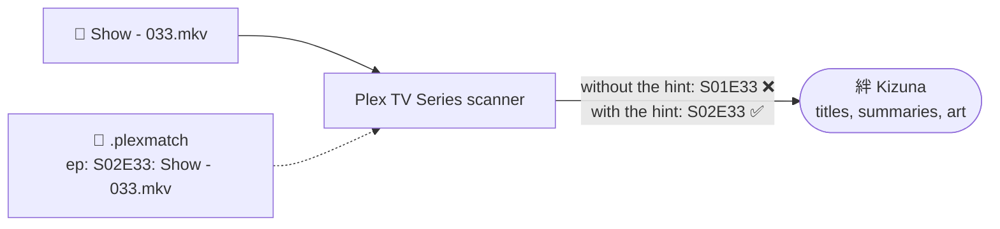
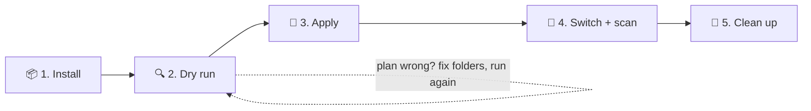
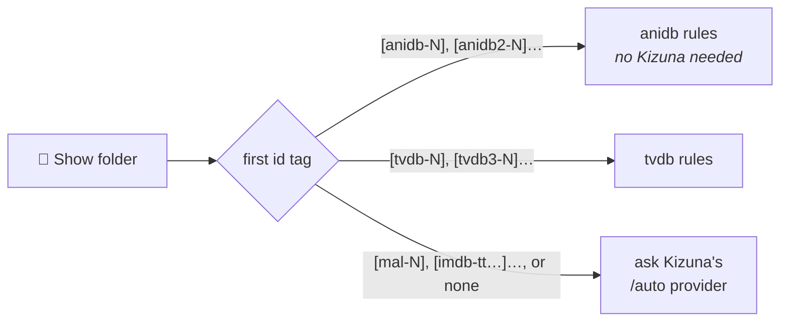

<div align="center">

<a href="README.md"></a>

# Kizuna · Migrating from HAMA

**Move a HAMA + Absolute Series Scanner library to Kizuna without renaming a single file.**

[Home](README.md) &nbsp;·&nbsp; [Setup](SETUP.md) &nbsp;·&nbsp; [Guide](GUIDE.md) &nbsp;·&nbsp; [Settings](SETTINGS.md) &nbsp;·&nbsp; [Mapping](MAPPING.md) &nbsp;·&nbsp; **Migration**

<sub>On this page: [How it works](#-how-it-works) · [What migrates](#-what-can-be-migrated) · [Before you start](#-before-you-start) · [Steps](#-1-install-the-script) · [Adding episodes later](#-adding-episodes-later) · [Reference](#-what-the-script-writes)</sub>

</div>

---

## 🧭 How it works

A Kizuna library uses Plex's own **Plex TV Series** scanner, which sets each file's season and episode before Kizuna
is asked anything ([how it works](README.md#-how-it-works)). Where your Absolute Series Scanner names would land on
the wrong number, a [`.plexmatch`](https://support.plex.tv/articles/plexmatch/) `ep:` line in the show folder tells
the scanner the right one:



`scripts/kizuna-migrate.sh` writes those lines, one `.plexmatch` per show. Your files, subtitles and torrents stay
untouched, and Plex sees the same paths.

## ✅ What can be migrated

| HAMA mode | Folder tag | Episode numbers | Script mode | Kizuna provider | Hints for |
|---|---|---|---|---|---|
| **`anidb`** | `[anidb-23]` or none | absolute, `- 033` | `-m anidb` | `/anidb` | specials, trailers, a lone unnumbered movie |
| **`tvdb3`** | `[tvdb3-81797]` | absolute, `S02E26` | `-m tvdb` | `/tvdb` | every episode outside season 1 |
| **`tvdb`** | `[tvdb-81797]` | per season, `S02E01` | `-m tvdb` | `/tvdb` | every episode outside season 1, [renumbered](#plain-tvdb-folders-per-season-numbers) to absolute |
| a mix | any | any | `-m auto` | `/auto` | per folder, by its tag ([rules](#auto-rules)) |
| `tvdb2`, `tvdb4`–`tvdb6`, `anidb2`–`anidb4`, `tmdb`, `imdb` | | | ❌ | | not supported |

- **Unsupported numbering:** an `[anidb2-…]`, `[tvdb2-…]`, `[tvdb4-…]`… tag still finds the right show, but Kizuna
  numbers episodes its own way. The script warns about each such folder, and plans it like `[anidb-…]` or
  `[tvdb3-…]`. `[tmdb-…]` and `[imdb-…]` folders are planned only in `-m auto`, through Kizuna.
- **Openings and endings** named `NCOP1`, `ED2`… stay [extras](#openings-and-endings): no hints.
- **Left out on purpose:** HAMA's collections, online theme songs and rating badges. Local `theme.mp3` files still
  work through *Plex Local Media* ([setup step 3](SETUP.md#-3-register-kizuna-in-plex)).

> [!IMPORTANT]
> **Plain HAMA `tvdb` shows need the `[tvdb-…]` tag**, with no digit after `tvdb`. It's the only way the script knows a
> folder counts episodes per season. Without it the folder looks converted already, gets no hints, and its episodes
> land on the wrong numbers. Add the tag before the dry run.

## 🧪 Before you start

> [!CAUTION]
> The script handles the common anime library layouts, **not every library**. A misread file name gives a wrong hint,
> and a wrong hint puts the wrong title on an episode. Read the whole dry run before applying anything.

- [ ] **Set up Kizuna** and add it to Plex ([SETUP.md](SETUP.md)), but don't switch a library yet: the script asks
  Kizuna for seasons and openings.
- [ ] **Back up the Plex database**: stop Plex and copy its `Plug-in Support/Databases` folder.
- [ ] **Try a test library** first: two or three show folders copied into their own Plex library, through step 4.
- [ ] **Save watched states elsewhere** if you depend on them, e.g. sync to Trakt.

> [!WARNING]
> **Watched states may not survive.** File paths stay the same, but every item's ID changes, e.g.
> `com.plexapp.agents.hama://anidb-23` → `tv.plex.agents.custom.kizuna.anidb://show/anidb-23`. Kizuna recognises
> HAMA's `anidb` and `tvdb` IDs when matching, but whether Plex carries watched states across hasn't been verified. Check the test
> library.

---



## 📦 1. Install the script

Run it on any machine that **sees the library folder with write access** and, for `tvdb` and `auto`, **can reach
Kizuna**. A desktop with the NAS share mounted works.

```bash
curl -fsSLO https://raw.githubusercontent.com/KurtzPT/kizuna/main/scripts/kizuna-migrate.sh
chmod +x kizuna-migrate.sh
```

| | Needs | Library path |
|---|---|---|
| **Linux, NAS** | `bash` 4.4+, `curl`, `jq` from your package manager. On Unraid, Synology, TrueNAS…, run it on the host, with the host's path | `/mnt/user/Anime` |
| **macOS** | `brew install bash jq`, then start it as `"$(brew --prefix)/bin/bash" kizuna-migrate.sh …`: macOS ships bash 3.2 | `/Volumes/Anime` |
| **Windows, WSL** (recommended) | `wsl --install`, then `sudo apt install curl jq` in Ubuntu. A share: `sudo mount -t drvfs '\\nas\Anime' /mnt/anime` | `/mnt/d/Anime` |
| **Windows, Git Bash** | [Git for Windows](https://git-scm.com/download/win) and `winget install jqlang.jq` | `/d/Anime`, `//nas/Anime` |

- `curl` and `jq` only talk to Kizuna: plain `anidb` mode runs without them, except for
  [opening and ending variants](#openings-and-endings-with-variants).
- Use Kizuna's **LAN address** with `-u`, such as `http://192.168.1.10:32600`. Inside WSL, `localhost` isn't always
  the Windows machine.
- Run it as the owner of the library files if you can; files written as root work too.

> [!NOTE]
> **"Kizuna not reachable"?** The script needs `/health` to answer `ok`: right after Kizuna starts, wait until it
> does. If you narrowed [`ALLOW_FROM`](SETTINGS.md#%EF%B8%8F-access) to the Plex server, add the machine running the
> script. With a domain name in `-u`, it must be in `ALLOWED_HOSTS`.

## 🔍 2. Dry run

Without `-a` the script only prints the plan. Save it and read all of it:

```bash
./kizuna-migrate.sh -m auto -u http://192.168.1.10:32600 /mnt/media/Anime > plan.txt 2>&1

grep -c '^  + ' plan.txt         # hints planned
grep '^WARNING' plan.txt         # everything the script left alone
grep 'files to write' plan.txt   # summary
```

In `tvdb` mode it stops right away when Kizuna's `/health` doesn't answer `ok`, or `curl` or `jq` is missing. In `anidb` and `auto`
it carries on, with a `note:` at the top saying what it can't plan.

| Look for | Means | Fix |
|---|---|---|
| an episode number that doesn't match the file | the script read the name differently | write that hint [by hand](#-your-own-plexmatch-files) |
| a special, opening or ending on an unexpected `S00E` number | AniDB numbers them its own way | check the [variants](#openings-and-endings-with-variants) |
| a `tvdb` season that's off, `S03` where you expect `S02` | TheTVDB's seasons differ, or the mapping is wrong | [fix the mapping](MAPPING.md) |
| renumbered `[tvdb-…]` files off by one, or one with no hint | see [plain `tvdb` folders](#plain-tvdb-folders-per-season-numbers) | compare with TheTVDB |
| a show with no hints at all | already fine, a plain `tvdb` folder without its tag, or not matched | read its `WARNING` lines |
| any `WARNING` | a file or show the script left alone | fix it by hand, or accept it |

Fix folders and file names, then **run the dry run again** until the plan is right. Can't get your layout right?
[Open an issue](https://github.com/KurtzPT/kizuna/issues/new?template=2-migration-script.yml) with a few file names
and their dry-run lines.

## 📝 3. Apply the hints

Run **exactly the same command**, plus `-a`:

```bash
./kizuna-migrate.sh -m auto -u http://192.168.1.10:32600 -a /mnt/media/Anime
```

> [!WARNING]
> **There's no undo.** Hints are plain `ep:` lines with no marker, so the script can't tell them from yours later:
> changing or removing one is done by hand. Back up existing `.plexmatch` files first.

The Absolute Series Scanner ignores `.plexmatch` files, so the library works as before until step 4.

## 🔁 4. Switch the library

Do [SETUP step 4](SETUP.md#-4-point-a-library-at-it): scanner *Plex TV Series*, your Kizuna agent, then *Scan
Library Files* and *Refresh All Metadata*.

## 🧹 5. Clean up

Once no library uses them, delete `Plug-ins/Hama.bundle` and `Scanners/Series/Absolute Series Scanner.py`.

> [!IMPORTANT]
> **Keep the `.plexmatch` files.** Plex reads them on every scan.

## ➕ Adding episodes later

A hint names one file, so a new `Show - 038.mkv` in a `tvdb` show has no hint and lands in season 1. Either:

- **re-run the script**, dry run then `-a`, which adds `ep: S02E38: Show - 038.mkv`; or
- **name the file the way Kizuna numbers it**, so no hint is needed: `Show - S02E38.mkv`, with the absolute number.

Then *Scan Library Files*. Files that need this: in `tvdb` shows any episode outside season 1; in `anidb` shows
specials and trailers as `S00Exx` with [Kizuna's number](#openings-and-endings-with-variants), and a lone movie as
`S01E01`.

---

## 📘 What the script writes

### `anidb` rules

| Your ASS layout | The scanner reads | Action |
|---|---|---|
| `Show [anidb-23]/Show - 01.mkv` … `- 148.mkv`, `S01E05`, `Specials/Show - 01.mkv` | the right number | none |
| specials: `SP3` `Special 3` `OVA2` `OAD` | skipped | 🔧 `ep: S00E03: … SP3.mkv`; a bare `OVA`, `OAD` or `Special` is `S00E01` |
| trailers: `PV` `PV2` `CM` `Trailer` `Teaser` `Promo` `Preview` | skipped | 🔧 `ep: S00E201: … PV.mkv`, `PV2` is `S00E202` |
| a folder's **only** video, without a number: `Movie (2016).mkv` | skipped | 🔧 `ep: S01E01: Movie (2016).mkv` |
| openings and endings | made extras | none ([below](#openings-and-endings)) |
| HAMA `anidb.id`, `tvdb.id`… | ignored by Plex | ✋ rename the folder ([`.id` files](#hama-id-files)) |
| `tvshow.nfo` | ignored by Plex | ✋ put the id in the folder name: `Show [anidb-23]` |
| grouping folders, `Show/[2] Sequel/` | merged into one show | ✋ move each to the library root; the script warns |
| folder offsets, `-s2e12` | not supported | ✋ write `ep:` hints by hand |
| `extras/` and hidden folders | ignored by the script | none. Other folders, such as `Trailers/`, are planned like the rest |

<sub>🔧 the script does it &nbsp;·&nbsp; ✋ you do it</sub>

> [!NOTE]
> Hints are written as `S00Exx`. Plex's `.plexmatch` documentation also allows `SPxx`, but Plex Media Server 1.43
> reads that without a season and leaves the file out. The script warns about an `SPxx` line for a file it would hint.

### Openings and endings

Plex makes openings and endings **extras** before it reads any hint, so the script writes **no hint for them**. It
only reports each one, with [Kizuna's number](#openings-and-endings-with-variants) when it knows it. Check
[which names Plex keeps](GUIDE.md#-openings-and-endings), then by hand:

- ✋ **`Opening 1`, `Ending`** (left out of the library): rename with `OP1` / `ED1` in place of the word.
- ✋ **`op1`, `ncop2`** (small letters, no extra): rename with `OP1` / `NCOP2`.
- ✋ **An episode with such a word**, `Show - 05 [ED fix].mkv`: rename it without the word; the script warns about
  it. With `S01E05` in the name it stays an episode.
- Extras such as `NCOP1` can get a [readable title](GUIDE.md#readable-titles).

> [!TIP]
> **Want an opening as Kizuna's special instead?** Rename the file so it has none of those words, e.g.
> `Show - Theme 1.mkv`, and add `ep: S00E101: Show - Theme 1.mkv` with the number the script reported.

### Openings and endings with variants

Kizuna numbers AniDB's openings from `S00E101` and endings from `S00E151`, one number per version, so a variant
shifts every number after it:

| AniDB | Kizuna | Your file |
|---|---|---|
| Opening 1a | `S00E101` | `NCOP1a.mkv` |
| Opening 1b | `S00E102` | `NCOP1b.mkv` |
| Opening 2 | **`S00E103`** | `NCOP2.mkv` |
| Ending 1 | `S00E151` | `NCED1.mkv` |

The script asks Kizuna for the show's openings and endings and matches each file by title: `NCOP1a`, `OP1a` and
`Opening 1a` are *Opening 1a*. `NCOP1` when AniDB has 1a and 1b is *Opening 1a*, with a warning; `NCOP1b` when AniDB
has only *Opening 1* is *Opening 1*; one AniDB doesn't list is reported without a number.

> [!IMPORTANT]
> This needs **Kizuna running with AniDB details** for the show, at [`-u`](#-command-line-reference). Without it,
> plain `OP1`, `ED2`… are numbered from the name, as `S00E101` and `S00E152`, and a folder with opening (or ending)
> variants gets no numbers for them. The script reads Kizuna's English or Japanese titles for them, such as
> *Opening 1a* or *オープニング 1a*. With titles in another language it gives no numbers and says so: for the run, put
> `en` first in Kizuna's [`EPISODE_LANGS`](SETTINGS.md#-matching--titles) and restart Kizuna, then set it back.

### HAMA `.id` files

HAMA could read a show's id from `anidb.id`, `tvdb.id`, `tvdb3.id`, `tmdb.id` or `imdb.id`. **Plex never reads them.**
For a folder without an id tag, the script plans as if the tag were there and warns with the folder name to use:

```text
WARNING: …/Cowboy Bebop: anidb.id says [anidb-23], but Plex never reads .id files. Rename the folder to
"Cowboy Bebop [anidb-23]" before switching the library (the hints above assume that tag)
```

> [!IMPORTANT]
> **Rename those folders before step 4**, or Kizuna matches them by title. The hints stay valid after the rename.

`tvdb.id` becomes a plain [`[tvdb-…]`](#plain-tvdb-folders-per-season-numbers) tag, `tvdb3.id` a `[tvdb3-…]` one. A
folder that already has a tag ignores its `.id` file, as HAMA did. With several `.id` files, the first of `anidb`,
`tvdb`, `tmdb`, `imdb` wins, with a warning.

### `tvdb` rules

ASS put `Show [tvdb3-12345]/Show - 033.mkv` into the right TVDB season by itself; Plex's scanner reads it as
**`S01E33`**. So every episode outside season 1 gets a hint with its season, and keeps its absolute number:
`S02E26`, not `S02E01`, as Kizuna's `/tvdb` expects.

```text
📁 Attack on Titan [tvdb3-267440]
   Attack on Titan - 01.mkv … - 25.mkv       ← season 1: no hints needed
   Attack on Titan - 26.mkv
   .plexmatch                                ← new:
     ep: S02E26: Attack on Titan - 26.mkv
```

- **Seasons** come from Kizuna, through the same calls Plex makes, so Kizuna needs a
  [TheTVDB key](SETTINGS.md#-accounts--keys).
- **Left alone:** files with `SxxEyy` in the name or in a `Season NN` folder.
- **Episode numbers** are read from ` - 033`, `E33`, `Ep 33`, `Episode 33`, or a number ending the name; `[…]`,
  `(…)` and `{…}` groups don't count. A file with none is reported.
- **A lone unnumbered movie** gets `ep: S01E01`. Tag its folder `[anidb-…]`, not with the series' tag
  ([why](GUIDE.md#-movies-and-specials)).
- **Specials** are only reported: TheTVDB numbers its own. Add their `ep: S00Exx:` lines
  [yourself](#-your-own-plexmatch-files).

### Plain `tvdb` folders: per-season numbers

HAMA's plain `tvdb` mode starts every season at 1. In `[tvdb-…]` folders the script turns each per-season number into
the absolute one, counted from the show's TVDB episode list:

```text
📁 Attack on Titan [tvdb-267440]
   Attack on Titan - S02E01.mkv              → ep: S02E26: Attack on Titan - S02E01.mkv
   Season 03/Attack on Titan - 02.mkv        → ep: S03E39: Season 03/Attack on Titan - 02.mkv
   Attack on Titan - S00E01.mkv              ← specials keep TheTVDB's numbers
```

Only `SxxEyy` names and files in season folders are renumbered: a bare `Show - 05.mkv` counts as absolute already,
so a half-converted show is fine. A number the season doesn't have is reported, not guessed.

> [!WARNING]
> - **An episode missing on TheTVDB shifts every later number** in its season. Compare a few files with TheTVDB.
> - **A per-season number that is also an absolute number of the same season counts as absolute.** With 12 episodes
>   in season 1 and 24 in season 2, `S02E13` is read as absolute 13 and gets no hint, though it's episode 25. Rename
>   such files to the absolute number, or add your own `ep:` lines.

### `auto` rules

With the [`/auto` provider](README.md#auto-both-in-one-library), `-m auto` picks each folder's rules the way Kizuna
will in Plex, by its first id tag, in the folder or a file name:



Without Kizuna, only `[anidb-N]` folders are planned. A tag still has to work in Plex: one per show, for a mode
that is set up ([`/auto`](README.md#auto-both-in-one-library)).

> [!WARNING]
> **Tag your untagged folders.** In Plex, `/auto` also follows the GUID a show already has, such as HAMA's
> `com.plexapp.agents.hama://tvdb3-81797`. The script can't see GUIDs, so it plans an untagged folder with
> [`AUTO_DEFAULT`](SETTINGS.md#-matching--titles), and the two can disagree. A tag decides for both.

## 📄 Your own `.plexmatch` files

The script only **adds `ep:` lines** at the end, and reads the rest the way Plex does:

| You already have | The script |
|---|---|
| no `.plexmatch` | creates one with just its hints |
| `title:` / `show:`, `year:` in the show folder | sends them to Kizuna as the show's title and year, like Plex |
| `ep:` lines, yours or from an earlier run | **keeps them** and writes no hint for that file. Warns if Kizuna numbers it differently, or about `ep: SPxx:`: change those to `ep: S00Exx:` |
| `season:` in a subfolder | treats that folder as that season |
| `season:` in the show folder | warns: every file without its own hint is read as that season |
| `tvdbid:`, `tmdbid:`, `imdbid:`, `guid:` in the show folder | ⚠️ warns and ignores them: put the id in the folder name |
| `pattern:` / `pt:`, in any folder of the show | ⚠️ **skips the show**: it can't tell which files a pattern numbers |

## 💻 Command-line reference

```text
kizuna-migrate.sh [-m anidb|tvdb|auto] [-u URL] [-a] LIBRARY      options before LIBRARY; -h prints this
```

| Option | Meaning | Default |
|---|---|---|
| `-m` | mode: `anidb`, `tvdb` or `auto` | `anidb` |
| `-u` | Kizuna's address. `tvdb` needs Kizuna there, `auto` for every folder but `[anidb-N]` ones, `anidb` for opening and ending numbers | `$KIZUNA_URL`, else `http://localhost:32600` |
| `-a` | write the plan | off: dry run |

- **It only writes `.plexmatch` files** in show folders, keeping your lines, line endings and permissions. Each is
  written as `.plexmatch.kizuna-tmp` and moved over the old one, so an interrupted run leaves the old file whole. A
  `.plexmatch` that is a symlink is never written: the script lists its hints for you to add.
- **Every folder in `LIBRARY` is a show**, hidden ones skipped; videos loose in `LIBRARY` itself are ignored. It
  reads every video up to 6 levels below, except in `extras/` and hidden subfolders, and follows symlinks as Plex
  does. Videos are `mkv`, `mp4`, `avi`, `m4v`, `ts`, `m2ts`, `wmv`, `mov`, `webm`, `ogm`, `flv` and `mpg` files.
- **Running it twice changes nothing**; after adding episodes it only adds their hints. It never changes or removes an
  `ep:` line.
