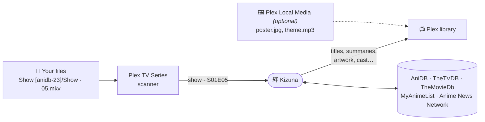
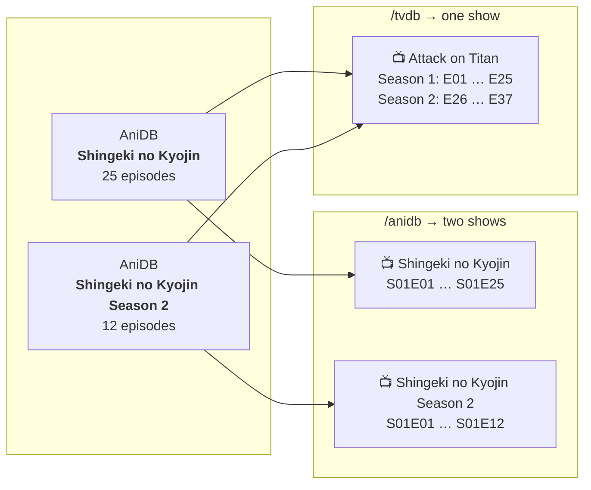
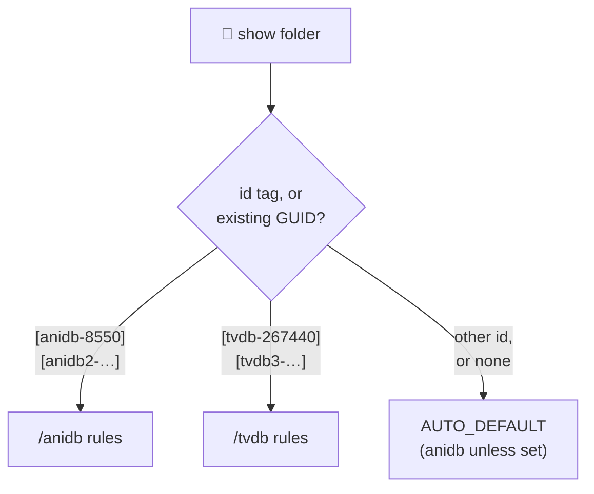

<div align="center">


# Kizuna

**An anime metadata provider for Plex that keeps your absolute episode numbers.**

*Kizuna* means "bond". It ties AniDB, TheTVDB, TheMovieDb, MyAnimeList and Anime News Network together
into one Plex provider.


[](LICENSE)
<br>
[](https://github.com/KurtzPT/kizuna/actions/workflows/ci.yml)
[](https://github.com/KurtzPT/kizuna/actions/workflows/docker.yml)
[](https://github.com/KurtzPT/kizuna/releases/latest)

**Home** &nbsp;·&nbsp; [Setup](SETUP.md) &nbsp;·&nbsp; [Guide](GUIDE.md) &nbsp;·&nbsp; [Settings](SETTINGS.md) &nbsp;·&nbsp; [Mapping](MAPPING.md) &nbsp;·&nbsp; [Migration](MIGRATION.md)

<sub>On this page: [Quick start](#-quick-start) · [How it works](#-how-it-works) · [Modes](#%EF%B8%8F-modes) · [Matching](#-how-a-show-is-found) · [Sources](#-sources) · [Reports](#-match-reports)</sub>

</div>

---

## ✨ What it is

Kizuna is a **custom metadata provider**: the new kind of Plex agent, running as a small web service next to Plex.

| Feature | What you get |
|---|---|
| 🔢 **Absolute numbering** | Episode 148 stays episode 148, in every mode |
| 🗂️ **Three modes** | One AniDB entry per show, one TVDB series per show (its movies and OVAs apart), or [both in one library](#auto-both-in-one-library) |
| 🏷️ **Matches by id** | `[anidb-8550]`, `[tvdb-81797]`, `[mal-21]`… in the folder name. No guessing |
| 🔀 **Per-field sources** | Pick the source order for titles, summaries, posters, cast… separately |
| 🖼️ **Your files win**\* | `poster.jpg`, `fanart.jpg`, `theme.mp3` next to your files override every online source |
| 📊 **Match reports** | An optional [page per show](#-match-reports) that says how it was matched and where each value came from |
| 🤝 **Plays fair** | Every source is [rate-limited and cached](#-fair-use), so your IP stays welcome |
| 🪶 **Tiny** | One static Go binary, standard library only, a ~10 MB image |

<sub>\* Done by *Plex Local Media*, Plex's own provider, when you add it to the agent next to Kizuna (optional,
[setup](SETUP.md#-3-register-kizuna-in-plex)).</sub>

## 🚀 Quick start

1. [Get an AniDB client name and the API keys](SETUP.md#-1-get-your-keys) for the sources you want.
2. [Run Kizuna](SETUP.md#-2-run-kizuna) with Docker Compose, plain Docker or Unraid.
3. [Add it to Plex](SETUP.md#-3-register-kizuna-in-plex) as a metadata provider, with the URL of your [mode](#%EF%B8%8F-modes).
4. [Point a library at it](SETUP.md#-4-point-a-library-at-it), then scan and refresh.

> [!TIP]
> **Coming from HAMA + Absolute Series Scanner?** [MIGRATION.md](MIGRATION.md) moves a library over without renaming
> files.

## 🧭 How it works



| Step | Who | Does |
|---|---|---|
| 1 | Plex's **Plex TV Series** scanner | reads your file names and `.plexmatch` hints, and sets each file's season and episode |
| 2 | **Kizuna** | gets the show name and file path from Plex, [finds the show](#-how-a-show-is-found), and describes it |
| 3 | **Plex Local Media** *(optional)* | Plex's own provider: adds your own artwork and theme songs on top, when the agent has it |

> [!IMPORTANT]
> Kizuna never reads your media folders and can't move an episode to another number. **The folder layout of your
> [mode](#%EF%B8%8F-modes) is what puts each file in the right place.**

---

## 🗂️ Modes

Each mode is its own provider URL; a library's agent uses one of them.

| Mode | A show in Plex is… | Files look like | Pick it when |
|---|---|---|---|
| **`/anidb`** | one **AniDB entry** | `Show - 01.mkv` … `Show - 148.mkv` | every season or sequel is its own folder |
| **`/tvdb`** | one **TVDB series** | `Show - S02E26.mkv` | one folder per series, with seasons |
| **`/auto`** | either, **per folder** | both, side by side | your library mixes the two |

The same anime in both models, *Attack on Titan* (25 + 12 episodes):



### `/anidb`: one AniDB entry per show

```text
📁 Hunter x Hunter (2011) [anidb-8550]
 ├─ Hunter x Hunter - 001.mkv        →  S01E01
 ├─ Hunter x Hunter - 148.mkv        →  S01E148
 ├─ Hunter x Hunter - S00E01.mkv     →  Specials · special 1
 └─ Hunter x Hunter - S00E101.mkv    →  Specials · opening 1
```

**Season 1** holds every regular episode, 1…n. **Season 0** holds everything else, in number blocks:

| AniDB type | Plex episodes |
|---|---|
| `S` specials | `S00E01` … |
| `C` openings | `S00E101` … |
| `C` endings | `S00E151` … |
| `T` trailers | `S00E201` … |
| `P` parodies | `S00E301` … |
| `O` other | `S00E401` … |

> [!NOTE]
> Openings and endings don't have to be specials. Named `OP1`, `NCED2`…, Plex makes them **extras** of the show
> instead, and Kizuna can give them readable titles such as *Opening 1*
> ([openings and endings](GUIDE.md#-openings-and-endings)).

- **Movies** are one-episode AniDB entries: `S01E01`, with the movie's own title and summary.
- **Episode thumbnails**, and summaries and dates AniDB lacks, come from TheTVDB.
- **Without AniDB details** (AniDB paused, or its daily limit reached), every episode still exists as
  *Episode N*. A later refresh fills it in.

### `/tvdb`: one TVDB series per show

```text
📁 Attack on Titan [tvdb-267440]
 ├─ Attack on Titan - S01E01.mkv     →  Season 1 · episode 1
 ├─ Attack on Titan - S01E25.mkv     →  Season 1 · episode 25
 ├─ Attack on Titan - S02E26.mkv     →  Season 2 · episode 26   ← keeps counting
 └─ Attack on Titan - S02E37.mkv     →  Season 2 · episode 37
```

- **Seasons and episodes** are TheTVDB's, and episode numbers keep counting across seasons: season 1 ends at 25,
  so season 2 starts at **26**. A `Season 02/` folder works, but the `S02` in the name is enough.
- **Specials** are season 0, with TheTVDB's numbers.
- **Show details** come from the series' first AniDB entry, **episode titles** from each season's own entry.
- **Movies and OVAs** with no TVDB series of their own, or that TheTVDB lists among the series' specials, are
  their own show with the `/anidb` rules ([movies and specials](GUIDE.md#-movies-and-specials)).
- A series TheTVDB has no episodes for finds nothing here: use `/anidb` for it.

### `/auto`: both in one library

Each show folder picks its rules:



```text
📁 Anime
 ├─ 📁 Hunter x Hunter (2011) [anidb-8550]     ← /anidb: Hunter x Hunter - 148.mkv
 ├─ 📁 Attack on Titan [tvdb-267440]           ← /tvdb:  Attack on Titan - S02E26.mkv
 └─ 📁 Cowboy Bebop                            ← AUTO_DEFAULT
```

> [!NOTE]
> With only one of the two modes set up, every show gets that mode's rules, except a show tagged `[anidb-…]` or
> `[tvdb-…]` for the mode that's off: it gets no match.

## 🔍 How a show is found

The first piece of evidence that names a show wins:

| | Evidence | Example |
|---|---|---|
| 1 | **An id tag** in the folder or file name | `[anidb-69]` `[tvdb-81797]` `[tmdb-37854]` `[imdb-tt0388629]` `[mal-21]` `[anilist-21]` `[kitsu-12]` `[ann-13]`, or the same in `{…}` |
| 2 | **The GUID Plex already has** from another agent | `com.plexapp.agents.thetvdb://81797`, a HAMA `anidb-69` GUID, `imdb://tt0388629` |
| 3 | **AniDB title search** in the offline title list (~1 ms, no API call) | `Hunter x Hunter` + year 2011 → *Hunter x Hunter (2011)*, not the 1999 series |

- **Fix Match** in Plex lists the show the tag or GUID names first, then the results for the title you type, so a
  wrong match can be changed without unmatching first.
- **Ids from other sites** are turned into an AniDB entry through the [id mapping](#-id-mapping).

> [!TIP]
> **Tag your show folders.** An id tag is the sure way to the right show. Use **one id tag per show**: two different
> ones give no match; the same tag in the folder and the file name is fine.

How an id that fits several entries is resolved, and when a tag blocks the match: [matching in
detail](GUIDE.md#-matching-in-detail).

---

## 📚 Sources

| Source | Mainly gives |
|---|---|
| [**AniDB**](https://anidb.net) | show details and episode titles |
| [**TheTVDB**](https://thetvdb.com) | artwork, `/tvdb` seasons and episodes, episode thumbnails |
| [**TheMovieDb**](https://www.themoviedb.org) | more details, artwork and episode titles |
| [**MyAnimeList**](https://myanimelist.net) | more details and posters |
| [**Anime News Network**](https://www.animenewsnetwork.com/encyclopedia/) | more details and posters, no key needed |
| **Plex** ([its metadata service](GUIDE.md#-plex-as-a-source)) | what the others leave empty: logos, backgrounds, cast, episode thumbnails; uses your `PLEX_TOKEN` |

Each field has its own source order, which you can change. **More:** [which keys each mode needs](SETUP.md#-1-get-your-keys) ·
[what each source can supply](SETTINGS.md#which-source-answers) · [changing the order per field](SETTINGS.md#-sources-per-field).

### 🔗 Id mapping

Two community lists connect AniDB to every other site. Both are downloaded daily; when they disagree, the first list
in [`MAPPING_SOURCES`](SETTINGS.md#-matching--titles) wins:

| List | Adds |
|---|---|
| [Anime-Lists](https://github.com/Anime-Lists/anime-lists) | TVDB, TMDB and IMDb ids, plus each entry's TVDB season, episode offset and per-episode exceptions |
| [Fribb/anime-lists](https://github.com/Fribb/anime-lists) | MyAnimeList, AniList, Kitsu and ANN ids, plus TVDB, TMDB and IMDb ids Anime-Lists lacks |

Wrong mapping? Correct it yourself with `anime-list-custom.xml`: see [MAPPING.md](MAPPING.md).

### 🏷️ Episode titles and pairing

Episode titles come from AniDB, TheTVDB or TheMovieDb ([order](SETTINGS.md#-sources-per-field),
[language](SETTINGS.md#-matching--titles)). To take a title from another site, Kizuna **pairs** each episode with
the same episode there, through the [id mapping](#-id-mapping). When an episode gets the wrong title or thumbnail,
the mapping is what to [fix](MAPPING.md). [How pairing works](MAPPING.md#-how-episodes-are-paired).

<a name="-anidb-fair-use"></a>

### 🤝 Fair use

Each source's API has usage rules, and Kizuna keeps to them: it paces its requests to every source and caches the
answers for days. No setting turns this off. AniDB is the strictest, so a large library takes several days to fill
in: [AniDB's limits](GUIDE.md#-anidb-fair-use).

---

## 📊 Match reports

Wondering why a show matched the way it did, or where a title came from? Set [**`MATCH_REPORTS=true`**](SETTINGS.md#-logging) and Kizuna
writes one page per show: how it was matched, which source gave each value, and what looks wrong. Titles that
matched nothing get a page too. [More about the reports](GUIDE.md#-match-reports).

---

<div align="center">

**[Set it up →](SETUP.md)**

<sub>Metadata from <a href="https://anidb.net">AniDB</a>, <a href="https://thetvdb.com">TheTVDB</a>,
<a href="https://www.themoviedb.org">TheMovieDb</a>, <a href="https://myanimelist.net">MyAnimeList</a> and the
<a href="https://www.animenewsnetwork.com/encyclopedia/">Anime News Network encyclopedia</a>. Id mappings from
<a href="https://github.com/Anime-Lists/anime-lists">Anime-Lists</a> and
<a href="https://github.com/Fribb/anime-lists">Fribb/anime-lists</a>.</sub>

<sub>Copyright © 2026 KurtzPT · Kizuna is free software under the <a href="LICENSE">GNU General Public License v3.0</a>:
you may use, change and share it, and anything you distribute that's built on it must stay under the same license.
It comes with no warranty.</sub>

</div>
