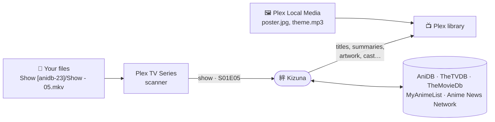
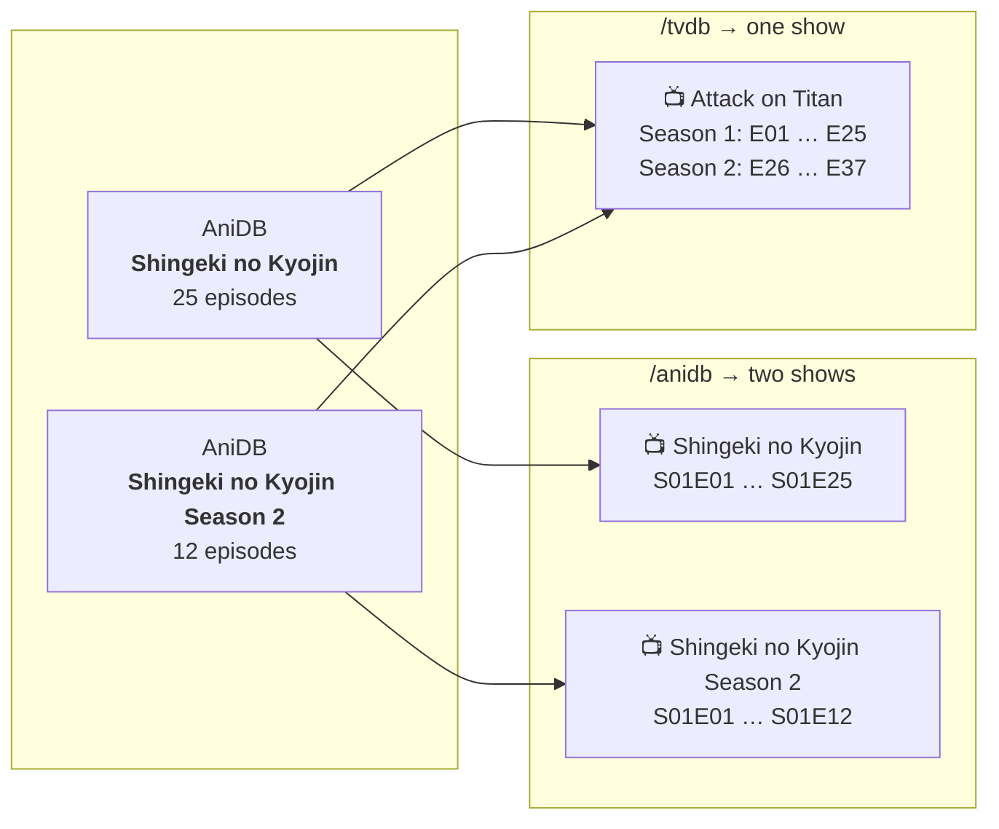
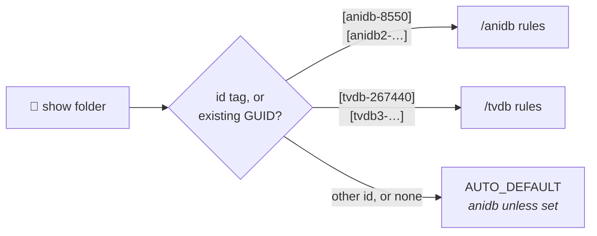
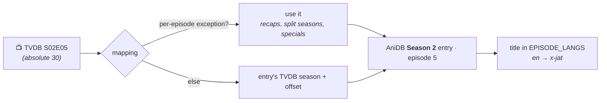

<div align="center">


# Kizuna

**An anime metadata provider for Plex that keeps your absolute episode numbers.**

*Kizuna* means "bond". It ties AniDB, TheTVDB, TheMovieDb, MyAnimeList and Anime News Network together
into one Plex provider.


[](LICENSE)
<br>
[](https://github.com/KurtzPT/kizuna/actions/workflows/ci.yml)
[](https://github.com/KurtzPT/kizuna/actions/workflows/docker.yml)
[](https://github.com/KurtzPT/kizuna/releases/latest)

[**Setup →**](SETUP.md) &nbsp;·&nbsp; [How it works](#-how-it-works) &nbsp;·&nbsp; [Modes](#%EF%B8%8F-modes) &nbsp;·&nbsp; [Matching](#-how-a-show-is-found) &nbsp;·&nbsp; [Sources](#-sources) &nbsp;·&nbsp; [Mapping fixes](MAPPING.md) &nbsp;·&nbsp; [Migrating from HAMA](MIGRATION.md) &nbsp;·&nbsp; [Contributing](CONTRIBUTING.md)

</div>

---

## ✨ What it is

Kizuna is a **custom metadata provider**: the new kind of Plex agent, running as a small web service next to Plex.

| Feature | What you get |
|---|---|
| 🔢 **Absolute numbering** | Episode 148 stays episode 148, in every mode |
| 🗂️ **Three modes** | One AniDB entry per show, one TVDB series per show (its movies and OVAs apart), or [both in one library](#auto-both-in-one-library) |
| 🏷️ **Matches by id** | `[anidb-8550]`, `[tvdb-81797]`, `[mal-21]`… in the folder name. No guessing |
| 🔀 **Per-field sources** | Pick the source order for titles, summaries, posters, cast… separately |
| 🖼️ **Your files win** | `poster.jpg`, `fanart.jpg`, `theme.mp3` next to your files override every online source |
| 🤝 **Plays fair with AniDB** | [Rate limits, caching and ban handling](#-anidb-fair-use) built in, so your IP stays welcome |
| 🪶 **Tiny** | One static Go binary, standard library only, a ~10 MB image |

## 🚀 Quick start

1. [Get an AniDB client name and the API keys](SETUP.md#-1-get-your-keys) for the sources you want.
2. [Run Kizuna](SETUP.md#-2-run-kizuna) with Docker Compose, plain Docker or Unraid.
3. [Add it to Plex](SETUP.md#-3-register-kizuna-in-plex) as a metadata provider, with the URL of your [mode](#%EF%B8%8F-modes).
4. [Point a library at it](SETUP.md#-4-point-a-library-at-it), then scan and refresh.

Coming from HAMA + Absolute Series Scanner? [MIGRATION.md](MIGRATION.md) moves a library over without renaming files.

## 🧭 How it works



| Step | Who | Does |
|---|---|---|
| 1 | Plex's **Plex TV Series** scanner | reads your file names and `.plexmatch` hints, and sets each file's season and episode |
| 2 | **Kizuna** | gets the show name and file path from Plex, [finds the show](#-how-a-show-is-found), and describes it |
| 3 | **Plex Local Media** | adds your own artwork and theme songs on top |

Kizuna never reads your media folders and can't move an episode to another number. **The folder layout of your
[mode](#%EF%B8%8F-modes) is what puts each file in the right place.**

---

## 🗂️ Modes

Each mode is its own provider URL; a library's agent uses one of them.

| Mode | A show in Plex is… | Files look like | Pick it when |
|---|---|---|---|
| **`/anidb`** | one **AniDB entry** | `Show - 01.mkv` … `Show - 148.mkv` | every season or sequel is its own folder |
| **`/tvdb`** | one **TVDB series** | `Show - S02E26.mkv` | one folder per series, with seasons |
| **`/auto`** | either, **per folder** | both, side by side | your library mixes the two |

The same anime in both models, *Attack on Titan* (25 + 12 episodes):



### `/anidb`: one AniDB entry per show

```text
📁 Hunter x Hunter (2011) [anidb-8550]
 ├─ Hunter x Hunter - 001.mkv        →  S01E01
 ├─ Hunter x Hunter - 148.mkv        →  S01E148
 ├─ Hunter x Hunter - S00E01.mkv     →  Specials · special 1
 └─ Hunter x Hunter - S00E101.mkv    →  Specials · opening 1
```

**Season 1** holds every regular episode, 1…n. **Season 0** holds everything else, in number blocks:

| AniDB type | Plex episodes |
|---|---|
| `S` specials | `S00E01` … |
| `C` openings | `S00E101` … |
| `C` endings | `S00E151` … |
| `T` trailers | `S00E201` … |
| `P` parodies | `S00E301` … |
| `O` other | `S00E401` … |

- **Movies** are one-episode AniDB entries: `S01E01`, with the movie's own title and summary.
- **Episode thumbnails** come from TheTVDB, since AniDB has none, through [pairing](#%EF%B8%8F-episode-titles-and-pairing).
  Missing AniDB summaries and dates are filled the same way.
- **Without AniDB details** (no client, ban, daily limit), every episode still exists as *Episode N*. A later
  refresh fills it in.

### `/tvdb`: one TVDB series per show

```text
📁 Attack on Titan [tvdb-267440]
 ├─ Attack on Titan - S01E01.mkv     →  Season 1 · episode 1
 ├─ Attack on Titan - S01E25.mkv     →  Season 1 · episode 25
 ├─ Attack on Titan - S02E26.mkv     →  Season 2 · episode 26   ← keeps counting
 └─ Attack on Titan - S02E37.mkv     →  Season 2 · episode 37
```

| Part | Comes from |
|---|---|
| **Seasons** | TheTVDB's. A `Season 02/` folder works, but the `S02` in the name is enough |
| **Episode numbers** | keep counting across seasons: season 1 ends at 25, so season 2 starts at **26** |
| **Specials** | season 0, with TheTVDB's numbers |
| **Episode list** | TheTVDB, always. A show TheTVDB doesn't have finds nothing in `/tvdb`: use `/anidb` for it |
| **Show details** | the series' first AniDB entry |
| **Episode titles** | AniDB by default, from *each season's own* AniDB entry ([pairing](#%EF%B8%8F-episode-titles-and-pairing)) |
| **No TVDB series** | an entry without one (most movies, many OVAs) uses the `/anidb` rules |
| **Movies and specials** | an entry that lives only among the series' specials (One Piece Film Red is TheTVDB's S00E46) is its own show with the `/anidb` rules too. `S00Exx` files inside the series' folder stay its specials ([more](SETUP.md#-movies-and-specials)) |

### `/auto`: both in one library

Each show folder picks its rules:



```text
📁 Anime
 ├─ 📁 Hunter x Hunter (2011) [anidb-8550]     ← /anidb: Hunter x Hunter - 148.mkv
 ├─ 📁 Attack on Titan [tvdb-267440]           ← /tvdb:  Attack on Titan - S02E26.mkv
 └─ 📁 Cowboy Bebop                            ← AUTO_DEFAULT
```

With only one of the two modes set up, every show gets that mode's rules (a GUID of the other site is converted
through the [id mapping](#-id-mapping)), except a show with an `[anidb-…]` or `[tvdb-…]` tag: that tag needs its own
mode, and without it the show gets no match ([below](#-how-a-show-is-found)).

## 🔍 How a show is found

The first piece of evidence that names a show wins:

| | Evidence | Example |
|---|---|---|
| 1 | **An id tag** in the folder or file name | `[anidb-69]` `[tvdb-81797]` `[tmdb-37854]` `[imdb-tt0388629]` `[mal-21]` `[anilist-21]` `[kitsu-12]` `[ann-13]`, or the same in `{…}` |
| 2 | **The GUID Plex already has** from another agent | `com.plexapp.agents.thetvdb://81797`, a HAMA `anidb-69` GUID, `imdb://tt0388629` |
| 3 | **AniDB title search** in the offline title list (~1 ms, no API call) | `Hunter x Hunter` + year 2011 → *Hunter x Hunter (2011)*, not the 1999 series |

**One id tag only.** Two different ones (`Show [anidb-1234]/Show [tvdb-5678] - 01.mkv`) give no match and a
warning. The same tag again (the folder's tag in the file name too) is fine.

**A tag that blocks the match** (two different tags, or in `/auto` an `[anidb-…]` / `[tvdb-…]` tag whose mode is
off) gives no automatic match, without trying the GUID or the title. Plex's *Fix Match* for the show still lists the
results for the title you type; *Fix Match* for a season or an episode gives no match either.

**Fix Match** otherwise lists the show the tag or GUID names first, then the title search results for the title you
type, so a wrong match can be changed without unmatching first.

**Ids from other sites** become an AniDB entry through the [id mapping](#-id-mapping):

- A `[tmdb-…]` tag (or `tmdb://` GUID) is a TheMovieDb **TV show** id, as `{tmdb-…}` is in a Plex TV library.
  TheMovieDb numbers movies separately, so a movie id is used only when no entry has that number as its TV show. When
  one entry has it as a TV show and another as a movie, the title search decides; when it finds neither, the TV show
  wins.
- In `/anidb`, an id that covers several AniDB entries (a TVDB series with one entry per season) gives the series'
  first entry, by that site's own placement (for `tmdb`, TheMovieDb's; for `imdb` and other ids, TheTVDB's, else
  TheMovieDb's). Movies and specials count only when nothing else does.
- Inside a `[tvdb-…]` tag, a movie or special among the series' specials is found only when the title or file name
  clearly names it, with a warning ([movies and specials](SETUP.md#-movies-and-specials)).

---

## 📚 Sources

| Source | Best at |
|---|---|
| [**AniDB**](https://anidb.net) | titles in every language, summaries, episodes and specials, cast with characters, staff |
| [**TheTVDB**](https://thetvdb.com) | `/tvdb` seasons and episodes, episode thumbnails, posters, backgrounds, logos |
| [**TheMovieDb**](https://www.themoviedb.org) | artwork and details where TheTVDB has none; episode titles and crew |
| [**MyAnimeList**](https://myanimelist.net) | summary, poster, genres, studio, rating, date |
| [**Anime News Network**](https://www.animenewsnetwork.com/encyclopedia/) | summary, genres, Japanese cast, staff, studio, date |

Every field has its own source order, and any source can come first. Later sources are only downloaded when the ones
before them have nothing. By default AniDB comes first for show details and TheTVDB for artwork; TheTVDB always
comes before TheMovieDb, and Anime News Network is the last fallback.

**Setup:** [which keys each mode needs](SETUP.md#-1-get-your-keys) ·
[what each source can supply, and changing the order per field](SETUP.md#-sources-per-field).

### 🏷️ Episode titles and pairing

To give an episode a title from another source, Kizuna first finds that episode on the other source: it **pairs**
them through the [id mapping](#-id-mapping).



**Pairing**, first rule that applies:

1. Anime-Lists' per-episode exceptions.
2. The AniDB entry's TVDB season and episode offset.
3. For an AniDB special the mapping doesn't list: TheTVDB's special with the same number (`S1` = `S00E01`), but
   only on the entry that starts the series and isn't in TVDB season 0. Openings, endings and trailers only pair
   through an exception.

**The other sites** are paired per mode:

- **`/anidb`**: TheMovieDb the same way, by its own season, offset and exceptions (`tmdbseason`…), else at TheTVDB's
  season and number.
- **`/tvdb`**: through AniDB. An episode's place on the list gives its AniDB episode, and the mapping gives that
  episode's place on the other site. An episode without an AniDB counterpart (or whose AniDB entry isn't cached yet)
  is paired by absolute number, a special by its number in season 0. An episode whose AniDB entry the mapping puts on
  another TheMovieDb show gets no TheMovieDb title or crew.

**Picking the title:** `EPISODE_TITLES` sets the source order (default AniDB → TheTVDB → TheMovieDb), in both modes.
The first **real** title wins: *Episode 12* or *TBA* don't count. AniDB titles follow `EPISODE_LANGS` (default
English, then romaji); with none of those, the other sources' real titles come first, then AniDB's title in any
language.

In `/tvdb` a show spans several AniDB entries. Uncached ones are fetched in the background
([within AniDB's limits](#-anidb-fair-use)), so their titles appear on a later refresh.

### 🔗 Id mapping

Two community lists connect AniDB to every other site. Both are downloaded daily; when they disagree, the first list
in `MAPPING_SOURCES` wins:

| List | Adds |
|---|---|
| [Anime-Lists](https://github.com/Anime-Lists/anime-lists) | TVDB, TMDB and IMDb ids, plus each entry's TVDB season, episode offset and per-episode exceptions |
| [Fribb/anime-lists](https://github.com/Fribb/anime-lists) | MyAnimeList, AniList, Kitsu and ANN ids, plus TVDB, TMDB and IMDb ids Anime-Lists lacks |

Wrong mapping? Correct it yourself with `anime-list-custom.xml`: see [MAPPING.md](MAPPING.md).

### 🤝 AniDB fair use

AniDB bans clients that ask too much, so these rules are built in. No setting changes them:

| Rule | Details |
|---|---|
| Finding a show never calls the API | it searches the daily title list. Once that list has loaded, an AniDB id it doesn't have isn't asked about either (unless it's cached), so an entry added since waits for the next list |
| One call every 4 s, at most 200 a day | AniDB's limits. A call that failed without AniDB's answer (network error, HTTP error other than a ban, broken answer) isn't counted |
| Plex's calls go first | background fetches (other entries of a `/tvdb` show) wait behind them, still 4 s apart, and stop at 150 calls a day |
| Every answer is cached | 6 days while airing and for 60 days after the end, then 180 days |
| Each anime at most once a day | once AniDB has answered about an anime (its entry, an error such as *not found*, or XML that doesn't parse), it isn't asked again for 24 h. A failure without such an answer (network error, HTTP error other than a ban, a redirect, a broken or oversized answer) blocks no anime: the backoff covers it |
| Backoff after failures without an answer | network errors, HTTP errors, broken answers: 30 s → 2 min → 15 min → 1 h → 6 h → 24 h; AniDB's next answer about an anime (its entry, or an error such as *not found*) starts it over |
| A ban pauses all calls for 24 h | more traffic would only extend it |
| A rejected client pauses all calls for 24 h | when AniDB says `ANIDB_CLIENT` / `ANIDB_CLIENTVER` is wrong. A restart with new values asks again at once |
| Queued calls are checked again | a call waiting for its 4 s turn isn't sent, or counted, once a ban, backoff or rejected client came in ahead of it |
| Stopping ends background calls | once Kizuna starts shutting down, no background call goes out (it could be cut off before its outcome is saved); Plex's calls still do |

The state survives restarts (`anidb-state.json` in the data folder, replaced whole on every save), the 4 s gap
included: the first call after a restart waits for the rest of it. If that file can't be read, Kizuna can't know
whether a ban or a full day of calls was in it, so it doesn't ask AniDB until 24 h after the file was last
written. While AniDB can't be asked, shows use cached AniDB data, then the other sources.

---

<div align="center">

**[Set it up →](SETUP.md)** &nbsp;·&nbsp; [Contribute](CONTRIBUTING.md) &nbsp;·&nbsp; [Security](SECURITY.md)

<sub>Metadata from <a href="https://anidb.net">AniDB</a>, <a href="https://thetvdb.com">TheTVDB</a>,
<a href="https://www.themoviedb.org">TheMovieDb</a>, <a href="https://myanimelist.net">MyAnimeList</a> and the
<a href="https://www.animenewsnetwork.com/encyclopedia/">Anime News Network encyclopedia</a>. Id mappings from
<a href="https://github.com/Anime-Lists/anime-lists">Anime-Lists</a> and
<a href="https://github.com/Fribb/anime-lists">Fribb/anime-lists</a>.</sub>

<sub>Copyright © 2026 KurtzPT · Kizuna is free software under the <a href="LICENSE">GNU General Public License v3.0</a>:
you may use, change and share it, and anything you distribute that's built on it must stay under the same license.
It comes with no warranty.</sub>

</div>
