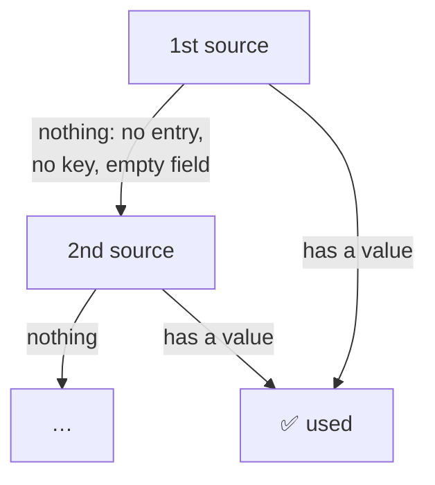
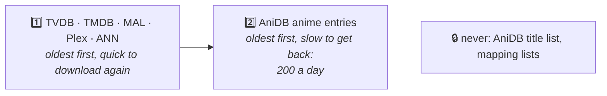

# Kizuna · Settings

**Every setting, its default and what it changes.**

[Home](README.md) &nbsp;·&nbsp; [Setup](SETUP.md) &nbsp;·&nbsp; [Guide](GUIDE.md) &nbsp;·&nbsp; **Settings** &nbsp;·&nbsp; [Mapping](MAPPING.md) &nbsp;·&nbsp; [Migration](MIGRATION.md)

Settings: [Keys](#-accounts--keys) · [Matching](#-matching--titles) · [Sources](#-sources-per-field) · [Openings](#-opening-and-ending-titles) · [Logging](#-logging) · [Cache](#-storage--cache) · [Server](#%EF%B8%8F-server) · [Access](#%EF%B8%8F-access)

More: [The settings file](#-where-settings-go) · [How sources are used](#-how-sources-are-used) · [Cache cleanup](#-cache-cleanup) · [Wrong values](#%EF%B8%8F-when-a-value-is-wrong)

---

## 📄 Where settings go

In `kizuna.env` in the data folder: [SETUP step 2](SETUP.md#-2-run-kizuna) creates it and says how to change it.
[`.env.sample`](.env.sample) lists every setting with its default. Every setting applies to every mode and library:
Plex doesn't pass per-library settings to providers.

- **One `NAME=value` per line, names in upper case.** Any other name, such as `port=`, is ignored with a warning.
- **A `#` after a space or tab starts a comment.** Quotes, `"..."` or `'...'`, keep a value exactly as written.
  A line with a missing closing quote, or text after it, is skipped with a warning.
- `export NAME=value` works too, so a shell can `source` the same file.
- `KIZUNA_CONFIG=/path/to/file`, in the environment only, reads that file instead; Kizuna won't start if it's
  missing. `DATA_DIR` in the file moves the cache and logs, but not where the file is looked for.

---

## ⚙️ All settings

> [!WARNING]
> - **`PLEX_TOKEN` gives full access to your Plex server.** [Keep the settings file private](SETUP.md#changing-settings).
> - **In Docker, leave `PORT`, `LISTEN` and `DATA_DIR` alone.** Change the port mapping's *host* side and the
>   volume instead: `LISTEN=127.0.0.1:…` in a container makes Kizuna unreachable.
> - **`ALLOW_FROM=any`**, or `0.0.0.0/0`, lets every address use Kizuna, which has no login.
> - **The legacy TheTVDB key gives less** ([footnotes](#which-source-answers)), and TheTVDB may switch its v3 API off
>   at any time.

### 🔑 Accounts & keys

Where to get each key: [SETUP step 1](SETUP.md#-1-get-your-keys). A key left empty turns its source off.

| Variable | Default | What it does |
|---|---|---|
| `ANIDB_CLIENT` | – | Your registered AniDB HTTP client name. Without it, AniDB details are off |
| `ANIDB_CLIENTVER` | `1` | The client version you registered |
| `TVDB_API_KEY` | – | TheTVDB v4 key: `/tvdb` episodes, episode thumbnails, artwork |
| `TVDB_PIN` | – | Your TheTVDB subscriber PIN. Needed for a free, user-supported key; a company key works without it |
| `TVDB_LEGACY_API_KEY` | – | A legacy TheTVDB key, for its older v3 API. Used when `TVDB_API_KEY` is empty or rejected |
| `TMDB_API_KEY` | – | TheMovieDb v3 key: artwork, logos, details, episode titles and crew |
| `MAL_CLIENT_ID` | – | MyAnimeList API v2 Client ID |
| `PLEX_TOKEN` | – | A [Plex token](https://support.plex.tv/articles/204059436-finding-an-authentication-token-x-plex-token/) of the server's owner ([where it goes](SECURITY.md#-your-data)): turns on the `plex` source, [Plex's own metadata service](GUIDE.md#-plex-as-a-source), and with `PLEX_URL` the [opening and ending titles](#-opening-and-ending-titles) |

### 🎯 Matching & titles

| Variable | Default | What it does |
|---|---|---|
| `MIN_SCORE` | `80` | Lowest title-search score, 0–100, for an automatic match. Plex's *Fix Match* list ignores it |
| `AUTO_DEFAULT` | `anidb` | `anidb` or `tvdb`: the rules `/auto` uses for a show without an AniDB or TVDB tag or GUID. A mode that is off gives way to the other, here and for an AniDB or TVDB GUID, but not for a tag |
| `MAPPING_SOURCES` | `animelists,fribb` | [Id mapping](README.md#-id-mapping) lists, in priority order. A later list only fills ids the earlier ones lack. Can't be `none` |
| `TITLE_LANGS` | `main,x-jat,en` | Show title language order: `main` is AniDB's main title, then AniDB language codes such as `x-jat` (romaji), `en`, `ja`, `de` |
| `TITLE_OFFICIAL_ONLY` | `false` | `true`: `TITLE_LANGS` only uses AniDB's main and official titles, never synonyms, so a language without an official title falls through to the next |
| `ORIGINAL_TITLE_LANGS` | `ja` | Language order for Plex's *original title*, official titles only; `x-jat` gives romaji. Left empty when it equals the title; `none` turns it off |
| `EPISODE_LANGS` | `en,x-jat` | AniDB episode title language order. With none of these, the other sources' real titles come first, then AniDB's title in any language |

### 🔀 Sources per field

Each list names the sources to ask, in order, from the ones the field allows: `anidb`, `tvdb`, `tmdb`, `mal`,
`plex`, `ann`. The first that has a value wins; `none` turns the field off ([how it works](#-how-sources-are-used)).
`plex` is always last in a default list, or right before `ann`: it only fills what the others leave empty.

| Variable | Default | What it does |
|---|---|---|
| `TITLE_SOURCES` | `anidb,tvdb,tmdb,plex,ann` | Show title. AniDB's follows `TITLE_LANGS`; in `/anidb`, a sequel or a movie keeps its own ([later entries](#later-entries-in-anidb)) |
| `SUMMARY_SOURCES` | `anidb,tvdb,tmdb,mal,plex,ann` | Summary. In `/anidb`, a later entry gets its season's ([later entries](#later-entries-in-anidb)) |
| `GENRE_SOURCES` | `anidb,tvdb,tmdb,mal,plex,ann` | Genres. AniDB: its main ("infobox") tags |
| `CAST_SOURCES` | `anidb,tvdb,tmdb,plex,ann` | Voice actors with their characters; an actor listed twice for the same character shows once. ANN: Japanese cast, no photos |
| `CREW_SOURCES` | `anidb,tvdb,tmdb,plex,ann` | The show's directors and writers, both from the same source. Episodes get their own ([episode crew](#episode-directors-and-writers)) |
| `STUDIO_SOURCES` | `anidb,tvdb,tmdb,mal,plex,ann` | Studio |
| `DATE_SOURCES` | `anidb,tvdb,tmdb,mal,plex,ann` | First aired or release date |
| `RATING_SOURCES` | `anidb,tvdb,tmdb,mal,plex,ann` | Content rating. AniDB only marks 18+, as `X`; MAL uses US ratings |
| `RATING_COUNTRY` | `US` | Rating country order, e.g. `DE` or `GB,US`: every source is checked for these before any other country. Non-US ratings are written the Plex way: `de/12` |
| `POSTER_SOURCES` | `tvdb,tmdb,anidb,mal,plex,ann` | Posters |
| `BACKGROUND_SOURCES` | `tvdb,tmdb,plex` | Backgrounds |
| `LOGO_SOURCES` | `tvdb,tmdb,plex` | Clear logos |
| `ART_ALL_SOURCES` | `false` | `true`: images from **every** listed source; the first source's best is the default, the rest can be picked in Plex's *Edit* dialog. `false`: only the first source that has any. `plex` then also offers every picture Plex lists, but its copies of TheTVDB's and TheMovieDb's when that site is set up and in the list |
| `SEASON_ART_FALLBACK` | `true` | A TheTVDB or TheMovieDb season without art of a kind gives that site's series art. `false`: the next source is asked instead ([season art](#season-art)) |
| `EPISODE_TITLES` | `anidb,tvdb,tmdb,plex` | Episode titles, both modes, from the [paired](MAPPING.md#-how-episodes-are-paired) episode. The first real title wins: placeholders such as *Episode 12*, *Ep. 5*, *TBA* or *TBD* only beat nothing. `tvdb,tmdb,anidb` puts TheTVDB's English titles first |
| `EPISODE_FILL_SOURCES` | `tvdb,plex` | `/anidb`: episode thumbnails, plus summaries, dates and runtimes AniDB lacks, from the paired episode: per episode and value, the first listed source that has one. `tvdb`, `plex` or `none` |

### 🎵 Opening and ending titles

Both are needed for Kizuna to give Plex's opening and ending extras readable titles, such as *Opening 1* instead of
`OP1` ([how it works](GUIDE.md#readable-titles)). `PLEX_TOKEN` alone turns on the `plex` source only.

| Variable | Default | What it does |
|---|---|---|
| `PLEX_URL` | – | Your Plex server's address as Kizuna reaches it: `http://192.168.1.10:32400`, or `http://plex:32400` on a shared Docker network. Nothing after the port: no path, no `?…` |
| `PLEX_TOKEN` | – | See [Accounts & keys](#-accounts--keys) |

### 📝 Logging

| Variable | Default | What it does |
|---|---|---|
| `LOG_LEVEL` | `info` | `info` or `debug` ([what each logs](GUIDE.md#-logs)) |
| `LOG_RETENTION_DAYS` | `7` | Days of old log files kept; older ones are deleted. `0`, or 100000 and up, keeps them forever |
| `TZ` | UTC (image) · system time zone (binary) | Time zone, e.g. `Europe/London`, for log timestamps and when a new log day starts |
| `MATCH_REPORTS` | `false` | `true`: write a [match report](GUIDE.md#-match-reports) per show to `reports/` in the data folder |

### 💾 Storage & cache

| Variable | Default | What it does |
|---|---|---|
| `CACHE_MIN_FREE` | `1GB` | When the disk holding the cache has less free space than this, the oldest cache files are deleted ([cleanup](#-cache-cleanup)). `0` never cleans up |
| `CACHE_FREE_TARGET` | `2GB` | …until this much is free again; at least `CACHE_MIN_FREE`. Sizes like `500MB`, `2GB`, `1.5TB`; a plain number is MB |

### 🖥️ Server

For the binary or host networking. In Docker, leave them alone ([why](#%EF%B8%8F-all-settings)).

| Variable | Default | What it does |
|---|---|---|
| `PORT` | `32600` | Port Kizuna listens on, 1–65535 |
| `LISTEN` | – | Full listen address, e.g. `127.0.0.1:32600` to accept only local connections. Overrides `PORT`. The health check asks this address, or `127.0.0.1` when it's every address |
| `DATA_DIR` | `/data` (image) · `./data` (binary, relative to the folder it's started from) | Cache, AniDB state, mapping corrections, logs and match reports |

### 🛡️ Access

Two checks limit who may talk to Kizuna ([why](SECURITY.md#%EF%B8%8F-how-kizuna-is-protected)); a refused request
gets `403`. The defaults fit Plex and Kizuna on the same LAN, Docker host or Tailscale network.

| Variable | Default | What it does |
|---|---|---|
| `ALLOW_FROM` | `private` | Client addresses that may use Kizuna, comma-separated: `private` for loopback, `10.x`, `172.16–31.x`, `192.168.x`, Tailscale's `100.64.0.0/10`, link-local and IPv6 private; single IPs such as `192.168.1.10`; networks such as `192.168.1.0/24`. `any` or `all` turns it off. The machine itself is always allowed, and so is `/health` from its own address, for Docker's health check with `LISTEN=<ip>` |
| `ALLOWED_HOSTS` | – | Extra names Kizuna may be reached by: `kizuna.example.com`, or `.example.com` or `*.example.com` for it and every name under it. `any`, `all` or `*` turns it off. Always allowed: IP addresses, `localhost`, one-word names such as a container name, and names ending in `.local`, `.lan`, `.home`, `.home.arpa`, `.internal`, `.localdomain` |

Each refused client or name is logged once every 10 minutes, with the setting to change.

---

## 📖 How sources are used

### Which source answers

For each field, Kizuna asks the sources in its list's order. A source without its key is skipped, and a later source
is only downloaded when the ones before it have nothing.

| Field | AniDB | TheTVDB | TheMovieDb | MyAnimeList | Plex | ANN |
|---|:-:|:-:|:-:|:-:|:-:|:-:|
| Title | ⭐ | ✅ | ✅ | | ✅ | ✅ |
| Summary | ⭐ | ✅ | ✅ | ✅ | ✅ | ✅ |
| Genres | ⭐ | ✅ | ✅ | ✅ | ✅ | ✅ |
| Cast | ⭐ | ✅ | ✅ | | ✅ | ✅ |
| Crew | ⭐ | ✅¹ | ✅ | | ✅ | ✅ |
| Studio | ⭐ | ✅¹ | ✅ | ✅ | ✅ | ✅ |
| Content rating | ⭐ | ✅² | ✅ | ✅ | ✅ | ✅ |
| Date | ⭐ | ✅ | ✅ | ✅ | ✅ | ✅ |
| Poster | ✅ | ⭐ | ✅ | ✅ | ✅ | ✅ |
| Background, logo | | ⭐³ | ✅ | | ✅ | |
| Episode list, `/tvdb` | | ⭐ only | | | | |
| Episode titles | ⭐ | ✅ | ✅ | | ✅ | |
| Episode thumbnails, `/anidb` | | ⭐ | | | ✅ | |
| Episode directors, writers | | ⭐ | ✅ | | ✅⁴ | |

⭐ first by default &nbsp;·&nbsp; ✅ can be used, first or as a fallback &nbsp;·&nbsp; with a legacy TheTVDB key:
¹ none, ² US rating only, ³ backgrounds only, no logos; no season summaries or season backgrounds, and episodes get
the series' runtime &nbsp;·&nbsp; ⁴ [only when its episode list was read](#episode-directors-and-writers)

> [!NOTE]
> **A list where no source is set up leaves its field empty.** For a list in your settings, Kizuna warns at startup
> with `no usable source in these lists`: set it to `none` if you want it empty. A list you didn't set only gets an
> info line naming the key that would fill it.

### Later entries in `/anidb`

In `/anidb` each AniDB entry is its own show, but TheTVDB and TheMovieDb describe the whole series. So their data
only goes to the entry that starts the series; the other entries skip them and take the next source in the list.
Plex follows TheTVDB here: it finds a series by its TheTVDB id, and its seasons are TheTVDB's. A movie is asked for
as a movie, by its TheMovieDb id, else its IMDb id, and gets Plex's movie data.

| `/anidb` show | TheTVDB / TheMovieDb give its… |
|---|---|
| **First entry**: *Shingeki no Kyojin* | title, summary, genres, cast, crew, studio, rating, date: the series' |
| **Later entry**: *Shingeki no Kyojin Season 2* | summary only: that of the season the [id mapping](README.md#-id-mapping) puts it in (TVDB season 2). None without such a season, or without an English summary |
| **Movie or OVA** among the series' specials | nothing from TheTVDB. A TheMovieDb movie is its own entry, so it gets TheMovieDb's movie data |

- **"Starts the series" is per site.** With *X* and *X Part 2* as one TheTVDB series but two TheMovieDb shows,
  part 2 is a later entry for TheTVDB and a first entry for TheMovieDb.
- **Which entry starts the series** follows the mapping: [the rule](MAPPING.md#-how-episodes-are-paired).

### Episode directors and writers

They have no setting: they come from TheTVDB, else TheMovieDb, each field on its own, in both modes. AniDB has none
per episode. Plex's fill in what both lack, but only when Plex's episode list was read for the show anyway: when
`plex` comes before `tvdb` in `EPISODE_TITLES` or `EPISODE_FILL_SOURCES`, TheTVDB isn't set up or its episode list
failed, or an episode still
lacks a real title (or, in `/anidb`, a summary, thumbnail, date or runtime) after the sources listed before `plex`.

> [!TIP]
> With a v4 TheTVDB key, Kizuna fetches them for up to 8 seconds while building a show and the rest in the
> background. On a long show's first scan some episodes may lack them: refresh the show a few minutes later.

### Image languages

- **TheMovieDb:** English, Japanese or text-free art only.
- **TheTVDB:** posters and backgrounds in those languages first, best rated first, other languages after them, so
  one only wins when there is nothing else. Clear logos: English or text-free only.
- **Legacy TheTVDB key:** the series' own poster and background first, then the rest, best rated first.
- **Banners** aren't sent: Plex's metadata providers have no image type for them.

### Season art

A show and each of its Plex seasons get the art of the season they stand for, where the site has season art of that
kind: TheTVDB season posters and backgrounds, TheMovieDb season posters, Plex season posters, backgrounds and
logos (Plex's seasons are TheTVDB's). AniDB, MyAnimeList and Anime News Network have one poster per entry, whatever
`SEASON_ART_FALLBACK` says.

| Plex item | TheTVDB / TheMovieDb art of |
|---|---|
| `/anidb` show, the entry that starts its series (on that site) | the series, then season 1 |
| `/anidb` show, a later entry (*Shingeki no Kyojin Season 3*) | the season the [id mapping](MAPPING.md) puts it in (TVDB season 3) |
| `/anidb` show, a movie or special among the series' specials | season 0 (TheMovieDb: the movie's own art) |
| `/anidb` show in absolute order, or not mapped to a season | the series |
| `/anidb` *Season 1* / *Specials* | the entry's season, as above (the first entry: season 1 alone) / season 0 |
| `/tvdb` show | the series |
| `/tvdb` *Season N* / *Specials* | TheTVDB's season N / 0; TheMovieDb's season that holds the same episodes, when it holds no other TheTVDB season's (else its series) |

With `ART_ALL_SOURCES=true`, each source lists its season's art, then its series' with `SEASON_ART_FALLBACK`,
before the next source. A [match report](GUIDE.md#-match-reports) says, per source, how many images came from the
season and how many from the series.

---

## 🧹 Cache cleanup

The cache has no size limit of its own. Every 10 minutes Kizuna checks the free space and, when it's below
`CACHE_MIN_FREE`, deletes in this order until `CACHE_FREE_TARGET` is free:

If the target still isn't reached, something else is filling the disk, and Kizuna logs a warning.

| Cached | For |
|---|---|
| AniDB anime | see [AniDB fair use](GUIDE.md#-anidb-fair-use) |
| TheTVDB · TheMovieDb | 2–7 days; TheMovieDb id lookups 30 days |
| MyAnimeList | 30 days |
| Plex | 2–7 days; which Plex show an id is 30 days, "not on Plex" 1 day |
| Anime News Network | 7 days |
| AniDB title list · mapping lists | refreshed daily, every 5 min until the first download succeeds; an unchanged list isn't downloaded again |
| Built shows, in memory | 1 hour; 2 min when something was missing or the build failed: `complete=false` in the [logs](GUIDE.md#-logs) |

> [!TIP]
> When a source fails (TheTVDB: its login too), an expired cached copy answers instead: old data beats none.

## ⚠️ When a value is wrong

Kizuna warns at startup, quoting the value as written:

| You set | Kizuna |
|---|---|
| a variable to `""` or nothing | uses the default. For an API key the default is empty, so that source is off |
| an unknown source, or one the field doesn't allow, in a list, such as `TITLE_SOURCES=anidb,tvbd` | drops it. A list with nothing left uses the default; only `none` turns a field off |
| a boolean, number, size, mode or `LOG_LEVEL` it can't read or that is out of range, such as `TITLE_OFFICIAL_ONLY=yes` or `MIN_SCORE=150` | uses the default. Booleans: `true`/`false` or `1`/`0`. Sizes: `MB`, `GB`, `TB` |
| a bad `TZ` | keeps the default time zone |
| a bad `ALLOW_FROM` or `ALLOWED_HOSTS` entry | ignores it. An `ALLOW_FROM` with no valid entry left falls back to `private` |
| an unknown language or country code | no warning: it never matches, so the next one is used |
| neither `ANIDB_CLIENT` nor a TheTVDB key, a port in use, or a `LISTEN` address it can't open | **doesn't start** ([troubleshooting](SETUP.md#kizuna-doesnt-start)) |
