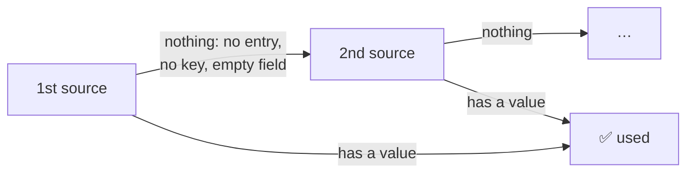
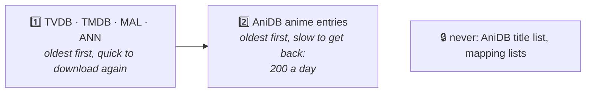
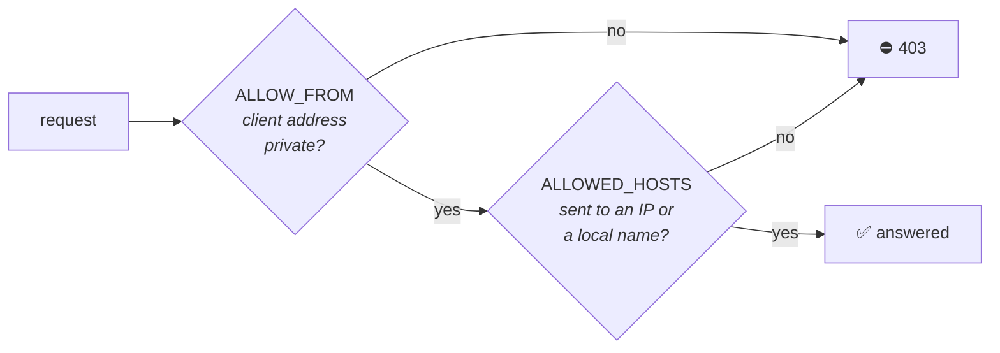

<div align="center">

<a href="README.md"></a>

# Kizuna · Settings

**Every setting, its default and what it changes.**

[Home](README.md) &nbsp;·&nbsp; [Setup](SETUP.md) &nbsp;·&nbsp; [Guide](GUIDE.md) &nbsp;·&nbsp; **Settings** &nbsp;·&nbsp; [Mapping](MAPPING.md) &nbsp;·&nbsp; [Migration](MIGRATION.md)

<sub>On this page: [Where settings go](#-where-settings-go) · [Keys](#-accounts--keys) · [Matching](#-matching--titles) · [Sources](#-sources-per-field) · [Openings](#-opening-and-ending-titles) · [Logging](#-logging) · [Cache](#-storage--cache) · [Server](#%EF%B8%8F-server) · [Access](#%EF%B8%8F-access)</sub>

<sub>Setting Kizuna up for the first time? Follow <a href="SETUP.md">SETUP.md</a>: it needs only the keys. Come back
here to change what Kizuna does.</sub>

</div>

---

## 📄 Where settings go

Settings go in **`kizuna.env` in the data folder** (`/data/kizuna.env` in Docker), one `NAME=value` per line.
[`.env.sample`](.env.sample) lists every setting with its default; [SETUP.md](SETUP.md#-2-run-kizuna) shows how to
create the file.

```bash
# /change/me/kizuna.env
ANIDB_CLIENT=myclient
TVDB_API_KEY=...
TITLE_LANGS=en,main      # a comment after a space is fine
```

> [!IMPORTANT]
> **Restart Kizuna after editing the file**, and refresh the metadata of the shows that should change. Every setting
> applies to every mode and library: Plex doesn't pass per-library settings to providers.

- **Names are upper case**; any other name (`port=`) is ignored with a warning.
- **Quotes** (`"..."` or `'...'`) keep a value exactly as written. You need them only for ` #` in a value: unquoted,
  a `#` after a space or tab starts a comment. A line with a missing closing quote, or text after it, is skipped
  with a warning.
- `export NAME=value` works too, so a shell can `source` the same file.
- `KIZUNA_CONFIG=/path/to/file`, in the environment only, reads that file instead; Kizuna won't start if it's
  missing. `DATA_DIR` in the file moves the cache and logs, but not where the file is looked for.

> [!NOTE]
> **Environment variables win over the file**, even when set to `""`: use the file for your settings and the
> environment for one-off overrides. `-e TMDB_API_KEY=` with `docker run` keeps TheMovieDb off whatever the file says.

At startup Kizuna logs which file it read, which settings the environment overrode, and any name in the file it
doesn't know (a typo). The `ready` line then shows the main settings in effect ([logs](GUIDE.md#-logs)). API keys
and tokens are never logged.

### When a value is wrong

| You set | Kizuna |
|---|---|
| a variable to `""` or nothing | uses the default. For an API key the default is empty, so that source is off |
| an unknown source, or one the field doesn't allow, in a list (`TITLE_SOURCES=anidb,tvbd`) | warns and drops it. A list with nothing left uses the default; only `none` turns a field off |
| a boolean, number, size, mode or `LOG_LEVEL` it can't read or that is out of range (`TITLE_OFFICIAL_ONLY=yes`, `MIN_SCORE=150`) | warns and uses the default. Booleans: `true`/`false` or `1`/`0`. Sizes: `MB`, `GB`, `TB` |
| a bad `TZ` | warns and keeps the default time zone |
| a bad `ALLOW_FROM` or `ALLOWED_HOSTS` entry | warns and ignores it. An `ALLOW_FROM` with no valid entry left falls back to `private` |
| an unknown language or country code | nothing: it never matches, so the next one is used |
| neither `ANIDB_CLIENT` nor a TheTVDB key | **doesn't start** (`no mode can build shows`) |
| a port in use, or a `LISTEN` address it can't open | **doesn't start** ([troubleshooting](SETUP.md#-troubleshooting)) |

Warnings appear at startup and quote the value as written.

## 🔑 Accounts & keys

Where to get each one, and which modes need which: [SETUP step 1](SETUP.md#-1-get-your-keys).

| Variable | Default | What it does |
|---|---|---|
| `ANIDB_CLIENT` | – | Your registered AniDB HTTP client name. Without it, AniDB details are off |
| `ANIDB_CLIENTVER` | `1` | The client version you registered |
| `TVDB_API_KEY` | – | TheTVDB v4 key: TVDB episodes, episode thumbnails, artwork |
| `TVDB_PIN` | – | Your TheTVDB subscriber PIN. Needed for a free user-supported key; a company key works without it |
| `TVDB_LEGACY_API_KEY` | – | A legacy TheTVDB key (from before v4), for TheTVDB's older v3 API. Used when `TVDB_API_KEY` is empty or rejected |
| `TMDB_API_KEY` | – | TheMovieDb v3 key: artwork, logos, details, episode titles and crew |
| `MAL_CLIENT_ID` | – | MyAnimeList API v2 Client ID (public data only) |

> [!WARNING]
> **The legacy TheTVDB key gives less** ([footnotes](#-sources-per-field)), and TheTVDB may switch its v3 API off at
> any time. When TheTVDB rejects `TVDB_API_KEY` (wrong key, missing `TVDB_PIN`), Kizuna logs a warning and uses the
> legacy key until it restarts. Without a legacy key, TheTVDB is skipped and tried again every 10 minutes.

## 🎯 Matching & titles

| Variable | Default | What it does |
|---|---|---|
| `MIN_SCORE` | `80` | Lowest title-search score (0–100) for an automatic match. Plex's *Fix Match* list ignores it |
| `AUTO_DEFAULT` | `anidb` | `anidb` or `tvdb`: the rules `/auto` uses for a show without an AniDB or TVDB tag or GUID. A mode that is off (no key) gives way to the other, here and for an AniDB or TVDB GUID, but not for a tag |
| `MAPPING_SOURCES` | `animelists,fribb` | Id mapping lists, in priority order. A later list only fills ids the earlier ones lack. Can't be `none` |
| `TITLE_LANGS` | `main,x-jat,en` | Show title language order: `main` = AniDB's main title, then AniDB language codes such as `x-jat` (romaji), `en`, `ja`, `de` |
| `TITLE_OFFICIAL_ONLY` | `false` | `true`: `TITLE_LANGS` only uses AniDB's main and official titles, never synonyms, so a language without an official title falls through to the next |
| `ORIGINAL_TITLE_LANGS` | `ja` | Language order for Plex's *original title* (official titles only, e.g. `x-jat` for romaji). Left empty when it equals the title; `none` turns it off |
| `EPISODE_LANGS` | `en,x-jat` | AniDB episode title language order ([fallbacks](MAPPING.md#-how-episodes-are-paired)) |

## 🔀 Sources per field

Each `*_SOURCES` value is a comma-separated list of `anidb`, `tvdb`, `tmdb`, `mal`, `ann`. The first source in the
list that is set up and has a value wins; a source without its key is skipped, and later sources are only downloaded
when they're needed. `none` turns a field off.



> [!NOTE]
> **A list where no source is set up leaves its field empty.** For a list in your settings, Kizuna warns at startup
> (`no usable source in these lists`): set it to `none` if you want it empty. A list you didn't set only gets an info
> line naming the key that would fill it.

**What each source can supply:**

| Field | AniDB | TheTVDB | TheMovieDb | MyAnimeList | ANN |
|---|:-:|:-:|:-:|:-:|:-:|
| Title | ⭐ | ✅ | ✅ | | ✅ |
| Summary | ⭐ | ✅ | ✅ | ✅ | ✅ |
| Genres | ⭐ | ✅ | ✅ | ✅ | ✅ |
| Cast | ⭐ | ✅ | ✅ | | ✅ |
| Crew | ⭐ | ✅¹ | ✅ | | ✅ |
| Studio | ⭐ | ✅¹ | ✅ | ✅ | ✅ |
| Content rating | ⭐ | ✅² | ✅ | ✅ | ✅ |
| Date | ⭐ | ✅ | ✅ | ✅ | ✅ |
| Poster | ✅ | ⭐ | ✅ | ✅ | ✅ |
| Background, logo | | ⭐³ | ✅ | | |
| Episode list (`/tvdb`) | | ⭐ only | | | |
| Episode titles | ⭐ | ✅ | ✅ | | |
| Episode thumbnails (`/anidb`) | | ⭐ | | | |
| Episode directors, writers | | ⭐ | ✅ | | |

<sub>⭐ first by default &nbsp;·&nbsp; ✅ can be used, first or as a fallback &nbsp;·&nbsp; with a legacy TheTVDB key
(`TVDB_LEGACY_API_KEY`): ¹ none, ² US rating only, ³ backgrounds only, no logos; no season summaries or season
backgrounds, and episodes get the series' runtime</sub>

### Show details

| Variable | Default | Allowed | Notes |
|---|---|---|---|
| `TITLE_SOURCES` | `anidb,tvdb,tmdb,ann` | anidb tvdb tmdb ann | AniDB's title follows `TITLE_LANGS`. In `/anidb`, a sequel season or a movie among the specials keeps its own AniDB title ([later entries](#later-entries-in-anidb)) |
| `SUMMARY_SOURCES` | `anidb,tvdb,tmdb,mal,ann` | anidb tvdb tmdb mal ann | In `/anidb`, a later entry gets its season's summary ([later entries](#later-entries-in-anidb)) |
| `GENRE_SOURCES` | `anidb,tvdb,tmdb,mal,ann` | anidb tvdb tmdb mal ann | AniDB: its main ("infobox") tags |
| `CAST_SOURCES` | `anidb,tvdb,tmdb,ann` | anidb tvdb tmdb ann | Voice actors with their characters; an actor listed twice for the same character shows once. ANN: Japanese cast, no photos |
| `CREW_SOURCES` | `anidb,tvdb,tmdb,ann` | anidb tvdb tmdb ann | The show's directors and writers, both from the same source. Episodes get their own ([episodes](#episodes)) |
| `STUDIO_SOURCES` | `anidb,tvdb,tmdb,mal,ann` | anidb tvdb tmdb mal ann | |
| `DATE_SOURCES` | `anidb,tvdb,tmdb,mal,ann` | anidb tvdb tmdb mal ann | First aired / release date |
| `RATING_SOURCES` | `anidb,tvdb,tmdb,mal,ann` | anidb tvdb tmdb mal ann | Content rating. AniDB only marks 18+ (`X`); MAL uses US ratings |
| `RATING_COUNTRY` | `US` | ISO country codes | Country order, e.g. `DE` or `GB,US`. Every source is checked for these countries before any other is used. Non-US ratings are written the Plex way: `de/12` |

#### Later entries in `/anidb`

TheTVDB and TheMovieDb TV data describe the whole series, so for the title, genres, cast, crew, studio, rating and
date they're only used on the AniDB entry that starts the series. A TheMovieDb movie is always its own entry.

- **Each site decides by its own placement.** When TheTVDB has one series and TheMovieDb a show per part (*X* and
  *X Part 2*), part 2 is a later entry for TheTVDB's data but the first one for TheMovieDb's, and the reverse.
- **A series that no entry starts** in season 1 (or absolute order) without an offset starts with its lowest AniDB
  id, leaving out movies and OVAs among the specials unless there's nothing else.
- **The summary** of a later entry is that of the season the [id mapping](README.md#-id-mapping) puts it in. With no
  such season (absolute order, specials, no mapped season, or a season without an English summary), TheTVDB and
  TheMovieDb are skipped and the next source in `SUMMARY_SOURCES` answers.

### Artwork

| Variable | Default | Allowed | Notes |
|---|---|---|---|
| `POSTER_SOURCES` | `tvdb,tmdb,anidb,mal,ann` | anidb tvdb tmdb mal ann | |
| `BACKGROUND_SOURCES` | `tvdb,tmdb` | tvdb tmdb | |
| `LOGO_SOURCES` | `tvdb,tmdb` | tvdb tmdb | |
| `ART_ALL_SOURCES` | `false` | `true` / `false` | `true`: images from **every** listed source; the first source's best one is the default, the rest can be picked in Plex's *Edit* dialog. `false`: only the first source that has any |
| `SEASON_ART_FALLBACK` | `true` | `true` / `false` | A TheTVDB or TheMovieDb season without art of a kind gives that site's series art instead. `false`: nothing from that site, the next source in the list is asked ([season art](#season-art)) |

> [!NOTE]
> Banners aren't sent: Plex's metadata providers have no image type for them.

#### Image languages

- **TheMovieDb:** English, Japanese or text-free art only.
- **TheTVDB:** posters and backgrounds in those languages first (best rated first), other languages after them, so
  one only wins when there is nothing else. Clear logos: English or text-free only.
- **Legacy TheTVDB key:** the series' own poster and background first, then the rest, best rated first.

#### Season art

A show and each of its Plex seasons get the art of the season they stand for, where the site has season art of that
kind: TheTVDB season posters and backgrounds, TheMovieDb season posters. No site has season logos. AniDB,
MyAnimeList and Anime News Network have one poster per entry, whatever `SEASON_ART_FALLBACK` says.

| Plex item | TheTVDB / TheMovieDb art of |
|---|---|
| `/anidb` show, the entry that starts its series (on that site) | the series, then season 1 |
| `/anidb` show, a later entry (*Attack on Titan Season 3*) | the season the [id mapping](MAPPING.md) puts it in (TVDB season 3) |
| `/anidb` show, a movie or special among the series' specials | season 0 (TheMovieDb: the movie's own art) |
| `/anidb` show in absolute order, or not mapped to a season | the series |
| `/anidb` *Season 1* / *Specials* | the entry's season, as above (the first entry: season 1 alone) / season 0 |
| `/tvdb` show | the series |
| `/tvdb` *Season N* / *Specials* | TheTVDB's season N / 0; TheMovieDb's season that holds the same episodes, when it holds no other TheTVDB season's (else its series) |

With `ART_ALL_SOURCES=true`, each source lists its season's art, then (with `SEASON_ART_FALLBACK`) its series',
before the next source. A [match report](GUIDE.md#-match-reports) says, per source, how many images came from the
season and how many from the series.

### Episodes

| Variable | Default | Allowed | Notes |
|---|---|---|---|
| `EPISODE_TITLES` | `anidb,tvdb,tmdb` | anidb tvdb tmdb | Both modes ([how titles are picked](MAPPING.md#-how-episodes-are-paired)). `tvdb,tmdb,anidb` = TheTVDB's English titles first |
| `EPISODE_FILL_SOURCES` | `tvdb` | tvdb | `/anidb`: episode thumbnails, plus summaries, dates and runtimes AniDB lacks, from the paired TVDB episode. `none` turns it off |

**Episode directors and writers** have no setting: they come from TheTVDB, else TheMovieDb, each field on its own,
in both modes. AniDB has none per episode.

> [!TIP]
> With a v4 TheTVDB key, Kizuna fetches episode directors and writers for up to 8 seconds while building a show and
> the rest in the background. On a long show's first scan some episodes may lack them: refresh the show a few
> minutes later.

<details>
<summary><b>Examples</b></summary>

```bash
# AniDB posters by default, the others still offered in Plex's Edit dialog
POSTER_SOURCES=anidb,tvdb,tmdb,mal,ann
ART_ALL_SOURCES=true

# English titles where AniDB has an official one, else romaji
TITLE_LANGS=en,x-jat
TITLE_OFFICIAL_ONLY=true

# German age ratings first, then British, then anything
RATING_COUNTRY=DE,GB

# No cast at all
CAST_SOURCES=none
```

</details>

## 🎵 Opening and ending titles

Plex names the opening and ending extras it makes from your files after the file: `OP1`, `NCED2`. With both settings
below, Kizuna gives them the titles `Opening 1`, `Ending 2` through Plex's own API
([how it works](GUIDE.md#readable-titles)).

| Variable | Default | What it does |
|---|---|---|
| `PLEX_URL` | – | Your Plex server's address as Kizuna reaches it: `http://192.168.1.10:32400`, or `http://plex:32400` on a shared Docker network. Nothing after the port: no path, no `?…` |
| `PLEX_TOKEN` | – | A [Plex token](https://support.plex.tv/articles/204059436-finding-an-authentication-token-x-plex-token/) of the server's owner. Kizuna sends it only to `PLEX_URL` and never logs it |

> [!CAUTION]
> **The Plex token gives full access to your server.** Keep the settings file readable only by Kizuna's user.

With only one of the two set, or a `PLEX_URL` that isn't a bare web address, Kizuna logs a warning at start and
leaves the titles alone.

## 📝 Logging

| Variable | Default | What it does |
|---|---|---|
| `LOG_LEVEL` | `info` | `info` or `debug` ([what each logs](GUIDE.md#-logs)) |
| `LOG_RETENTION_DAYS` | `7` | Days of old log files kept; older ones are deleted. `0` (or 100000 and up) = keep forever |
| `TZ` | UTC (image) · system time zone (binary) | Time zone (e.g. `Europe/London`) for log timestamps and when a new log day starts |
| `MATCH_REPORTS` | `false` | `true`: write a [match report](GUIDE.md#-match-reports) per show to `reports/` in the data folder |

## 💾 Storage & cache

| Variable | Default | What it does |
|---|---|---|
| `CACHE_MIN_FREE` | `1GB` | When the disk holding the cache has less free space than this, the oldest cache files are deleted. `0` = never clean up |
| `CACHE_FREE_TARGET` | `2GB` | …until this much is free again (at least `CACHE_MIN_FREE`). Sizes like `500MB`, `2GB`, `1.5TB`; a plain number is MB |

The cache has no size limit of its own. Every 10 minutes Kizuna checks the free space and, when it's low, deletes in
this order:



If the target still isn't reached, something else is filling the disk, and Kizuna logs a warning.

| Cached | For |
|---|---|
| AniDB anime | see [AniDB fair use](GUIDE.md#-anidb-fair-use) |
| TheTVDB · TheMovieDb | 2–7 days (TheMovieDb id lookups: 30 days) |
| MyAnimeList | 30 days |
| Anime News Network | 7 days |
| AniDB title list · mapping lists | refreshed daily (every 5 min until the first download succeeds); an unchanged list isn't downloaded again |
| Built shows (in memory) | 1 hour; 2 min when something was missing (`complete=false` in the [logs](GUIDE.md#-logs)) or the build failed |

> [!TIP]
> When a source fails (TheTVDB: its login too), an expired cached copy answers instead: old data beats none.

## 🖥️ Server

| Variable | Default | What it does |
|---|---|---|
| `PORT` | `32600` | Port Kizuna listens on (1–65535) |
| `LISTEN` | – | Full listen address, e.g. `127.0.0.1:32600` to accept only local connections. Overrides `PORT`. The health check asks this address (`127.0.0.1` when it's every address) |
| `DATA_DIR` | `/data` (image) · `./data` (binary, relative to the folder it's started from) | Cache, AniDB state, mapping corrections, logs and match reports |

> [!IMPORTANT]
> **In Docker, leave `PORT`, `LISTEN` and `DATA_DIR` alone.** Change the *host* side of the port mapping instead
> (`"32700:32600"` makes Kizuna `http://<host>:32700`), and the volume for the data folder. They're for the binary
> or host networking; `LISTEN=127.0.0.1:…` in a container makes Kizuna unreachable.

## 🛡️ Access

Two checks limit who may talk to Kizuna ([why](SECURITY.md#%EF%B8%8F-how-kizuna-is-protected)). Both are on by
default and need no change for the usual setups: Plex and Kizuna on the same LAN, Docker host or Tailscale network.



| Variable | Default | What it does |
|---|---|---|
| `ALLOW_FROM` | `private` | Client addresses that may use Kizuna, comma-separated: `private` (loopback, `10.x`, `172.16–31.x`, `192.168.x`, Tailscale's `100.64.0.0/10`, link-local, IPv6 private), single IPs (`192.168.1.10`) or networks (`192.168.1.0/24`). `any` (or `all`) turns it off. The machine itself (loopback) is always allowed, and so is `/health` from the machine's own address, for Docker's health check with `LISTEN=<ip>` |
| `ALLOWED_HOSTS` | – | Extra names Kizuna may be reached by: `kizuna.example.com`, or `.example.com` (or `*.example.com`) for it and every name under it. `any` (or `all`, or `*`) turns it off. Always allowed: IP addresses, `localhost`, one-word names (`kizuna`, a container name), and names ending in `.local`, `.lan`, `.home`, `.home.arpa`, `.internal`, `.localdomain` |

```bash
ALLOW_FROM=192.168.1.10              # only the Plex server (and the machine itself)
ALLOW_FROM=private,203.0.113.7       # the LAN plus one outside address
ALLOWED_HOSTS=kizuna.mynas.example   # you added the provider as http://kizuna.mynas.example:32600
```

Each refused client or name is logged once every 10 minutes, with the setting to change.

> [!WARNING]
> `ALLOW_FROM=any` (or `0.0.0.0/0`) lets every address use Kizuna, which has no login. Kizuna warns about it at
> startup.
