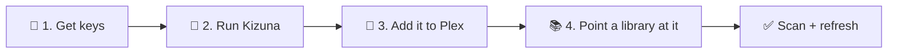
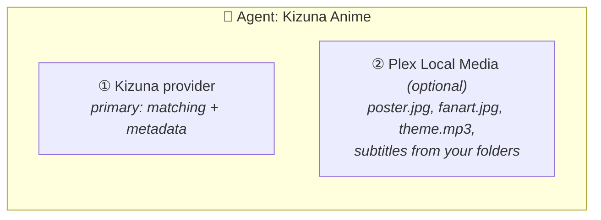

<div align="center">

<a href="README.md"></a>

# Kizuna · Setup

**From zero to a matched anime library in four steps.**

[① Keys](#-1-get-your-keys) &nbsp;·&nbsp; [② Run](#-2-run-kizuna) &nbsp;·&nbsp; [③ Plex](#-3-register-kizuna-in-plex) &nbsp;·&nbsp; [④ Library](#-4-point-a-library-at-it) &nbsp;·&nbsp; [⚙️ Settings](SETTINGS.md) &nbsp;·&nbsp; [🔍 Matching](#-matching-in-detail) &nbsp;·&nbsp; [🎬 Movies](#-movies-and-specials) &nbsp;·&nbsp; [🎵 Openings](#-openings-and-endings) &nbsp;·&nbsp; [📜 Logs](#-logs) &nbsp;·&nbsp; [📊 Reports](#-match-reports) &nbsp;·&nbsp; [🤝 AniDB](#-anidb-fair-use) &nbsp;·&nbsp; [🧰 Troubleshooting](#-troubleshooting) &nbsp;·&nbsp; [🩹 Mapping fixes](MAPPING.md)

<sub>New to Kizuna? Read the <a href="README.md">README</a> first. It explains the three modes.</sub>

</div>

---



**You need:** a machine that runs Docker on the same network as Plex, **Plex Media Server 1.43 or newer**, and a free
AniDB account.

> [!TIP]
> **Coming from HAMA + Absolute Series Scanner?** Do steps 1–3 here, then follow [MIGRATION.md](MIGRATION.md) instead
> of step 4.

## 🔑 1. Get your keys

| Source | Key | Where to get it | Setting |
|---|---|---|---|
| **AniDB** | client name | [anidb.net](https://anidb.net) → *Settings → Client → Add client*, protocol **HTTP** (free) | `ANIDB_CLIENT` |
| **TheTVDB** | API key (v4), or a legacy key | [thetvdb.com](https://thetvdb.com/api-information) | `TVDB_API_KEY` (legacy: `TVDB_LEGACY_API_KEY`) |
| **TheMovieDb** | API key (v3) | [themoviedb.org](https://www.themoviedb.org/settings/api) | `TMDB_API_KEY` |
| **MyAnimeList** | Client ID | [myanimelist.net/apiconfig](https://myanimelist.net/apiconfig) | `MAL_CLIENT_ID` |
| **Anime News Network** | none | – | – |

**Which keys you need.** Each [mode](README.md#%EF%B8%8F-modes) takes its episodes from one source, so that source
must be set up. Every other key only adds details ([what each source can supply](SETTINGS.md#-sources-per-field)):

| Mode | Episodes from | Works with |
|---|---|---|
| `/anidb` | AniDB | `ANIDB_CLIENT` |
| `/tvdb` | TheTVDB | `TVDB_API_KEY` or `TVDB_LEGACY_API_KEY` |
| `/auto` | AniDB or TheTVDB, per show | either; with only one, [most shows get that one's rules](README.md#auto-both-in-one-library) |

Kizuna starts when at least one mode works, and logs which ones do:
`modes anidb=ready tvdb="off: no TVDB_API_KEY or TVDB_LEGACY_API_KEY"`. A request to a mode that's off gets a 503
saying why (Plex keeps what it has). With no mode working, Kizuna doesn't start
(`can't start: no mode can build shows`).

Without an AniDB client, shows still match by title (from AniDB's offline title list), but get no AniDB details.
The title and original title then come from that list, and in `/tvdb` the show's runtime from TheTVDB's episodes.

## 🐳 2. Run Kizuna

<table>
<tr><th>Docker Compose (recommended)</th><th>Plain Docker</th></tr>
<tr><td>

Edit [`compose.yml`](compose.yml): fill in the `<...>` placeholders and replace `/change/me` with a folder on the
host. Then:

```bash
docker compose up -d
```

</td><td>

```bash
docker run -d --name kizuna \
  --restart unless-stopped --stop-timeout 35 \
  --user 1000:1000 \
  --read-only --cap-drop ALL --security-opt no-new-privileges:true \
  -p 32600:32600 \
  -v /srv/kizuna:/data \
  -e ANIDB_CLIENT=myclient \
  -e TVDB_API_KEY=... \
  -e TMDB_API_KEY=... \
  ghcr.io/kurtzpt/kizuna:latest
```

</td></tr>
</table>

<details>
<summary><b>Unraid</b></summary>

1. Create the folder `/mnt/user/appdata/kizuna` (through the `appdata` share, so it belongs to `nobody:users`).
2. Copy [`.env.sample`](.env.sample) into it as `kizuna.env` and fill in at least `ANIDB_CLIENT` or a TheTVDB key (one working mode is enough).
3. Get the template, in the Unraid terminal:

   ```bash
   wget -O /boot/config/plugins/dockerMan/templates-user/my-kizuna.xml \
     https://raw.githubusercontent.com/KurtzPT/kizuna/main/unraid/kizuna.xml
   ```

4. **Docker → Add Container**, pick **kizuna** under *Template* and click *Apply*. It only asks for the port and the
   data folder; everything else comes from `kizuna.env`. Restart the container after editing the file.

Unraid passes its own `TZ` to every container, and that wins over `TZ` in the file. It runs Kizuna as
`nobody:users` (99:100), locked down like the Compose file.

</details>

| Image tag | Is | Use it |
|---|---|---|
| **`:latest`** | the newest **stable** release | normally |
| `:1.2.3`, `:1.2` | one release / the newest patch of a minor | to pin a version |
| `:1.2.3-beta.1` | a pre-release of the next version | to test it, pinned |
| `:dev` | a **beta**, rebuilt from the `dev` branch on every change | to try fixes and features before release; may break |

The data folder (`/data` in the container) holds the [settings file](SETTINGS.md#-where-settings-go), the cache,
the AniDB rate-limit state, your optional [mapping corrections](MAPPING.md), the [logs](#-logs) and the
[match reports](#-match-reports). **It must be writable by `1000:1000`** (or whatever `user` you set).

**Check that it's up**, from the machine (or container) that runs Plex:

```bash
curl http://<kizuna-host>:32600/health
```

| Answer | Means |
|---|---|
| `{"status":"ok","version":"..."}` | ready. The version is `v1.2.3` for a release, `dev-<commit>` for a `:dev` build |
| `{"status":"starting","version":"..."}` (HTTP 503) | loading the lists: a few seconds from the cache, longer on the first start while they download. Plex's requests wait for it (up to 25 s, then a 503; stopping Kizuna meanwhile answers them `"stopping"` at once) |
| `{"status":"degraded","missing":["mapping"],"version":"..."}` (HTTP 503) | titles match, but the id mapping lists didn't download: TVDB tags and `/tvdb` mode find nothing beyond your `anime-list-custom.xml` entries. Docker shows the container `unhealthy` |
| `403` | Kizuna refused the caller ([access](SETTINGS.md#%EF%B8%8F-access)) |
| no answer | wrong address, or a firewall ([troubleshooting](#-troubleshooting)) |

> [!IMPORTANT]
> **Plex in Docker?** Inside the Plex container, `localhost` is Plex itself. Use the host's LAN IP, or put both
> containers on one Docker network and use `http://kizuna:32600`.

> [!WARNING]
> Kizuna has **no login** ([why](SECURITY.md#%EF%B8%8F-how-kizuna-is-protected)). Keep port 32600 on your LAN and
> never forward it to the internet.

## 🔌 3. Register Kizuna in Plex

In Plex Web, open **Settings → Metadata Agents**.

**a. Add the provider.** Click *Add Provider* and enter the URL for your library's layout:

| URL | Shows up in Plex as | Use it for |
|---|---|---|
| `http://<host>:32600/anidb` | Kizuna (AniDB) | every season is its own show, episodes numbered 1…n |
| `http://<host>:32600/tvdb` | Kizuna (TVDB) | one show with TVDB seasons ([movies and specials](#-movies-and-specials) apart) |
| `http://<host>:32600/auto` | Kizuna | one library that mixes both ([README](README.md#auto-both-in-one-library)) |

You can add more than one; each is its own provider.

**b. Create an agent.** Click *Add Agent*, give it a name (e.g. *Kizuna Anime*), then add its providers:

1. **The Kizuna provider from step a.** It's the agent's **primary** provider (matching and metadata) and always
   stays first, so there's nothing to reorder.
2. **Plex Local Media** (optional, Plex's own provider). It adds your own `poster.jpg`, `fanart.jpg`, `clearlogo.png`, `Season02.jpg`, `theme.mp3`
   and subtitles from your folders, and they win over online artwork. Leave it out and none of these are picked
   up: Kizuna never reads your folders.



**One Kizuna mode per agent.** `/anidb` and `/tvdb` number episodes differently, so never put both in one agent. Use
`/auto` for a mixed library.

## 📚 4. Point a library at it

In **Manage Library → Edit → Advanced**:

| Field | Value |
|---|---|
| **Scanner** | `Plex TV Series`. Legacy scanners such as ASS can't be combined with the new providers |
| **Agent** | the agent from step 3 |

Save, then run **Scan Library Files** and **Refresh All Metadata**.

> [!CAUTION]
> **Changing an existing library's agent makes Plex re-match every show.** Back up the Plex database first.

A large library takes **several days** to get all its AniDB details ([AniDB's limits](#-anidb-fair-use)).
Shows fill in on later refreshes.

**To change titles, artwork, sources per field or who may reach Kizuna**, see [SETTINGS.md](SETTINGS.md).

---

## 🔍 Matching in detail

The README says [how a show is found](README.md#-how-a-show-is-found): an id tag, then the GUID Plex already has,
then the title search. The finer points:

**A tag that blocks the match.** Two different id tags (`Show [anidb-1234]/Show [tvdb-5678] - 01.mkv`), or in `/auto`
an `[anidb-…]` / `[tvdb-…]` tag whose mode is off, give no automatic match, without trying the GUID or the title.
Plex's *Fix Match* for the show still lists the results for the title you type; *Fix Match* for a season or an
episode gives no match either.

**`/auto` with one mode set up.** Every show gets that mode's rules; a GUID of the other site is converted through
the [id mapping](README.md#-id-mapping). Only a tag for the mode that's off blocks the match (above).

**Ids from other sites** become an AniDB entry through the id mapping:

- A `[tmdb-…]` tag (or `tmdb://` GUID) is a TheMovieDb **TV show** id, as `{tmdb-…}` is in a Plex TV library.
  TheMovieDb numbers movies separately, so a movie id is used only when no entry has that number as its TV show. When
  one entry has it as a TV show and another as a movie, the title search decides; when it finds neither, the TV show
  wins.
- In `/anidb`, an id that covers several AniDB entries (a TVDB series with one entry per season) gives the series'
  first entry, by that site's own placement (for `tmdb`, TheMovieDb's; for `imdb` and other ids, TheTVDB's, else
  TheMovieDb's). Movies and specials count only when nothing else does.
- Inside a `[tvdb-…]` tag, a movie or special among the series' specials is found only when the title or file name
  clearly names it, with a warning ([movies and specials](#-movies-and-specials)).

## 🎬 Movies and specials

The [id mapping](README.md#-id-mapping) often puts an anime's movies, OVAs and specials among its TVDB series'
specials: One Piece Film Red is TheTVDB's S00E46 of One Piece (`defaulttvdbseason="0"`). Such an entry is **its own
show in every mode**, with the `/anidb` rules (the movie is `S01E01`), when it is found by an `[anidb-…]`, `[tmdb-…]`
or other id tag, a GUID, or the title search.

| You have | Kizuna |
|---|---|
| a movie folder tagged `[anidb-16983]` or `[tmdb-900667]` (its TheMovieDb movie) | that movie, exactly. **The sure way** |
| an untagged movie folder, `One Piece Film Red` | the title search finds the movie, not the series |
| a movie folder tagged with the series, `[tvdb-81797]` | the whole series, unless the folder or file name clearly names one of the series' movies or specials: then that one, with the warning `matched to an AniDB entry by name inside a TheTVDB id; may be wrong`, which names the tags to use. The same for another agent's TheTVDB GUID (`com.plexapp.agents.thetvdb://81797`) |
| `One Piece - S00E46.mkv` inside the series' `/tvdb` folder | stays a special of the series |

*Clearly* means: at least `MIN_SCORE`, and 10 points over the series' own title and the other movies' titles; two
movies closer than that are told apart by the year Plex sends (or a `(2022)` in the name). A series with only one
AniDB entry never goes by name.

Without AniDB details (no `ANIDB_CLIENT`, or AniDB paused), such a show's episodes come from TheTVDB's specials at
their mapped spots, so a `/tvdb` setup with only a TheTVDB key still gets a real movie. Its episodes carry their
TheTVDB specials' GUIDs.

**GUIDs.** Whether an entry is TheMovieDb's movie comes from the mapping alone, so its GUIDs are the same with and
without AniDB details. It is one when it has a TheMovieDb movie id, and no TheMovieDb TV show id or no regular
TheTVDB season:

| The mapping gives the entry | The show's GUIDs |
|---|---|
| a movie id, and no regular TheTVDB season or no TV show id | the movie's `tmdb://` and `imdb://`, not the series' `tvdb://` |
| a regular TheTVDB season and a TheMovieDb TV show id | the series' `tvdb://` and that TV show's `tmdb://` |

## 🎵 Openings and endings

Plex's scanner decides by itself which files are openings and endings, from the file name alone. It does so before
Kizuna is asked anything and before it reads a [`.plexmatch`](MIGRATION.md#-how-it-works) hint, so neither can change
it. What follows was read from Plex Media Server 1.43.5 and checked on a library.

**Which files.** Plex looks for one of these as a separate word in the name (a space, `.`, `_`, `-` or a bracket on
each side), spelled in capitals as shown:

| The name has | Examples | Plex makes the file |
|---|---|---|
| `OP`, `ED` or `OPED`, with or without `NC` in front | `OP1` `NCED2` `OP 1` `ED_03` `NCOP` | an opening or ending **extra** |
| `Creditless` or `Clean`, then `Opening`, `Ending`, `OP`, `ED` or `OPED` | `Creditless Opening` `Clean Ending 2` | an opening or ending **extra** |
| `Opening` or `Ending` without `Creditless` or `Clean` | `Opening 1` `Ending` `NCOpening` | **nothing**: the file is left out of the library, as neither an extra nor an episode |
| the word in small letters | `op1` `ncop` | no opening or ending: the name is read like any other |
| a season and episode | `Show - S00E101` | an episode: Plex doesn't look for the words in such a name |

- After the word may come a number of 1 or 2 digits (`OP1`, `OP 01`, `OP.1`), one letter (`OP1a`, `OP1 b`) and a
  version (`OP1v2`).
- The first such word in the name counts, wherever it is: an episode named `Show - 05 [ED fix].mkv` becomes an ending
  extra too.
- `OP` and `OPED` are openings, `ED` is an ending.

**What you get.** An extra plays from the show's page (*Extras*), as an *Opening* or *Ending*. It is not a special:
it has no episode number and nothing from Kizuna, and its title is just the words Plex found: `OP1`, `NCED2`,
`Creditless Opening`. To have an opening as a special with its AniDB title instead, name the file by its number,
e.g. `Show - S00E101.mkv` ([the numbers](MIGRATION.md#openings-and-endings-with-variants)).

**When.** Plex adds, renames and removes these extras only when it refreshes the show's metadata. *Scan Library
Files* alone doesn't: after adding or renaming such a file, use *Refresh Metadata* on the show (or *Refresh All
Metadata* on the library).

### Readable titles

Set [`PLEX_URL` and `PLEX_TOKEN`](SETTINGS.md#-opening-and-ending-titles) and Kizuna gives these extras readable
titles, made from the same words in the file name:

| File | Plex's title | Kizuna's title |
|---|---|---|
| `Show - OP01.mkv` | `OP01` | **Opening 1** |
| `Show - OP01a.mkv` · `Show - OP 1 a.mkv` | `OP01a` · `OP 1 a` | **Opening 1a** |
| `Show - OP02.mkv` | `OP02` | **Opening 2** |
| `Show - OP1v2.mkv` | `OP1` | **Opening 1** |
| `Show - NCED2.mkv` · `Show - Clean Ending 2.mkv` | `NCED2` · `Clean Ending 2` | **Ending 2** |
| `Show - NCOP.mkv` | `NCOP` | **Opening** |
| `Show - OP a.mkv` (a letter without a number) | `OP a` | **Opening a** |
| `Show - OPED.mkv` | `OPED` | **Opening & Ending** |
| `Show - NCED1.mkv` next to `Show - ED1.mkv` | `NCED1` | **Ending 1 (creditless)** |

How it works, and what follows from it:

- Plex sets every extra's title back to its own on each metadata refresh. It also asks Kizuna for the show's extras
  at that moment (Kizuna has none), so Kizuna knows: 15 seconds and again 2 minutes later it looks the show up in
  Plex and sets the titles that differ. So, when Plex answers, **a title changes about 15 seconds after its show's
  refresh**, and until then you see Plex's own (`OP1`).
- The 15 seconds count per show, from that show's refresh, not one after the other: 10 shows refreshed together are
  all renamed about 15 seconds later. Kizuna takes them one at a time, a few hundredths of a second each, so even a
  *Refresh All Metadata* of a large library adds almost nothing to the wait.
- Each refresh gets its own two looks: a show refreshed again while it waits is looked at 15 seconds and 2 minutes
  after the newer refresh.
- Nothing happens until Plex refreshes a show. After setting the two values, run *Refresh All Metadata* once.
- Kizuna only changes the titles of opening and ending extras, only for shows matched by Kizuna, in every library
  that has the show. Your files are never touched, and the titles come from the file names: AniDB isn't asked.
- The log has a `plex: extra renamed` line per title. When Plex can't be reached or refuses the token, a warning
  says so, at most once a minute.
- When Plex doesn't answer several times in a row, Kizuna stops asking for a minute, with a warning. The shows that
  waited then, and those refreshed during that minute, get their titles on their next refresh.

## 📜 Logs

Logs go to **`logs/kizuna.log`** in the data folder and to `docker logs kizuna`, one `key=value` line per event. On
the first line after midnight (in `TZ`) the file is renamed `kizuna-YYYY-MM-DD.log` and a new one starts. API keys
and Plex tokens are always shown as `***`.

**`LOG_LEVEL=info`** (default) logs:

- the `ready` line with the settings in effect: which keys are set (never their values), and `tvdb=v4`, `v3` or `off`
  for the TheTVDB API in use
- `AniDB title list loaded` and `mapping loaded`, with their counts
- one `match` line per Plex match, with **how** it was decided (`tag [anidb-23]`, `guid …`, `title search`) or why
  nothing was found
- one `show built` line per show. `complete=false` means something was missing, so the show is rebuilt in 2 minutes:
  AniDB details, part of an episode list, a source that failed or ran out of time, or a later AniDB entry or episode
  crew still being fetched. When AniDB was the missing part, an `AniDB details not available` line before it says
  `why=`. Without `ANIDB_CLIENT` AniDB is never waited for. An anime in its [24 h block](#-anidb-fair-use)
  is logged once (`not asking about this anime again`) and its show counts as complete until the block ends
- failed requests, rejected API keys, a switch to the legacy TheTVDB key, AniDB backoff, bans and a rejected client

**`LOG_LEVEL=debug`** adds:

- every Plex request and match body
- every outgoing call and cache decision
- the top 5 title-search scores, and why AniDB wasn't called
- which source supplied each field (`show fields: source used`) and the episode pairing counts
- cache cleanup checks

## 📊 Match reports

The logs answer *what happened when*. The match reports answer *what did Kizuna do with this show*: one HTML page per
show in **`reports/`** in the data folder. They are off by default: set **`MATCH_REPORTS=true`** to turn them on.
Open **`reports/index.html`** in a browser (straight from the folder: the pages need no server, and nothing but the
images you open comes from the internet). The index lists every show, newest activity first, and the titles that
matched nothing. Filter it by title or id, by provider (`/anidb`, `/tvdb`, `/auto`), and the shows by their newest
build: failed, incomplete, or with something to check.

A show's page starts with what Plex asked and what it got, in a sentence, and how many of the values sent came from
each source. A source has one colour on every page: a bar in it beside a value says where the value came from. Then,
for the one of its last 5 builds picked at the top:

- **What to check** (when there is something): what looks wrong. Episodes without a real title or air date, text
  with HTML entities that Plex shows literally, a source that failed, AniDB entries still loading, a build with
  something missing, no source with a title, summary or poster, a match by an inexact title
- **Match**: what Plex sent, and how Kizuna decided: the id tag, the GUID, or the title search scores against
  `MIN_SCORE`. The latest match request is kept too, for builds that a later metadata request started
- **Sources**: the AniDB entries behind the show and their TheTVDB and TheMovieDb seasons and offsets, then what every
  source offered for the title, summary, genres, cast, studio, crew, content rating, date and artwork, and which one
  Plex got (per the [source settings](SETTINGS.md#-sources-per-field))
- **Episodes** (newest build only): every episode as Plex gets it, season by season, where it is on each source, and
  which source gave its title. Search by title (any source's) or by number (`s01e08`, `1x08`, `s2`, `8`), or show
  only the episodes with a problem. Open an episode for the rest Plex got: summary, air date, runtime, directors,
  writers and thumbnail, each with its source
- **Art** (newest build only): a gallery of every image Plex got for the show and for each season, in the order sent,
  with the source that gave it and which one is the poster or background shown. A level's images are downloaded only
  when you open it, an episode's thumbnail when you open the episode
- **Sent to Plex**: the show item Kizuna answered with, whole: every genre, role, GUID and image, each value with its
  source when it has one. The images and the cast's photos are downloaded only when you open their row, the poster
  and background only while the pointer is on their address
- **Timeline**: every download, cache read and in-memory answer of the build on a time line, so a slow or failing
  source stands out. Downloads that finish up to 2 minutes after the build are added to it
- **Plex requests**: the last 50 Plex requests about the show, each with the build that answered it (the same request
  repeated is one row, counted "N times")

**Copy for a bug report** copies the picked build as Markdown, to paste into an issue: the Kizuna version, the build
and its checks, the match and its candidates, the id mapping, the source used for each field, and each episode's
number, pairing, title, title source and problem. It leaves out what is yours: folders (a file keeps only its name),
Plex request URLs, summaries, cast and image addresses.

`/anidb` and `/tvdb` builds of the same anime share a page, named after its AniDB entry (`anidb-1234.html`); a TheTVDB
series that no AniDB entry maps to gets `tvdb-5678.html`. A title that matched nothing gets
`unmatched-<title>-<hash>.html` (one per title, whatever the year), with why nothing matched, the candidates and how
to fix it. It is removed once the title matches (with an id tag too), or after 30 days without a request about it. A
page is updated a few seconds after a build, the index at most every 30 s. A page stays small (it keeps its newest
builds and requests); delete the folder to start over. Turning reports off again leaves the folder as it is.

## 🤝 AniDB fair use

AniDB bans clients that ask too much, so these rules are built in. No setting changes them:

| Rule | Details |
|---|---|
| Finding a show never calls the API | it searches the daily title list. Once that list has loaded, an AniDB id it doesn't have isn't asked about either (unless it's cached), so an entry added since waits for the next list |
| One call every 4 s, at most 200 a day | AniDB's limits. A failure without AniDB's answer about the anime (next rows) isn't counted |
| Plex's calls go first | background fetches (other entries of a `/tvdb` show) wait behind them, still 4 s apart, and stop at 150 calls a day |
| Every answer is cached | 6 days while airing and for 60 days after the end, then 180 days |
| Each anime at most once a day | once AniDB has answered about an anime (its entry, an error such as *not found*, or XML that doesn't parse), it isn't asked again for 24 h. A failure without such an answer (network error, HTTP error other than a ban, a redirect, a broken or oversized answer, a page that isn't AniDB's XML) blocks no anime: the backoff covers it |
| Backoff after failures without an answer | those failures pause every call: 30 s → 2 min → 15 min → 1 h → 6 h → 24 h; AniDB's next answer about an anime (its entry, or an error such as *not found*) starts it over |
| A ban pauses all calls for 24 h | more traffic would only extend it |
| A rejected client pauses all calls for 24 h | when AniDB says `ANIDB_CLIENT` / `ANIDB_CLIENTVER` is wrong. A restart with new values asks again at once |
| Queued calls are checked again | a call waiting for its 4 s turn isn't sent, or counted, once a ban, backoff or rejected client came in ahead of it |
| Stopping ends background calls | once Kizuna starts shutting down, no background call goes out (it could be cut off before its outcome is saved); Plex's calls still do |

The state survives restarts (`anidb-state.json` in the data folder, replaced whole on every save), the 4 s gap
included: the first call after a restart waits for the rest of it. If that file can't be read, Kizuna can't know
whether a ban or a full day of calls was in it, so it doesn't ask AniDB until 24 h after the file was last
written. While AniDB can't be asked, shows use cached AniDB data, then the other sources.

The other sources have no daily limit: Kizuna spaces its calls to each one, and caches their answers for days
([how long](SETTINGS.md#-storage--cache)).

## 🧰 Troubleshooting

**Kizuna won't start, or isn't ready**

| Symptom | Fix |
|---|---|
| `can't run: port 32600 is already in use by another program` | Something else has the port, often a second Kizuna. Stop it, or use another port: the host side of the port mapping in Docker, else `PORT` (the binary, or Docker with host networking). Kizuna exits right away (code 1) instead of starting half-way |
| `can't start: no mode can build shows` | Set `ANIDB_CLIENT` (for `/anidb`), or a TheTVDB key (for `/tvdb`) ([which mode needs what](#-1-get-your-keys)). With a settings file, check the `settings file` line above it: the file may not be where Kizuna looks (`no settings file`) |
| `can't start: can't read the settings file` | `KIZUNA_CONFIG` names a file that isn't there, or the file can't be read by the container's user |
| `docker compose up` says *port is already allocated* | Docker found the host port taken before Kizuna started. Change the first number under `ports:` in `compose.yml` |
| log says `can't write the log file` | Kizuna runs, but can't write to the data folder: no log file, no cache. Make it writable by the container's user (`1000:1000` by default) |
| `/health` says `starting` for a long time | The AniDB title list couldn't be downloaded (first start, no network). It retries every 5 min; look for `a list is missing` |
| `/health` says `degraded` (container `unhealthy`) | The id mapping lists couldn't be downloaded (first start, no network, GitHub unreachable). It retries every 5 min; look for `anime mapping` and `a list is missing`. `docker inspect --format '{{json .State.Health}}' kizuna` shows the health check's answer |

**Plex can't reach Kizuna**

| Symptom | Fix |
|---|---|
| Plex can't add the provider | `curl` the `/health` URL from the Plex machine or container ([step 2](#-2-run-kizuna)). In Docker, `localhost` is the container itself |
| `refused a request from an address outside ALLOW_FROM` | The log line shows the client's address. If it's yours, add it to [`ALLOW_FROM`](SETTINGS.md#%EF%B8%8F-access) |
| `refused a request for an unknown host name` | You reached Kizuna by a domain name it doesn't consider local. Add it to [`ALLOWED_HOSTS`](SETTINGS.md#%EF%B8%8F-access) |

**Matching and metadata**

| Symptom | Fix |
|---|---|
| A show doesn't match | Its [unmatched report](#-match-reports) (with `MATCH_REPORTS=true`) or the `match: nothing found` line gives the reason and the closest titles. Add an id tag to the folder: `Show [anidb-1234]` |
| `match: more than one id tag; only one is allowed` | The show title and the file path together hold two different id tags. Keep one ([why](#-matching-in-detail)) |
| `/auto`: `match: id tag needs /tvdb, which is off` (or `/anidb`) | The tag's mode isn't set up: set `TVDB_API_KEY` or `TVDB_LEGACY_API_KEY` for a `[tvdb-…]` tag, `ANIDB_CLIENT` for an `[anidb-…]` tag, or change the tag. Until then the show gets no match ([why](#-matching-in-detail)) |
| A request gets `503` `the show wasn't ready in time` | Its first build took longer than Plex's request may (25 s, often a slow AniDB answer or a queue of AniDB calls). Plex keeps what it has; the build goes on, and the next refresh gets the show |
| A request gets `503` `the show's sources didn't answer in time` | The build itself ran out of its time (about 23 s) before its sources answered, so nothing was kept. Plex keeps what it has, and the next refresh builds the show again |
| A request gets `503` `the show can't be built now` | The reason follows: a source that didn't answer (`no episode list from TheTVDB`: TheTVDB is down and no older copy is cached), or a `tvdb-…` show asked through `/anidb` or `/auto` without a TheTVDB key (`needs TheTVDB, which is off`). Plex keeps what it has and asks again on a later refresh; for 2 minutes the failure is the answer, then the show is built again. Only a show that doesn't exist (an unknown AniDB id, `TheTVDB has no episodes for this show`) gets no match or a 404. A new AniDB entry is unknown until the next daily title list ([why](#-anidb-fair-use)) |
| A movie folder became the whole series, or `matched to an AniDB entry by name inside a TheTVDB id` | Tag the folder `[anidb-…]` or `[tmdb-…]` (the movie) instead of `[tvdb-…]` ([movies and specials](#-movies-and-specials)) |
| Wrong show matched (remake, sequel) | Add an id tag, or use *Fix Match* in Plex: Kizuna lists up to 10 candidates with their ids, the tag's or current GUID's show first, then the title you typed |
| No summaries, only *Episode N* titles | `ANIDB_CLIENT` isn't set, or AniDB is paused (ban, rejected client, daily limit, backoff). The `AniDB details not available` line before `show built` says which (`why=`); a later *Refresh Metadata* fills them in. An error answer from AniDB about an anime (e.g. *not found*) blocks that anime for 24 h (`not asking about this anime again`); a failure without AniDB's answer only starts the backoff (`AniDB call failed; backing off`) ([fair-use rules](#-anidb-fair-use)). Its show is kept the usual hour meanwhile, and the first build after the block asks AniDB again |
| `/tvdb` show has no episodes | Set `TVDB_API_KEY` (or `TVDB_LEGACY_API_KEY`). With a key, `TheTVDB has no episodes for this show`: use `/anidb` (or `/auto`) for it |
| Episodes land in the wrong season | Plex's scanner decides seasons from file names and `.plexmatch` hints, not Kizuna. Write hints with [MIGRATION.md](MIGRATION.md)'s script |
| Episodes paired with the wrong TVDB episode | [Fix the mapping](MAPPING.md) |
| `source rejected the request: check its API key / client id`, `TMDB rejected the request`, `MyAnimeList rejected the request` | That key or client id is wrong or expired. TMDB and MyAnimeList aren't asked again for 10 min (cached data still answers) |
| `AniDB rejected the client` | AniDB doesn't know `ANIDB_CLIENT` / `ANIDB_CLIENTVER`: use the name and version of a client registered at anidb.net (protocol HTTP), then restart. Until then AniDB isn't asked for 24 h (cache only); new values are tried at once |
| `TVDB rejected the API key` | TheTVDB refused `TVDB_API_KEY` (wrong key, or a user-supported key without `TVDB_PIN`) or `TVDB_LEGACY_API_KEY`. Kizuna skips TheTVDB and tries again in 10 min (cached data still answers) |
| `TVDB rejected TVDB_API_KEY: falling back to TVDB_LEGACY_API_KEY` | The v4 key was refused, so Kizuna uses your legacy key until it restarts: no TheTVDB logos, studio or show crew meanwhile. Fix `TVDB_API_KEY` / `TVDB_PIN` and restart |

**Still stuck?** [Open an issue](CONTRIBUTING.md#-reporting-a-problem).
