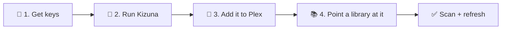
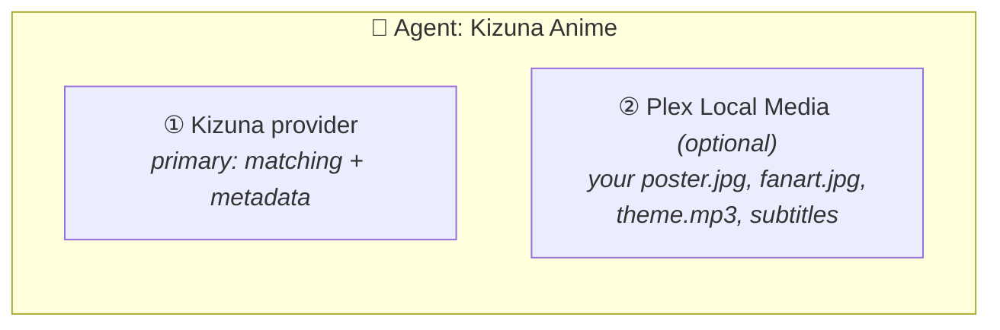

<div align="center">

<a href="README.md"></a>

# Kizuna · Setup

**From zero to a matched anime library in four steps.**

[Home](README.md) &nbsp;·&nbsp; **Setup** &nbsp;·&nbsp; [Guide](GUIDE.md) &nbsp;·&nbsp; [Settings](SETTINGS.md) &nbsp;·&nbsp; [Mapping](MAPPING.md) &nbsp;·&nbsp; [Migration](MIGRATION.md)

<sub>On this page: [Before you start](#-before-you-start) · [1. Keys](#-1-get-your-keys) · [2. Run](#-2-run-kizuna) · [3. Plex](#-3-register-kizuna-in-plex) · [4. Library](#-4-point-a-library-at-it) · [Troubleshooting](#-troubleshooting)</sub>

<sub>New to Kizuna? Read the <a href="README.md">README</a> first. It explains the three modes.</sub>

</div>

---



## 📋 Before you start

| You need | Why |
|---|---|
| **Plex Media Server 1.43 or newer** | Kizuna plugs into Plex as a custom metadata provider |
| **Docker** (Compose, plain Docker or Unraid) | Kizuna ships as a container image |
| **A host Plex can reach** on port 32600 | Plex calls Kizuna for every match and refresh; keep it on your LAN |
| **A free AniDB account, a TheTVDB key, or both** | at least one source to match against: see [step 1](#-1-get-your-keys) |

> [!TIP]
> **Coming from HAMA + Absolute Series Scanner?** Do steps 1–3 here, then follow [MIGRATION.md](MIGRATION.md) instead
> of step 4.

## 🔑 1. Get your keys

| Source | Setting | Where to get it | Needed for |
|---|---|---|---|
| **AniDB** | `ANIDB_CLIENT` | [anidb.net](https://anidb.net) → *Settings → Client → Add client*, protocol **HTTP** | `/anidb`; show details and episode titles in every mode |
| **TheTVDB** | `TVDB_API_KEY` (v4) + `TVDB_PIN`, or a legacy `TVDB_LEGACY_API_KEY` | [thetvdb.com](https://thetvdb.com/api-information); the PIN is your subscriber PIN, on your TheTVDB account page | `/tvdb` |
| **TheMovieDb** | `TMDB_API_KEY` | [themoviedb.org](https://www.themoviedb.org/settings/api) | optional: more details and art |
| **MyAnimeList** | `MAL_CLIENT_ID` | [myanimelist.net/apiconfig](https://myanimelist.net/apiconfig) | optional: more details |
| **Anime News Network** | – | no key | – |

**TheTVDB's PIN:** a free, user-supported v4 key only works together with your subscriber PIN in `TVDB_PIN`. A
company key needs no PIN. Without the PIN, TheTVDB rejects the key ([what the log says](GUIDE.md#-metadata-problems)).

## 🐳 2. Run Kizuna

Kizuna keeps everything in one **data folder**: its settings file `kizuna.env` (your keys go there), the cache, logs
and reports. Set that up first, then start the container.

**a. Create the data folder and the settings file.** [`.env.sample`](.env.sample) is the settings file with every
setting listed and explained; download it as `kizuna.env`:

```bash
sudo mkdir -p /srv/kizuna
sudo curl -fsSL -o /srv/kizuna/kizuna.env https://raw.githubusercontent.com/KurtzPT/kizuna/main/.env.sample
```

**b. Fill in your keys** from [step 1](#-1-get-your-keys) (`sudo nano /srv/kizuna/kizuna.env`). Leave every other line
as it is; [SETTINGS.md](SETTINGS.md) explains them when you want to change titles, artwork or sources.

```bash
ANIDB_CLIENT=myclient
TVDB_API_KEY=...
TVDB_PIN=...
TMDB_API_KEY=...
```

**c. Hand the folder to Kizuna's user.** Kizuna runs as `1000:1000`, not root, and must be able to write the folder.
The file holds your keys, so only that user reads it:

```bash
sudo chown -R 1000:1000 /srv/kizuna
sudo chmod 600 /srv/kizuna/kizuna.env
```

**d. Start it:**

<table>
<tr><th>Docker Compose (recommended)</th><th>Plain Docker</th></tr>
<tr><td>

Get [`compose.yml`](compose.yml) and start it. It already uses `/srv/kizuna`; change the path under `volumes:` if
you picked another folder.

```bash
curl -fsSLO https://raw.githubusercontent.com/KurtzPT/kizuna/main/compose.yml
docker compose up -d
```

</td><td>

```bash
docker run -d --name kizuna \
  --restart unless-stopped --stop-timeout 35 \
  --user 1000:1000 \
  --read-only --cap-drop ALL --security-opt no-new-privileges:true \
  -p 32600:32600 \
  -v /srv/kizuna:/data \
  ghcr.io/kurtzpt/kizuna:latest
```

</td></tr>
</table>

<details>
<summary><b>Unraid</b></summary>

Unraid runs Kizuna as `nobody:users` (99:100), and the folder lives under `appdata`:

1. Create `/mnt/user/appdata/kizuna` through the `appdata` share, so it already belongs to `nobody:users`.
2. Copy [`.env.sample`](.env.sample) into it as `kizuna.env` and fill in your keys (steps a and b above).
3. Get the template, in the Unraid terminal:

   ```bash
   wget -O /boot/config/plugins/dockerMan/templates-user/my-kizuna.xml \
     https://raw.githubusercontent.com/KurtzPT/kizuna/main/unraid/kizuna.xml
   ```

4. **Docker → Add Container**, pick **kizuna** under *Template*, click *Apply*. Unraid's own `TZ` wins over the
   file's.

</details>

**Changed a setting later?** Edit `kizuna.env`, then `docker restart kizuna`.

> [!NOTE]
> **Overriding the file:** a setting given to the container itself (`-e NAME=value` with `docker run`, an
> `environment:` entry in `compose.yml`, a variable in the Unraid template) wins over `kizuna.env`, even when it is
> empty. Useful for a quick test, such as `-e LOG_LEVEL=debug`; remove it to go back to the file.

**Check that it's up**, from the machine (or container) that runs Plex:

```bash
curl http://<kizuna-host>:32600/health
```

| Answer | Means |
|---|---|
| `"status":"ok"` | ✅ ready |
| `"status":"starting"` | loading its lists: seconds, longer on the first start |
| `"status":"degraded"` | the id mapping lists didn't download: `[tvdb-…]` tags and `/tvdb` find nothing yet. It retries every 5 min |
| `403` | Kizuna refused the caller: see [access](SETTINGS.md#%EF%B8%8F-access) |
| no answer | wrong address, or a firewall: see [troubleshooting](#-troubleshooting) |

> [!IMPORTANT]
> **Plex in Docker?** Inside the Plex container, `localhost` is Plex itself. Use the host's LAN IP, or put both
> containers on one Docker network and use `http://kizuna:32600`.

> [!WARNING]
> Kizuna has **no login** ([why](SECURITY.md#%EF%B8%8F-how-kizuna-is-protected)). Keep port 32600 on your LAN and
> never forward it to the internet.

<details>
<summary><b>Which image tag?</b></summary>

| Image tag | Use it |
|---|---|
| **`:latest`** | normally: the newest stable release |
| `:1.2.3`, `:1.2` | to pin a version |
| `:1.2.3-beta.1` | to test a pre-release |
| `:dev` | to try fixes before release; may break |

</details>

## 🔌 3. Register Kizuna in Plex

In Plex Web, open **Settings → Metadata Agents**.

**a. Add the provider** (*Add Provider*) with the URL for your library's [mode](README.md#%EF%B8%8F-modes):

| URL | Shows up as | For |
|---|---|---|
| `http://<host>:32600/anidb` | Kizuna (AniDB) | every season its own show, episodes 1…n |
| `http://<host>:32600/tvdb` | Kizuna (TVDB) | one show per series, with TVDB seasons |
| `http://<host>:32600/auto` | Kizuna | a library that mixes both |

**b. Create an agent** (*Add Agent*, e.g. *Kizuna Anime*) with these providers:



Kizuna is the **primary** provider and always stays first. **Plex Local Media** is Plex's own, and optional: without
it, your own artwork, theme songs and subtitles aren't used (Kizuna never reads your folders).

**One Kizuna mode per agent.** `/anidb` and `/tvdb` number episodes differently; use `/auto` for a mixed library.

## 📚 4. Point a library at it

In **Manage Library → Edit → Advanced**:

| Field | Value |
|---|---|
| **Scanner** | `Plex TV Series` (legacy scanners such as ASS don't work with the new providers) |
| **Agent** | the agent from step 3 |

Save, then run **Scan Library Files** and **Refresh All Metadata**.

> [!CAUTION]
> **Changing an existing library's agent makes Plex re-match every show.** Back up the Plex database first.

A large library takes **several days** to get all its AniDB details ([AniDB's limits](GUIDE.md#-anidb-fair-use)):
shows fill in on later refreshes.

**Next:** [change titles, artwork or sources](SETTINGS.md) · [movies, openings and match reports](GUIDE.md).

---

## 🧰 Troubleshooting

| Symptom | Fix |
|---|---|
| `can't run: port 32600 is already in use by another program` | Another program (often a second Kizuna) has the port. Stop it, or map another host port |
| `docker compose up` says *port is already allocated* | Change the first number under `ports:` in `compose.yml` |
| `can't start: no mode can build shows` | Set `ANIDB_CLIENT` or a TheTVDB key ([step 1](#-1-get-your-keys)). With a settings file, check the `settings file` log line: it may not be where Kizuna looks |
| `can't start: can't read the settings file` | `KIZUNA_CONFIG` names a missing file, or one the container's user can't read |
| `can't write the log file` | Make the data folder writable by `1000:1000` (no logs or cache until then) |
| `/health` stays `starting` | The AniDB title list didn't download (no network?). It retries every 5 min |
| `/health` says `degraded` | The id mapping lists didn't download (GitHub unreachable?). It retries every 5 min |
| Plex can't add the provider | `curl` the `/health` URL from the Plex machine or container. In Docker, `localhost` is the container itself |
| `refused a request from an address outside ALLOW_FROM` | Add your address (shown in the log line) to [`ALLOW_FROM`](SETTINGS.md#%EF%B8%8F-access) |
| `refused a request for an unknown host name` | Add the domain name to [`ALLOWED_HOSTS`](SETTINGS.md#%EF%B8%8F-access) |

A show doesn't match or lacks details: [metadata problems](GUIDE.md#-metadata-problems).

**Still stuck?** [Open an issue](CONTRIBUTING.md#-reporting-a-problem).
