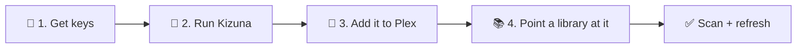
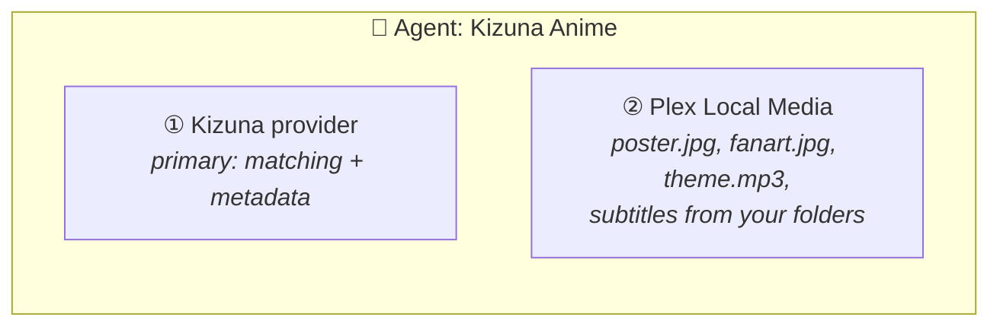
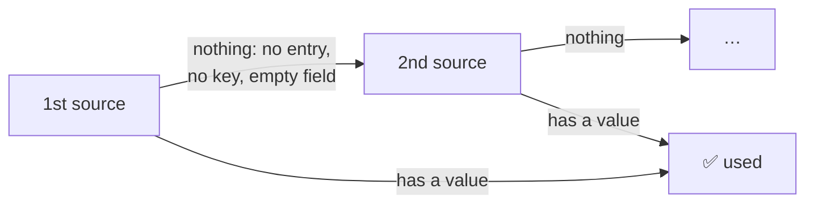
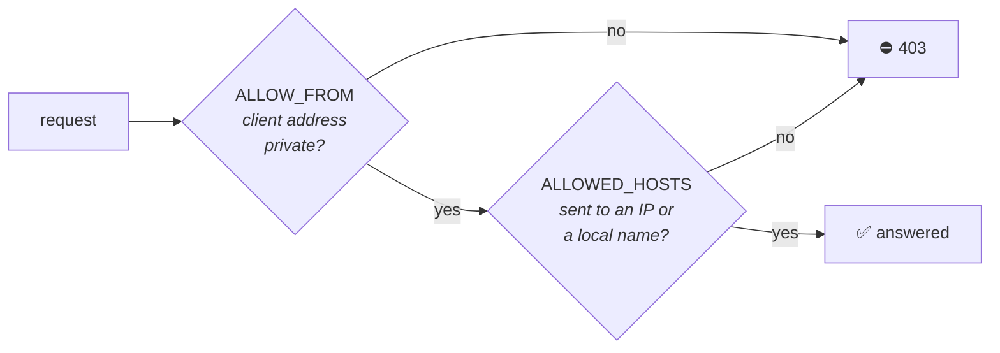
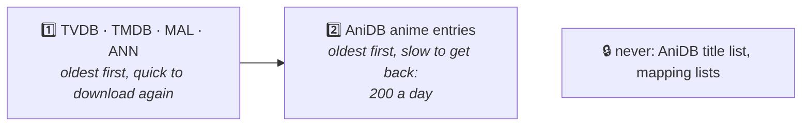
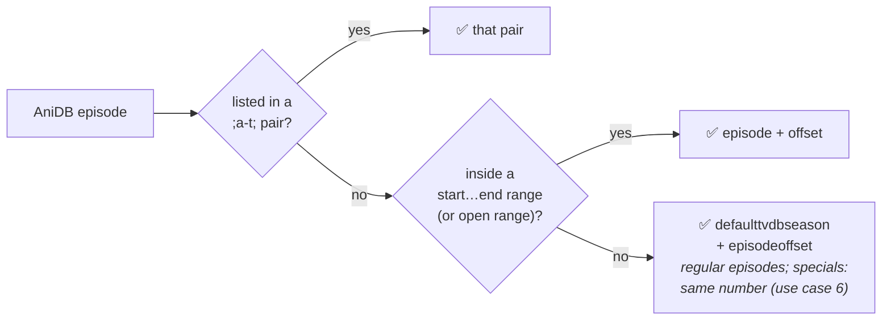

<div align="center">

<a href="README.md"></a>

# Kizuna · Setup

**From zero to a matched anime library in four steps.**

[① Keys](#-1-get-your-keys) &nbsp;·&nbsp; [② Run](#-2-run-kizuna) &nbsp;·&nbsp; [③ Plex](#-3-register-kizuna-in-plex) &nbsp;·&nbsp; [④ Library](#-4-point-a-library-at-it) &nbsp;·&nbsp; [⚙️ Settings](#%EF%B8%8F-settings) &nbsp;·&nbsp; [🩹 Mapping](#-fixing-a-wrong-mapping) &nbsp;·&nbsp; [📜 Logs](#-logs) &nbsp;·&nbsp; [📊 Reports](#-match-reports) &nbsp;·&nbsp; [🧰 Troubleshooting](#-troubleshooting)

<sub>New to Kizuna? Read the <a href="README.md">README</a> first. It explains the three modes.</sub>

</div>

---



**You need:** a machine that runs Docker on the same network as Plex, **Plex Media Server 1.43 or newer**, and a free
AniDB account.

> [!TIP]
> **Coming from HAMA + Absolute Series Scanner?** Do steps 1–3 here, then follow [MIGRATION.md](MIGRATION.md) instead
> of step 4.

## 🔑 1. Get your keys

| Source | Key | Where to get it | Setting |
|---|---|---|---|
| **AniDB** | client name | [anidb.net](https://anidb.net) → *Settings → Client → Add client*, protocol **HTTP** (free) | `ANIDB_CLIENT` |
| **TheTVDB** | API key (v4), or a legacy key | [thetvdb.com](https://thetvdb.com/api-information) | `TVDB_API_KEY` (legacy: `TVDB_LEGACY_API_KEY`) |
| **TheMovieDb** | API key (v3) | [themoviedb.org](https://www.themoviedb.org/settings/api) | `TMDB_API_KEY` |
| **MyAnimeList** | Client ID | [myanimelist.net/apiconfig](https://myanimelist.net/apiconfig) | `MAL_CLIENT_ID` |
| **Anime News Network** | none | – | – |

**The minimum for each [mode](README.md#%EF%B8%8F-modes):**

| Mode | Required | For |
|---|---|---|
| `/anidb` | AniDB | episode lists, specials, summaries |
| `/tvdb` | TheTVDB (TheMovieDb only fills in a show TheTVDB has no episodes for) | seasons and episode lists |
| `/auto` | AniDB **and** TheTVDB | both kinds of shows |

Without `ANIDB_CLIENT` and without a TheTVDB key, Kizuna doesn't start: it logs `can't start: no AniDB client and
no TheTVDB key` and exits. TheMovieDb, MyAnimeList and Anime News Network alone aren't enough, except when you put
TheMovieDb first for episodes (`EPISODE_SOURCES=tmdb` or `tmdb,tvdb`): then a `TMDB_API_KEY` is enough for `/tvdb`.

Without an AniDB client, shows still match by title (from AniDB's offline title list), but get no AniDB details.

**What each source can supply.** Every key you add is another source to pick from. You choose the order per field in
[sources per field](#-sources-per-field), so any source can be first, not just a fallback:

| Field | AniDB | TheTVDB | TheMovieDb | MyAnimeList | ANN |
|---|:-:|:-:|:-:|:-:|:-:|
| Title | ⭐ | ✅ | ✅ | | ✅ |
| Summary | ⭐ | ✅ | ✅ | ✅ | ✅ |
| Genres | ⭐ | ✅ | ✅ | ✅ | ✅ |
| Cast | ⭐ | ✅ | ✅ | | ✅ |
| Crew | ⭐ | ✅¹ | ✅ | | ✅ |
| Studio | ⭐ | ✅¹ | ✅ | ✅ | ✅ |
| Content rating | ⭐ | ✅² | ✅ | ✅ | ✅ |
| Date | ⭐ | ✅ | ✅ | ✅ | ✅ |
| Poster | ✅ | ⭐ | ✅ | ✅ | ✅ |
| Background, logo | | ⭐³ | ✅ | | |
| Episode list (`/tvdb`) | | ⭐ | ✅ | | |
| Episode titles | ⭐ | ✅ | ✅ | | |
| Episode thumbnails (`/anidb`) | | ⭐ | | | |
| Episode directors, writers | | ⭐ | ✅ | | |

<sub>⭐ first by default &nbsp;·&nbsp; ✅ can be used, first or as a fallback &nbsp;·&nbsp; with a legacy TheTVDB key
(`TVDB_LEGACY_API_KEY`): ¹ none, ² US rating only, ³ backgrounds only, no logos</sub>

## 🐳 2. Run Kizuna

<table>
<tr><th>Docker Compose (recommended)</th><th>Plain Docker</th></tr>
<tr><td>

Edit [`compose.yml`](compose.yml): fill in the `<...>` placeholders and replace `/change/me` with a folder on the
host. Then:

```bash
docker compose up -d
```

</td><td>

```bash
docker run -d --name kizuna \
  --restart unless-stopped \
  --user 1000:1000 \
  --read-only --cap-drop ALL --security-opt no-new-privileges:true \
  -p 32600:32600 \
  -v /srv/kizuna:/data \
  -e ANIDB_CLIENT=myclient \
  -e TVDB_API_KEY=... \
  -e TMDB_API_KEY=... \
  ghcr.io/kurtzpt/kizuna:latest
```

</td></tr>
</table>

<details>
<summary><b>Unraid</b></summary>

1. Create the folder `/mnt/user/appdata/kizuna` (through the `appdata` share, so it belongs to `nobody:users`).
2. Copy [`.env.sample`](.env.sample) into it as `kizuna.env` and fill in at least `ANIDB_CLIENT` and your keys.
3. Get the template, in the Unraid terminal:

   ```bash
   wget -O /boot/config/plugins/dockerMan/templates-user/my-kizuna.xml      https://raw.githubusercontent.com/KurtzPT/kizuna/main/unraid/kizuna.xml
   ```

4. **Docker → Add Container**, pick **kizuna** under *Template* and click *Apply*. It only asks for the port and the
   data folder; everything else comes from `kizuna.env`. Restart the container after editing the file.

Unraid passes its own `TZ` to every container, and that wins over `TZ` in the file. It runs Kizuna as
`nobody:users` (99:100), locked down like the Compose file.

</details>

| Image tag | Is | Use it |
|---|---|---|
| **`:latest`** | the newest **stable** release | normally |
| `:1.2.3`, `:1.2` | one release / the newest patch of a minor | to pin a version |
| `:dev` | a **beta**, rebuilt from the `dev` branch on every change | to try fixes and features before release; may break |

`curl http://<kizuna-host>:32600/health` shows which one you run: `v1.2.3` for a release, `dev-<commit>` for a beta.

The data folder (`/data` in the container) holds the cache, the AniDB rate-limit state, your optional
[mapping corrections](#-fixing-a-wrong-mapping), the [logs](#-logs) and the [match reports](#-match-reports). **It
must be writable by `1000:1000`** (or whatever `user` you set).

**Check that it's up**, from the machine (or container) that runs Plex:

```bash
curl http://<kizuna-host>:32600/health
```

| Answer | Means |
|---|---|
| `{"status":"ok","version":"..."}` | ready |
| `{"status":"starting","version":"..."}` (HTTP 503) | loading the lists: a few seconds from the cache, longer on the first start while they download. Plex's requests wait for it (up to 25 s, then a 503) |
| `{"status":"degraded","missing":["mapping"],"version":"..."}` (HTTP 503) | titles match, but the id mapping lists didn't download: TVDB tags and `/tvdb` mode find nothing beyond your `anime-list-custom.xml` entries. Docker shows the container `unhealthy` |
| `403` with `ALLOW_FROM` or `ALLOWED_HOSTS` | Kizuna refused the caller: see [access](#%EF%B8%8F-access) |
| no answer | wrong address, or a firewall: see [troubleshooting](#-troubleshooting) |

> [!IMPORTANT]
> **Plex in Docker?** Inside the Plex container, `localhost` is Plex itself. Use the host's LAN IP, or put both
> containers on one Docker network and use `http://kizuna:32600`.

> [!WARNING]
> Kizuna has **no login** ([why](SECURITY.md#%EF%B8%8F-how-kizuna-is-protected)). Keep port 32600 on your LAN and
> never forward it to the internet.

## 🔌 3. Register Kizuna in Plex

In Plex Web, open **Settings → Metadata Agents**.

**a. Add the provider.** Click *Add Provider* and enter the URL for your library's layout:

| URL | Shows up in Plex as | Use it for |
|---|---|---|
| `http://<host>:32600/anidb` | Kizuna (AniDB) | every season is its own show, episodes numbered 1…n |
| `http://<host>:32600/tvdb` | Kizuna (TVDB) | one show with TVDB seasons |
| `http://<host>:32600/auto` | Kizuna | one library that mixes both ([README](README.md#auto-both-in-one-library)) |

You can add more than one; each is its own provider.

**b. Create an agent.** Click *Add Agent*, give it a name (e.g. *Kizuna Anime*), then add two providers:

1. **The Kizuna provider from step a.** It's the agent's **primary** provider (matching and metadata) and always
   stays first, so there's nothing to reorder.
2. **Plex Local Media.** It adds your own artwork, theme songs and subtitles from your folders.



- **Plex Local Media** makes your own `poster.jpg`, `fanart.jpg`, `clearlogo.png`, `Season02.jpg` and `theme.mp3` win
  over online artwork. Kizuna never reads your folders.
- **One Kizuna mode per agent.** `/anidb` and `/tvdb` number episodes differently, so never put both in one agent. Use
  `/auto` for a mixed library.

## 📚 4. Point a library at it

In **Manage Library → Edit → Advanced**:

| Field | Value |
|---|---|
| **Scanner** | `Plex TV Series`. Legacy scanners such as ASS can't be combined with the new providers |
| **Agent** | the agent from step 3 |

Save, then run **Scan Library Files** and **Refresh All Metadata**.

> [!CAUTION]
> **Changing an existing library's agent makes Plex re-match every show.** Back up the Plex database first. For a
> HAMA + Absolute Series Scanner library, follow [MIGRATION.md](MIGRATION.md): its script writes the `.plexmatch`
> hints Plex's scanner needs, without renaming anything, with a dry run first.

A large library takes **several days** to get all its AniDB details ([AniDB's limits](README.md#-anidb-fair-use)).
Shows fill in on later refreshes.

---

## ⚙️ Settings

Everything is an environment variable; [`compose.yml`](compose.yml) lists the common ones. Plex doesn't pass
per-library settings to providers, so every setting applies to every mode and every library.

**Or put them in a file:** Kizuna reads `kizuna.env` in the data folder (`/data/kizuna.env` in Docker), one
`NAME=value` per line, the same names as below. [`.env.sample`](.env.sample) lists every setting with its default:

```bash
# /change/me/kizuna.env
ANIDB_CLIENT=myclient
TVDB_API_KEY=...
TITLE_LANGS=en,main      # comments after a space are fine
```

- **Environment variables win over the file**, even when set to `""`: `TVDB_API_KEY: ""` in `compose.yml` keeps
  TVDB off whatever the file says. Use the file for your settings and the environment for one-off changes.
- `KIZUNA_CONFIG=/path/to/file` (environment only) reads that file instead; Kizuna won't start if it's missing.
- `DATA_DIR` in the file moves the cache and logs, but not where the file is looked for.
- Values may be in `"..."` or `'...'` (taken as written; needed for a `#` in a value). `export NAME=value` works too,
  so a shell can `source` the same file.
- At startup Kizuna logs which file it read, which settings the environment overrode, and any name it doesn't know
  (a typo). It never logs the values. The file holds your API keys: keep it readable only by Kizuna's user.

| You set | Kizuna |
|---|---|
| a variable to `""` or nothing | uses the default. For an API key the default is empty, so that source is off |
| an unknown source in a list (`TITLE_SOURCES=anidb,tvbd`) | logs a warning at startup and drops it. A list with no known source left uses the default; only `none` turns a field off |
| an unknown mode, size, port or `LOG_LEVEL` | logs a warning at startup and uses the default |
| a boolean, number or score it can't read or that is out of range (`TITLE_OFFICIAL_ONLY=yes`, `MIN_SCORE=150`) | logs a warning at startup and uses the default |

The `ready` line at startup shows the settings in effect ([logs](#-logs)).

### 🔑 Accounts & keys

| Variable | Default | What it does |
|---|---|---|
| `ANIDB_CLIENT` | – | Your registered AniDB HTTP client name. Without it, AniDB details are off |
| `ANIDB_CLIENTVER` | `1` | The client version you registered |
| `TVDB_API_KEY` | – | TheTVDB v4 key: TVDB episodes, episode thumbnails, artwork |
| `TVDB_PIN` | – | Your TheTVDB subscriber PIN, for keys that need one: TheTVDB answers `pin required` without it |
| `TVDB_LEGACY_API_KEY` | – | A legacy TheTVDB key (from before v4), for TheTVDB's older v3 API. Used when `TVDB_API_KEY` is empty, or as a fallback when TheTVDB rejects `TVDB_API_KEY` (wrong key, missing `TVDB_PIN`): Kizuna then logs a warning and keeps using the legacy key until it restarts. It gives episodes (with their directors and writers), thumbnails, posters, backgrounds, cast, genres and the US content rating, but no clear logos, studio, or show directors and writers. TheTVDB may switch the v3 API off at any time |
| `TMDB_API_KEY` | – | TheMovieDb v3 key: artwork, logos and details, and `/tvdb` episodes for a show TheTVDB has none for |
| `MAL_CLIENT_ID` | – | MyAnimeList API v2 Client ID (public data only) |

### 🎯 Matching & titles

| Variable | Default | What it does |
|---|---|---|
| `MIN_SCORE` | `80` | Lowest title-search score (0–100) for an automatic match. Plex's *Fix Match* list ignores it |
| `AUTO_DEFAULT` | `anidb` | `anidb` or `tvdb`: the rules `/auto` uses for a show without an AniDB or TVDB tag or GUID |
| `MAPPING_SOURCES` | `animelists,fribb` | Id mapping lists, in priority order. A later list only fills ids the earlier ones lack |
| `TITLE_LANGS` | `main,x-jat,en` | Show title language order: `main` = AniDB's main title, then AniDB language codes such as `x-jat` (romaji), `en`, `ja`, `de` |
| `TITLE_OFFICIAL_ONLY` | `false` | `true`: `TITLE_LANGS` only uses AniDB's main and official titles, never synonyms, so a language without an official title falls through to the next |
| `ORIGINAL_TITLE_LANGS` | `ja` | Language order for Plex's *original title* (official titles only, e.g. `x-jat` for romaji). Left empty when it equals the title; `none` turns it off |
| `EPISODE_LANGS` | `en,x-jat` | AniDB episode title language order ([fallbacks](README.md#%EF%B8%8F-episode-titles-and-pairing)) |

### 🔀 Sources per field

Each `*_SOURCES` value is a comma-separated list of `anidb`, `tvdb`, `tmdb`, `mal`, `ann`:



Fallbacks are only downloaded when they're needed. `none` turns a field off.

**Show details**

| Variable | Default | Allowed | Notes |
|---|---|---|---|
| `TITLE_SOURCES` | `anidb,tvdb,tmdb,ann` | anidb tvdb tmdb ann | AniDB's title follows `TITLE_LANGS` |
| `SUMMARY_SOURCES` | `anidb,tvdb,tmdb,mal,ann` | anidb tvdb tmdb mal ann | |
| `GENRE_SOURCES` | `anidb,tvdb,tmdb,mal,ann` | anidb tvdb tmdb mal ann | AniDB: its main ("infobox") tags |
| `CAST_SOURCES` | `anidb,tvdb,tmdb,ann` | anidb tvdb tmdb ann | Voice actors with their characters; an actor listed twice for the same character shows once. ANN: Japanese cast, no photos |
| `CREW_SOURCES` | `anidb,tvdb,tmdb,ann` | anidb tvdb tmdb ann | The show's directors and writers, both from the same source. Episodes get their own: see below |
| `STUDIO_SOURCES` | `anidb,tvdb,tmdb,mal,ann` | anidb tvdb tmdb mal ann | |
| `DATE_SOURCES` | `anidb,tvdb,tmdb,mal,ann` | anidb tvdb tmdb mal ann | First aired / release date |
| `RATING_SOURCES` | `anidb,tvdb,tmdb,mal,ann` | anidb tvdb tmdb mal ann | Content rating. AniDB only marks 18+ (`X`); MAL uses US ratings |
| `RATING_COUNTRY` | `US` | ISO country codes | Country order, e.g. `DE` or `GB,US`. Every source is checked for these countries before any other is used. Non-US ratings are written the Plex way: `de/12` |

In `/anidb`, TheTVDB and TheMovieDb TV data describe the whole series, so for genres, cast, crew, studio, rating and
date they're only used on the AniDB entry that starts the series (a TheMovieDb movie is always its own entry).

**Episode directors and writers** come from TheTVDB, else TheMovieDb (each field on its own), in both modes; AniDB has
none per episode. With a v4 TheTVDB key they're in one record per episode: Kizuna fetches them for up to 8 seconds
while building a show and the rest in the background, so on a long show's first scan some episodes may still lack
them. Refresh the show's metadata a few minutes later to fill them in. The legacy key gets them with the episode list.

**Artwork**

| Variable | Default | Allowed | Notes |
|---|---|---|---|
| `POSTER_SOURCES` | `tvdb,tmdb,anidb,mal,ann` | anidb tvdb tmdb mal ann | |
| `BACKGROUND_SOURCES` | `tvdb,tmdb` | tvdb tmdb | |
| `LOGO_SOURCES` | `tvdb,tmdb` | tvdb tmdb | |
| `ART_ALL_SOURCES` | `false` | `true` / `false` | `true`: images from **every** listed source; the first source's best one is the default, the rest can be picked in Plex's *Edit* dialog. `false`: only the first source that has any |

**Episodes**

| Variable | Default | Allowed | Notes |
|---|---|---|---|
| `EPISODE_SOURCES` | `tvdb,tmdb` | tvdb tmdb | `/tvdb`: where the episode list comes from |
| `EPISODE_TITLES` | `anidb,tvdb,tmdb` | anidb tvdb tmdb | Both modes ([how titles are picked](README.md#%EF%B8%8F-episode-titles-and-pairing)). `tvdb,tmdb,anidb` = TheTVDB's English titles first |
| `EPISODE_FILL_SOURCES` | `tvdb` | tvdb | `/anidb`: episode thumbnails, plus summaries, dates and runtimes AniDB lacks, from the paired TVDB episode. `none` turns it off |

<details>
<summary><b>Examples</b></summary>

```yaml
# AniDB posters by default, the others still offered in Plex's Edit dialog
POSTER_SOURCES: "anidb,tvdb,tmdb,mal,ann"
ART_ALL_SOURCES: "true"

# English titles where AniDB has an official one, else romaji
TITLE_LANGS: "en,x-jat"
TITLE_OFFICIAL_ONLY: "true"

# German age ratings first, then British, then anything
RATING_COUNTRY: "DE,GB"

# No cast at all
CAST_SOURCES: "none"
```

</details>

### 🖥️ Server

| Variable | Default | What it does |
|---|---|---|
| `PORT` | `32600` | Port Kizuna listens on (1–65535). **In Docker, leave it** and change the *host* side of the port mapping instead: `"32700:32600"` makes Kizuna `http://<host>:32700`. Change `PORT` only for the binary or host networking |
| `LISTEN` | – | Full listen address, e.g. `127.0.0.1:32600` to accept only local connections. Overrides `PORT`. The health check asks this address (`127.0.0.1` when it's every address) |
| `DATA_DIR` | `/data` (image) · `./data` (binary) | Cache, AniDB state, mapping corrections, logs and match reports (`MATCH_REPORTS`) |

### 🛡️ Access

Two checks limit who may talk to Kizuna ([why](SECURITY.md#%EF%B8%8F-how-kizuna-is-protected)). Both are on by
default and need no change for the usual setups: Plex and Kizuna on the same LAN, Docker host or Tailscale network.



| Variable | Default | What it does |
|---|---|---|
| `ALLOW_FROM` | `private` | Client addresses that may use Kizuna, comma-separated: `private` (loopback, `10.x`, `172.16–31.x`, `192.168.x`, Tailscale's `100.64.0.0/10`, link-local, IPv6 private), single IPs (`192.168.1.10`) or networks (`192.168.1.0/24`). `any` turns it off. The machine itself (loopback) is always allowed, and so is `/health` from the machine's own address, for Docker's health check with `LISTEN=<ip>` |
| `ALLOWED_HOSTS` | – | Extra names Kizuna may be reached by: `kizuna.example.com`, or `.example.com` (or `*.example.com`) for it and every name under it. `any` turns it off. Always allowed: IP addresses, `localhost`, one-word names (`kizuna`, a container name), and names ending in `.local`, `.lan`, `.home`, `.home.arpa`, `.internal`, `.localdomain` |

Each refused client or name is logged once every 10 minutes, with the setting to change.

```yaml
ALLOW_FROM: "192.168.1.10"              # only the Plex server (and the machine itself)
ALLOW_FROM: "private,203.0.113.7"       # the LAN plus one outside address
ALLOWED_HOSTS: "kizuna.mynas.example"   # you added the provider as http://kizuna.mynas.example:32600
```

### 💾 Storage & cache

| Variable | Default | What it does |
|---|---|---|
| `CACHE_MIN_FREE` | `1GB` | When the disk holding the cache has less free space than this, the oldest cache files are deleted. `0` = never clean up |
| `CACHE_FREE_TARGET` | `2GB` | …until this much is free again (at least `CACHE_MIN_FREE`). Sizes like `500MB`, `2GB`, `1.5TB`; a plain number is MB |

The cache has no size limit of its own. Every 10 minutes Kizuna checks the free space and, when it's low, deletes in
this order:



If the target still isn't reached, something else is filling the disk, and Kizuna logs a warning.

| Cached | For |
|---|---|
| AniDB anime | see [AniDB fair use](README.md#-anidb-fair-use) |
| TheTVDB · TheMovieDb | 2–7 days (TheMovieDb id lookups: 30 days) |
| MyAnimeList | 30 days |
| Anime News Network | 7 days |
| AniDB title list · mapping lists | refreshed daily (every 5 min until the first download succeeds); an unchanged list isn't downloaded again |
| Built shows (in memory) | 1 hour (2 min when something was missing: AniDB details, part of an episode list, a source that failed or ran out of time, or a later AniDB entry or episode crew still being fetched) |

### 📝 Logging

| Variable | Default | What it does |
|---|---|---|
| `LOG_LEVEL` | `info` | `info` or `debug` ([what each logs](#-logs)) |
| `LOG_RETENTION_DAYS` | `7` | Days of old log files kept; older ones are deleted. `0` = keep forever |
| `TZ` | UTC | Time zone (e.g. `Europe/London`) for log timestamps and when a new log day starts |
| `MATCH_REPORTS` | `false` | `true`: write a [match report](#-match-reports) per show to `reports/` in the data folder |

---

## 🩹 Fixing a wrong mapping

Kizuna learns which AniDB entry is which TVDB series, season and episode from the
[Anime-Lists](https://github.com/Anime-Lists/anime-lists) and [Fribb](https://github.com/Fribb/anime-lists) lists.
When they're wrong or incomplete, write your own correction in **`anime-list-custom.xml`** in the data folder (next to
`cache/` and `logs/`). Your entries win over both lists, and are used even while neither list could be
downloaded.

| A correction changes | How |
|---|---|
| 🎯 Matching | which AniDB entry a `[tvdb-…]`, `[tmdb-…]` or `[imdb-…]` tag points to |
| 📺 `/tvdb` shows | which AniDB entries make up a TVDB series, and which one supplies the show details |
| 🖼️ `/anidb` episodes | which TVDB episode gives each AniDB episode its thumbnail, summary and date |
| 🏷️ Episode titles | which episodes are paired across AniDB, TheTVDB and TheMovieDb, in both modes |

> [!NOTE]
> A `[tmdb-…]` tag (or a `tmdb://…` GUID) is a TheMovieDb **TV show** id, an entry's `tmdbtv`, as `{tmdb-…}` is in
> a Plex TV library. TheMovieDb numbers movies separately, so a movie id (`tmdbid`) is used only when no entry has
> that number as its TV show. When one entry has it as a TV show and another as a movie, the title search decides
> between those two; when it finds neither, the TV show wins.

### The file

```xml
<anime-list>
  <anime anidbid="1234" tvdbid="56789" defaulttvdbseason="2" episodeoffset="0">
    <name>My Show Season 2</name>   <!-- optional, just a note for you -->
    <mapping-list>                  <!-- optional: per-episode exceptions -->
      <mapping anidbseason="1" tvdbseason="0">;9-1;</mapping>
    </mapping-list>
  </anime>
</anime-list>
```

| Attribute | Meaning |
|---|---|
| `anidbid` | the AniDB entry, from its page: `anidb.net/anime/1234` |
| `tvdbid` | the TVDB series id (on its page at thetvdb.com). Anything else (`movie`, `OVA`, `unknown`…) or left out = no TVDB series |
| `defaulttvdbseason` | the TVDB season the entry's episodes are in; `a` = TheTVDB's absolute order; `0` = TheTVDB's specials. **Always set it when `tvdbid` is a number**: left out, it counts as `0` |
| `episodeoffset` | AniDB episode 1 is TVDB episode `1 + offset` in that season (default `0`) |
| `tmdbtv` · `tmdbid` · `imdbid` | TheMovieDb TV show · TheMovieDb movie · IMDb id (`tt…`) |
| `tmdbseason` · `tmdboffset` | the same as `defaulttvdbseason` · `episodeoffset`, for the `tmdbtv` show, whose seasons often differ from TheTVDB's. Used for TheMovieDb's episode titles, directors and writers, in both modes. Left out, TheMovieDb is paired at the TVDB season and number |

> [!WARNING]
> An entry **replaces** that AniDB id's whole entry from both lists, including the MyAnimeList, AniList, Kitsu and
> ANN ids that only the Fribb list has. Those can't be written in this format, so for a corrected show a
> `[mal-…]`-style folder tag no longer matches. Use an `[anidb-…]` or `[tvdb-…]` tag for it.

### Reading `<mapping-list>`

Without exceptions, AniDB episode *N* is TVDB episode *N + `episodeoffset`* in `defaulttvdbseason`. A `<mapping>`
says otherwise for specific episodes:

```xml
<mapping anidbseason="1" tvdbseason="0">;9-1;18-2;</mapping>
<!--     AniDB side      TVDB side      pairs: "AniDB episode - TVDB episode" -->
```

| Attribute | Values |
|---|---|
| `anidbseason` | `1` = regular episodes (1, 2, 3…) · `0` = specials (`S1` is 1, `S2` is 2…; credits `C1` is 101, `C2` 102…, trailers `T1` 201…, other `O1` 401…, as Anime-Lists numbers them. Plex shows endings from 151, but here they keep their C number) |
| `tvdbseason` | the TVDB season the episodes land in · `0` = TheTVDB's specials · `a` = absolute order |
| `tmdbseason` | the same for TheMovieDb (`tmdbtv`). A `<mapping>` has `tvdbseason`, `tmdbseason` or both, and only moves the episodes of the site(s) it names; the pairs, `start`, `end` and `offset` work the same for both |

| Written | Means |
|---|---|
| `;9-1;` | AniDB episode **9** is TVDB episode **1** |
| `;9-1;18-2;` | AniDB 9 → TVDB 1, and AniDB 18 → TVDB 2 |
| `;5-5+6;` | AniDB 5 is TVDB 5 *and* 6 (a double episode). Kizuna uses the first, TVDB 5 |
| `;2-0;` | AniDB 2 has **no** TVDB episode: nothing is paired with it |
| `start="10" end="17" offset="-1"` | AniDB 10 … 17 are TVDB 9 … 16: every episode in the range, shifted by `offset` |
| `start="1156" offset="-1155"` | no `end`: AniDB 1156 and every later episode are TVDB 1, 2, 3… |
| `offset="7"` (no `start`, `end`) | every episode of the `anidbseason` is shifted (for specials: `S1`…`S99` only, not credits or trailers). Pairs in the same mapping still win |

When several rules cover the same episode, the most specific one wins:



### Use cases

| # | Problem | Fix |
|---|---|---|
| [1](#uc1) | no TVDB series, or the wrong one | `tvdbid` + `defaulttvdbseason` |
| [2](#uc2) | a sequel is a later TVDB season | `defaulttvdbseason="3"` |
| [3](#uc3) | a second cour continues the same TVDB season | `episodeoffset="12"` |
| [4](#uc4) | a long series in TheTVDB's absolute order | `defaulttvdbseason="a"` |
| [5](#uc5) | recaps that TheTVDB files as specials | pairs + ranges |
| [6](#uc6) | AniDB specials that are TVDB specials | `anidbseason="0"` pairs |
| [7](#uc7) | an OVA among TheTVDB's specials | `defaulttvdbseason="0"` |
| [8](#uc8) | a season TheTVDB splits in two | a range into season 2 |
| [9](#uc9) | a movie, kept out of the TV series | `tvdbid="movie"` |

<details open>
<summary><b><a id="uc1"></a>1 · The show has no TVDB series, or the wrong one</b></summary>

AniDB 1234 should be TVDB series 56789, starting at season 1:

```xml
<anime anidbid="1234" tvdbid="56789" defaulttvdbseason="1" episodeoffset="0" />
```

</details>

<details>
<summary><b><a id="uc2"></a>2 · A sequel is a later TVDB season</b></summary>

AniDB has one entry per season; TheTVDB has one series. The AniDB entry for season 3 is TVDB season 3, from its
episode 1:

```xml
<anime anidbid="1236" tvdbid="56789" defaulttvdbseason="3" episodeoffset="0" />
```

| AniDB 1236 | TheTVDB |
|---|---|
| episode 1 | S03E01 |
| episode 12 | S03E12 |

</details>

<details>
<summary><b><a id="uc3"></a>3 · A second cour continues the same TVDB season</b></summary>

AniDB gives episodes 13–24 their own entry, but TheTVDB keeps them in season 1. With `episodeoffset="12"`, episode 1
of the second cour is TVDB S01E13:

```xml
<anime anidbid="1235" tvdbid="56789" defaulttvdbseason="1" episodeoffset="12" />
```

| AniDB 1235 | TheTVDB |
|---|---|
| episode 1 | S01E13 |
| episode 12 | S01E24 |

</details>

<details>
<summary><b><a id="uc4"></a>4 · A long series in TheTVDB's absolute order</b></summary>

For series that TheTVDB numbers 1…n across seasons, use `a` and the number of episodes before this entry. This entry
starts after the first 61 episodes:

```xml
<anime anidbid="1240" tvdbid="56789" defaulttvdbseason="a" episodeoffset="61" />
```

| AniDB 1240 | TheTVDB |
|---|---|
| episode 1 | absolute 62, in whichever season TheTVDB has it |

</details>

<details>
<summary><b><a id="uc5"></a>5 · Recaps that TheTVDB files as specials</b></summary>

AniDB counts recap episodes 9 and 18 as regular episodes; TheTVDB moved them to specials S00E01 and S00E02. So every
episode after a recap is one (then two) behind on TheTVDB:

```xml
<anime anidbid="1234" tvdbid="56789" defaulttvdbseason="1" episodeoffset="0">
  <mapping-list>
    <mapping anidbseason="1" tvdbseason="0">;9-1;18-2;</mapping>
    <mapping anidbseason="1" tvdbseason="1" start="10" end="17" offset="-1"/>
    <mapping anidbseason="1" tvdbseason="1" start="19" end="26" offset="-2"/>
  </mapping-list>
</anime>
```

| AniDB | TheTVDB | Rule |
|---|---|---|
| 1 … 8 | S01E01 … S01E08 | default |
| **9** | **S00E01** | `;9-1;` |
| 10 … 17 | S01E09 … S01E16 | range, `offset="-1"` |
| **18** | **S00E02** | `;18-2;` |
| 19 … 26 | S01E17 … S01E24 | range, `offset="-2"` |

</details>

<details>
<summary><b><a id="uc6"></a>6 · AniDB specials that are TVDB specials</b></summary>

Without a mapping, the series' first entry pairs AniDB special `S1` with TheTVDB's S00E01, `S2` with S00E02 and so
on. Later entries, and entries in `defaulttvdbseason="0"`, pair their specials only through a mapping. Here AniDB's
specials `S1` and `S3` are TheTVDB's S00E04 and S00E05, and `S2` has no TVDB counterpart:

```xml
<anime anidbid="1234" tvdbid="56789" defaulttvdbseason="1" episodeoffset="0">
  <mapping-list>
    <mapping anidbseason="0" tvdbseason="0">;1-4;2-0;3-5;</mapping>
  </mapping-list>
</anime>
```

</details>

<details>
<summary><b><a id="uc7"></a>7 · An OVA that TheTVDB lists among the specials</b></summary>

The AniDB entry is a two-episode OVA that TheTVDB has as S00E07 and S00E08. Put the whole entry in season `0`:

```xml
<anime anidbid="1250" tvdbid="56789" defaulttvdbseason="0" episodeoffset="6" />
```

In `/tvdb` the OVA's titles then land on those two specials.

</details>

<details>
<summary><b><a id="uc8"></a>8 · A season that TheTVDB splits in two</b></summary>

AniDB has 24 episodes in one entry; TheTVDB splits them into S01 (1–12) and S02 (1–12):

```xml
<anime anidbid="1234" tvdbid="56789" defaulttvdbseason="1" episodeoffset="0">
  <mapping-list>
    <mapping anidbseason="1" tvdbseason="2" start="13" end="24" offset="-12"/>
  </mapping-list>
</anime>
```

| AniDB | TheTVDB |
|---|---|
| 1 … 12 | S01E01 … S01E12 (default) |
| 13 … 24 | S02E01 … S02E12 (range) |

</details>

<details>
<summary><b><a id="uc9"></a>9 · A movie, kept out of the TV series</b></summary>

`tvdbid="movie"` says there's no TVDB series on purpose, so no list can add one. `tmdbid` is the TheMovieDb movie,
used for artwork and details:

```xml
<anime anidbid="1260" tvdbid="movie" tmdbid="98765" imdbid="tt1234567" />
```

</details>

### Checking a correction

1. **Restart Kizuna** (`docker restart kizuna`), or wait for the daily mapping refresh.
2. In Plex, run **Refresh Metadata** on the show.
3. With `LOG_LEVEL=debug`, find the show's lines:

| Log line | Tells you |
|---|---|
| `episode pairing … exceptions=18 … paired_tvdb=26` | `/anidb` only: how many AniDB episodes your pairs and `start…end` ranges cover (use case 5 covers 18; open ranges aren't counted) and how many were paired with TheTVDB |
| `episode titles: source used … anidb=24 tvdb=0` | both modes: where each episode title came from |

> [!TIP]
> If your fix would help everyone, send it upstream to [Anime-Lists](https://github.com/Anime-Lists/anime-lists).
> Once it's in their list, delete it from yours.

## 📜 Logs

Logs go to **`logs/kizuna.log`** in the data folder and to `docker logs kizuna`, one `key=value` line per event. On
the first line after midnight (in `TZ`) the file is renamed `kizuna-YYYY-MM-DD.log` and a new one starts. API keys
and Plex tokens are always shown as `***`.

**`LOG_LEVEL=info`** (default) logs:

- the `ready` line with the settings in effect: which keys are set (never their values), and `tvdb=v4`, `v3` or `off`
  for the TheTVDB API in use
- `AniDB title list loaded` and `mapping loaded`, with their counts
- one `match` line per Plex match, with **how** it was decided (`tag [anidb-23]`, `guid …`, `title search`) or why
  nothing was found
- one `show built` line per show. `complete=false` means something was missing (AniDB details, part of an episode
  list, episode crew still being fetched), so it's rebuilt in 2 minutes; when AniDB was the missing part, an
  `AniDB details not available` line before it says `why=`
- failed requests, rejected API keys, a switch to the legacy TheTVDB key, AniDB backoff and bans

**`LOG_LEVEL=debug`** adds:

- every Plex request and match body
- every outgoing call and cache decision
- the top 5 title-search scores, and why AniDB wasn't called
- which source supplied each field (`show fields: source used`) and the episode pairing counts
- cache cleanup checks

## 📊 Match reports

The logs answer *what happened when*. The match reports answer *what did Kizuna do with this show*: one HTML page per
show in **`reports/`** in the data folder. They are off by default: set **`MATCH_REPORTS=true`** to turn them on.
Open **`reports/index.html`** in a browser (straight from the folder: the pages need no server and no internet). The
index lists every show, newest activity first, with the ones that have something to check marked, and the titles
that matched nothing.

A show's page has, for each of its last 5 builds:

- **Checks**: what looks wrong. Episodes without a real title or air date, text with HTML entities that Plex shows
  literally, a source that failed, AniDB entries still loading, a build with something missing, no source with a
  title, summary or poster, a match by an inexact title
- **Trace**: every download, cache read and in-memory answer of the build on a time line, so a slow or failing source
  stands out. Downloads that finish up to 2 minutes after the build are added to it
- **Match**: what Plex sent, and how Kizuna decided: the id tag, the GUID, or the title search scores against
  `MIN_SCORE`. The latest match request is kept too, for builds that a later metadata request started
- **Id mapping**: the AniDB entries behind the show and their TheTVDB and TheMovieDb seasons and offsets
- **Fields**: what every source offered for the title, summary, genres, cast, studio, crew, content rating, date and
  artwork, and which one Plex got (per the [source settings](#-sources-per-field))
- **Episodes** (newest build only): every episode as Plex gets it, where it is on each source, and which source gave
  its title
- **Sent to Plex**: the show item Kizuna answered with

and the last 50 Plex requests about the show, each with the build that answered it (the same request repeated is one
row, counted `×N`).

`/anidb` and `/tvdb` builds of the same anime share a page, named after its AniDB entry (`anidb-1234.html`); a TheTVDB
series that no AniDB entry maps to gets `tvdb-5678.html`. A title that matched nothing gets
`unmatched-<title>-<hash>.html` (one per title, whatever the year), with the candidates and how to fix the match. It
is removed once the title matches (with an id tag too), or after 30 days without a request about it. A page is
updated a few seconds after a build, the index at most every 30 s. A page stays small (it keeps its newest builds and
requests); delete the folder to start over. Turning reports off again leaves the folder as it is.

## 🧰 Troubleshooting

**Kizuna won't start, or isn't ready**

| Symptom | Fix |
|---|---|
| `can't run: port 32600 is already in use by another program` | Something else has the port, often a second Kizuna. Stop it, or use another port: the host side of the port mapping in Docker, `PORT` outside Docker. Kizuna exits right away (code 1) instead of starting half-way |
| `can't start: no AniDB client and no TheTVDB key` | Set `ANIDB_CLIENT`, or a TheTVDB key (or, for TheMovieDb's episode order, `TMDB_API_KEY` with `EPISODE_SOURCES=tmdb`) ([which mode needs what](#-1-get-your-keys)). With a settings file, check the `settings file` line above it: the file may not be where Kizuna looks (`no settings file`) |
| `can't start: can't read the settings file` | `KIZUNA_CONFIG` names a file that isn't there, or the file can't be read by the container's user |
| `docker compose up` says *port is already allocated* | Docker found the host port taken before Kizuna started. Change the first number under `ports:` in `compose.yml` |
| log says `can't write the log file` | Kizuna runs, but can't write to the data folder: no log file, no cache. Make it writable by the container's user (`1000:1000` by default) |
| `/health` says `starting` for a long time | The AniDB title list couldn't be downloaded (first start, no network). It retries every 5 min; look for `a list is missing` |
| `/health` says `degraded` (container `unhealthy`) | The id mapping lists couldn't be downloaded (first start, no network, GitHub unreachable). It retries every 5 min; look for `anime mapping` and `a list is missing`. `docker inspect --format '{{json .State.Health}}' kizuna` shows the health check's answer |

**Plex can't reach Kizuna**

| Symptom | Fix |
|---|---|
| Plex can't add the provider | `curl` the `/health` URL from the Plex machine or container ([step 2](#-2-run-kizuna)). In Docker, `localhost` is the container itself |
| `refused a request from an address outside ALLOW_FROM` | The log line shows the client's address. If it's yours, add it to [`ALLOW_FROM`](#%EF%B8%8F-access) |
| `refused a request for an unknown host name` | You reached Kizuna by a domain name it doesn't consider local. Add it to [`ALLOWED_HOSTS`](#%EF%B8%8F-access) |

**Matching and metadata**

| Symptom | Fix |
|---|---|
| A show doesn't match | Its [unmatched report](#-match-reports) (with `MATCH_REPORTS=true`) or the `match: nothing found` line gives the reason and the closest titles. Add an id tag to the folder: `Show [anidb-1234]` |
| Wrong show matched (remake, sequel) | Add an id tag, or use *Fix Match* in Plex: Kizuna lists up to 10 candidates with their ids |
| No summaries, only *Episode N* titles | `ANIDB_CLIENT` isn't set, or AniDB is paused (ban, daily limit, backoff). The `AniDB details not available` line before `show built` says which (`why=`); a later *Refresh Metadata* fills them in. After a failed call, AniDB's rules keep that one anime from being asked again for 24 h: look for `not asking about this anime again` |
| `/tvdb` show has no episodes | Set `TVDB_API_KEY` (or `TVDB_LEGACY_API_KEY`) or `TMDB_API_KEY` |
| Episodes land in the wrong season | Plex's scanner decides seasons from file names and `.plexmatch` hints, not Kizuna. Write hints with [MIGRATION.md](MIGRATION.md)'s script |
| Episodes paired with the wrong TVDB episode | [Fix the mapping](#-fixing-a-wrong-mapping) |
| `source rejected the request: check its API key / client id` | That key or client id is wrong or expired |
| `TVDB rejected the API key` | TheTVDB refused `TVDB_API_KEY` (wrong key, or `pin required`: set `TVDB_PIN`) or `TVDB_LEGACY_API_KEY`. Kizuna skips TheTVDB and tries again in 10 min |
| `TVDB rejected TVDB_API_KEY: falling back to TVDB_LEGACY_API_KEY` | The v4 key was refused, so Kizuna uses your legacy key until it restarts: no TheTVDB logos, studio or show crew meanwhile. Fix `TVDB_API_KEY` / `TVDB_PIN` and restart |

**Still stuck?** [Open an issue](CONTRIBUTING.md#-reporting-a-problem).
