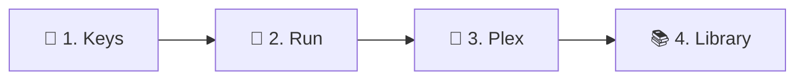

<div align="center">

<a href="README.md"></a>

# Kizuna · Setup

**From zero to a matched anime library in four steps.**

[Home](README.md) &nbsp;·&nbsp; **Setup** &nbsp;·&nbsp; [Guide](GUIDE.md) &nbsp;·&nbsp; [Settings](SETTINGS.md) &nbsp;·&nbsp; [Mapping](MAPPING.md) &nbsp;·&nbsp; [Migration](MIGRATION.md)

<sub>On this page: [Before you start](#-before-you-start) · [1. Keys](#-1-get-your-keys) · [2. Run](#-2-run-kizuna) · [3. Plex](#-3-register-kizuna-in-plex) · [4. Library](#-4-point-a-library-at-it) · [Troubleshooting](#-troubleshooting)</sub>

<sub>New to Kizuna? Read the <a href="README.md">README</a> first. It explains the three modes.</sub>

</div>

---



## 📋 Before you start

| You need | Why |
|---|---|
| **Plex Media Server 1.43 or newer** | Kizuna plugs into Plex as a custom metadata provider |
| **Docker** (Compose, plain Docker or Unraid) | Kizuna ships as a container image |
| **A host Plex can reach** on port 32600 | Plex calls Kizuna for every match and refresh |
| **A free AniDB account, a TheTVDB key, or both** | at least one source to match against: see [step 1](#-1-get-your-keys) |

> [!TIP]
> **Coming from HAMA + Absolute Series Scanner?** Do steps 1–3 here, then follow [MIGRATION.md](MIGRATION.md) instead
> of step 4.

## 🔑 1. Get your keys

| Source | Setting | Where to get it | Needed for |
|---|---|---|---|
| **AniDB** | `ANIDB_CLIENT` | [anidb.net](https://anidb.net) → *Settings → Client → Add client*, protocol **HTTP** | `/anidb`; show details and episode titles in every mode |
| **TheTVDB** | `TVDB_API_KEY` (v4) + `TVDB_PIN`, or a legacy `TVDB_LEGACY_API_KEY` | [thetvdb.com](https://thetvdb.com/api-information); the PIN is your subscriber PIN, on your TheTVDB account page | `/tvdb` |
| **TheMovieDb** | `TMDB_API_KEY` | [themoviedb.org](https://www.themoviedb.org/settings/api) | optional: more details and art |
| **MyAnimeList** | `MAL_CLIENT_ID` | [myanimelist.net/apiconfig](https://myanimelist.net/apiconfig) | optional: more details |
| **Anime News Network** | – | no key | – |

What each key setting does: [SETTINGS.md](SETTINGS.md#-accounts--keys).

> [!IMPORTANT]
> **TheTVDB's PIN:** a free, user-supported v4 key only works together with your subscriber PIN in `TVDB_PIN`. A
> company key needs no PIN. Without the PIN, TheTVDB rejects the key ([what the log says](GUIDE.md#-metadata-problems)).

## 🐳 2. Run Kizuna

Kizuna runs in Docker and keeps everything in one **data folder**: its settings file `kizuna.env`, the cache, logs
and reports. Follow the part for your setup, then check that it's up.

> [!WARNING]
> Kizuna has **no login** ([why](SECURITY.md#%EF%B8%8F-how-kizuna-is-protected)). Keep port 32600 on your LAN and
> never forward it to the internet.

### Docker Compose or plain Docker

1. **Create the data folder**, owned by (or writable for) `1000:1000`: Kizuna's user, not root.
2. **Add the settings file:** copy [`.env.sample`](.env.sample) into it as `kizuna.env` and fill in your keys from
   [step 1](#-1-get-your-keys).
3. **Start it:** download [`compose.yml`](compose.yml), replace `/change/me` with your data folder and run
   `docker compose up -d`. Without Compose, use the command below.

<details>
<summary><b>Plain Docker command</b></summary>

```bash
docker run -d --name kizuna \
  --restart unless-stopped --stop-timeout 35 \
  --user 1000:1000 \
  --read-only --cap-drop ALL --security-opt no-new-privileges:true \
  -p 32600:32600 \
  -v /change/me:/data \
  ghcr.io/kurtzpt/kizuna:latest
```

</details>

### Unraid

> [!IMPORTANT]
> Unraid runs Kizuna as **`nobody:users` (99:100)**, not `1000:1000`. Keep that owner.

1. **Create the data folder:** a `kizuna` folder in the `appdata` share. Made through the share, it already belongs to
   `nobody:users`.
2. **Add the settings file:** copy [`.env.sample`](.env.sample) into it as `kizuna.env` and fill in your keys from
   [step 1](#-1-get-your-keys).
3. **Add the template:** save [`unraid/kizuna.xml`](unraid/kizuna.xml) as `my-kizuna.xml` in the `flash` share,
   folder `config/plugins/dockerMan/templates-user`.
4. **Start it:** **Docker → Add Container**, pick **kizuna** under *Template*, click *Apply*.

### Choosing a version

Every setup runs `:latest` unless you change it. The version is the part after `:` in
`ghcr.io/kurtzpt/kizuna:latest`: under `image:` in `compose.yml`, on the last line of `docker run`, or in
*Repository* when you edit the container on Unraid.

| Tag | Use it |
|---|---|
| **`:latest`** | normally: the newest stable release |
| `:1.2.3`, `:1.2` | to stay on one version |
| `:1.2.3-beta.1` | to test a pre-release |
| `:dev` | to try fixes before release; may break |

### Check that it's up

From the machine that runs Plex, open `http://<kizuna-host>:32600/health`:

| Answer | Means |
|---|---|
| `"status":"ok"` | ✅ ready |
| `"status":"starting"` | loading its lists: seconds, longer on the first start. Stuck there: the AniDB title list didn't download (no network?); it retries every 5 min |
| `"status":"degraded"` | the id mapping lists didn't download (GitHub unreachable?); it retries every 5 min |
| `403` | Kizuna refused the caller: see [access](SETTINGS.md#%EF%B8%8F-access) |
| no answer | wrong address, a firewall, or Kizuna [didn't start](#kizuna-doesnt-start) |

> [!IMPORTANT]
> **Plex in Docker?** Inside the Plex container, `localhost` is Plex itself. Use the host's LAN IP, or put both
> containers on one Docker network and use `http://kizuna:32600`.

### Changing settings

- **Edit `kizuna.env`, then restart the container.** [SETTINGS.md](SETTINGS.md) explains every setting.
- **Keep the file private:** it holds your keys and maybe your Plex token. Only Kizuna's user needs to read it.

> [!NOTE]
> **Container variables win over the file**, even when empty: `environment:` in `compose.yml`, `-e` with
> `docker run`, a variable in the Unraid template, where Unraid always sets `TZ`. Handy for a quick test, such as
> `LOG_LEVEL=debug`.

## 🔌 3. Register Kizuna in Plex

In Plex Web, open **Settings → Metadata Agents**.

1. **Add Provider** with the URL for your library's [mode](README.md#%EF%B8%8F-modes):

   | URL | Shows up as | For |
   |---|---|---|
   | `http://<host>:32600/anidb` | Kizuna (AniDB) | every season its own show, episodes 1…n |
   | `http://<host>:32600/tvdb` | Kizuna (TVDB) | one show per series, with TVDB seasons |
   | `http://<host>:32600/auto` | Kizuna | a library that mixes both |

2. **Add Agent** (name it e.g. *Kizuna Anime*) with these providers, in this order:

   | # | Provider | What it does |
   |---|---|---|
   | 1 | **Kizuna**, the provider you just added | matching and all metadata. Always first |
   | 2 | **Plex Local Media** (optional) | uses your own `poster.jpg`, `fanart.jpg`, `theme.mp3` and subtitles, which Kizuna never reads |

> [!TIP]
> **Libraries in different modes?** Add one provider per mode and one agent for each, e.g. *Kizuna AniDB* with
> `/anidb` for one library and *Kizuna TVDB* with `/tvdb` for another. Each agent holds only one Kizuna provider:
> the modes number episodes differently. One Kizuna serves all of them, with the same settings.

## 📚 4. Point a library at it

> [!CAUTION]
> **Changing an existing library's agent makes Plex re-match every show.** Back up the Plex database first.

> [!IMPORTANT]
> Only the **Plex TV Series** scanner works with the new providers. Legacy scanners, such as Absolute Series Scanner,
> don't.

1. **Titles and artwork the way you want them?** Change them in `kizuna.env` ([SETTINGS.md](SETTINGS.md)) and restart
   Kizuna *now*: changing them after the first scan means refreshing every show again.
2. In **Manage Library → Edit → Advanced**, set:

   | Field | Value |
   |---|---|
   | **Scanner** | `Plex TV Series` |
   | **Agent** | the agent from step 3 |

3. Save, then run **Scan Library Files** and **Refresh All Metadata**.

> [!WARNING]
> A large library takes **several days** to get all its AniDB details ([AniDB's limits](GUIDE.md#-anidb-fair-use)):
> shows fill in on later refreshes.

---

## 🧰 Troubleshooting

Kizuna's messages are in its log: `docker logs kizuna`, or `logs/kizuna.log` in the data folder.

### Kizuna doesn't start

| Log says | Fix |
|---|---|
| `port 32600 is already in use`, or Docker says *port is already allocated* | Another program (often a second Kizuna) has the port. Stop it, or change the host port: the first number in `32600:32600` (*Port* on Unraid) |
| `no mode can build shows` | Set `ANIDB_CLIENT` or a TheTVDB key ([step 1](#-1-get-your-keys)). Already set? The `settings file` log line shows which file Kizuna read |
| `can't read the settings file` | Kizuna's user can't read `kizuna.env` (or `KIZUNA_CONFIG` names a missing file) |
| `can't write the log file` | The data folder isn't writable by Kizuna's user: `1000:1000`, on Unraid `nobody:users`. No logs or cache until then |

### Plex can't reach Kizuna

| You see | Fix |
|---|---|
| `/health` isn't `ok`, or Plex can't add the provider | See [check that it's up](#check-that-its-up), including *Plex in Docker* |
| Log: `refused a request from an address outside ALLOW_FROM` | Add the address from that log line to [`ALLOW_FROM`](SETTINGS.md#%EF%B8%8F-access) |
| Log: `refused a request for an unknown host name` | Add the domain name to [`ALLOWED_HOSTS`](SETTINGS.md#%EF%B8%8F-access) |

### A show doesn't match or lacks details

No match, the wrong show, missing episodes or summaries, episodes in the wrong season: see [metadata problems](GUIDE.md#-metadata-problems) in the guide.

**Still stuck?** [Open an issue](CONTRIBUTING.md#-reporting-a-problem).
